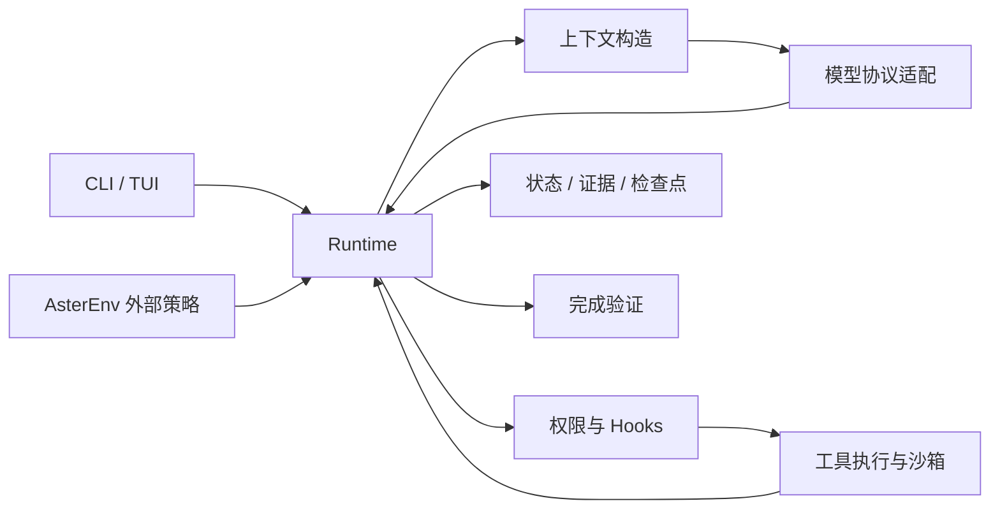

# Aster

**面向本地代码仓库的轻量级 Coding Agent，提供可检查、可恢复的任务执行过程。**

Aster 使用 Python 实现，将大模型、文件操作、命令执行、测试与交互接入同一个 Runtime。你可以在终端中让它阅读项目、修改代码、执行测试和维护文档，也可以沿着源码与配套教程学习 Coding Agent 的实现，或通过外部策略接口开展 Agent 评测研究。

[快速开始](#快速开始) · [使用指南](#使用指南) · [架构与模块](#架构与模块) · [目录结构](#目录结构) · [学习文档](#学习文档) · [示例项目](#示例项目)

## 项目目标

Aster 关注模型提出动作之后的工程问题：如何组织上下文、约束工具权限、保留执行证据、恢复中断任务，以及判断是否满足交付条件。这层连接模型与执行环境的运行系统称为 **Harness**。

- **完成本地编码任务**：在指定工作区中阅读、编辑和验证代码，通过 CLI 或 TUI 与用户协作。
- **保持实现可理解**：共享一条执行链路，从少量核心工具开始，按需加载计划、Skills、Memory 和 Worker 等能力。
- **支持可复现研究**：记录请求、动作、结果和成本，将工程测试、真实模型评测与外部策略 rollout 分别组织。

## 核心能力

| 能力 | 简介 |
|---|---|
| 模型接入 | 支持 Responses、Chat Completions、Anthropic Messages 三种协议；通过具名 profile 配置远程服务或兼容的本地模型服务 |
| 终端交互 | 提供一次性 CLI 和持续会话 TUI，支持审批、追问、取消、恢复，以及空闲时切换模型 |
| 工具执行 | 文件读取、搜索、创建、精确补丁、命令和测试；可选并行执行同轮纯只读工具批次 |
| 权限与隔离 | 审批策略、工作区写入范围、编辑前版本检查，以及基于 Landlock / seccomp 的 Linux 执行沙箱 |
| 长任务管理 | 请求预算控制、历史压缩、工具结果归档回读、检查点与同会话续接 |
| 按需扩展能力 | 计划与待办、项目 Skills、带来源验证的持久 Memory、可选 Worker；通过配置与工具目录启用 |
| 验证与审计 | 将正式测试绑定到工作区版本，保留事件轨迹、模型诊断和供应商报告的 token 用量 |

默认使用单 Agent 和核心工具集；Memory、记忆演化、自动 Dream、Worker 及依赖复用均需显式开启。交互入口默认启用 Responses 流式，单次 CLI 任务默认非流式，均可通过配置覆盖。功能边界与配置项见[配置说明](docs/configuration.md)。

## 快速开始

### 1. 准备环境

- Python **3.12+**，建议使用独立虚拟环境。
- 完整的文件写入、命令执行和正式测试需要支持 **Landlock / seccomp** 的 Linux 环境，以及 `libseccomp.so.2`（Debian / Ubuntu 对应 `libseccomp2` 包）。
- Node.js 仅在执行 JavaScript 项目或 `node --test` 时需要。

进入本仓库根目录，安装项目及开发依赖；已有 `aster` 环境时跳过创建步骤：

```bash
conda create -n aster python=3.12
conda activate aster
python -m pip install -e '.[dev]'
```

先运行一个不调用模型 API 的示例，观察完整的模型替身 → 工具 → 结果循环：

```bash
python docs/learning/run_examples.py 00
```

首次使用 `tiktoken` 可能下载词表；需要完全离线运行时，请提前准备词表缓存。

### 2. 配置模型

参考 [.env.example](.env.example)，在启动目录的 `.env` 中填写实际服务信息：

```dotenv
ASTER_PROTOCOL=responses
ASTER_BASE_URL=https://api.openai.com/v1
ASTER_MODEL=your-model-id
ASTER_API_KEY=your-api-key
```

`ASTER_MODEL` 填写服务实际提供的模型名称；`ASTER_BASE_URL` 是 API 根地址，不包含 `/responses` 等接口后缀。使用兼容网关时替换地址和模型名。密钥保存在本地 `.env` 或进程环境中。

未识别的模型使用保守预算回退，请按服务规格通过 profile 或 `--context-tokens`、`--output-tokens` 显式配置窗口与输出额度，详见[模型预算](docs/configuration.md#模型与输入预算)。

### 3. 启动任务

配置好模型后，在交互终端中运行 `aster` 即可打开持续会话界面。大多数参数都是可选项：

```bash
# 在当前目录启动交互界面，随后输入任务
aster

# 在指定项目中启动交互界面
aster --cwd /path/to/project

# 直接传入任务，执行完成后退出
aster '阅读项目，说明主要模块、启动方式和测试入口'

# 可选：限定工作区并以只读方式运行
aster --cwd /path/to/project --read-only '说明主要模块和测试入口'
```

工作区默认为当前目录；`--cwd` 可指定其他项目，`/path/to/project` 替换为实际路径。Aster 自动读取**启动命令所在目录**的 `.env`，需要使用其他文件时再传 `--env-file`。默认审批策略为 `ask`，需要批准的动作会先询问用户；提交任务后会调用所配置的模型服务。

`aster --tui` 和 `aster-tui` 仍可显式启动交互界面。非交互输入下没有任务时会给出简短错误；脚本中应传入任务文本。`--resume`、`--rl-smoke` 保持各自的执行方式。

## 使用指南

### 会话与恢复

TUI 默认使用简体中文，欢迎页显示 Aster 艺术字。输入任务即可开始工作，后续输入沿当前会话继续。输入 `/` 查看命令提示，按 `↑↓` 选择、`Tab` 补全；没有命令提示时，`↑↓` 浏览输入历史。

交互入口默认开启 Responses 流式输出；配置文件中的 `stream = false` 或 `--no-stream` 仍优先。运行时显示等待耗时、工具调用及结果；接口返回的思考摘要会单独显示，接口没有返回摘要时只显示实际运行状态。Chat 和 Anthropic 协议目前仍使用非流式请求。任务进行中仍可查看帮助和状态、取消或退出；新的任务输入会留在输入框中，等待本轮结束后再发送。

| 命令 | 作用 |
|---|---|
| `/help` / `F1` | 中文命令说明与快捷键 |
| `/model` | 列出已配置的模型 profile |
| `/model local` | 在空闲时切换到 `local` profile |
| `/new` | 开始新会话 |
| `/clear` / `Ctrl+L` | 仅清屏，保留会话 |
| `/cancel` / `Ctrl+C` / `Esc` | 取消当前任务（有命令提示时，Esc 先关闭提示） |
| `/continue` | 继续当前已停止的任务 |
| `/history` / `/resume RUN_ID` / `/resume latest` | 列出、选择或恢复最近的运行 |
| `/status` / `/session` | 查看状态、会话编号与保存位置 |
| `/context` / `/usage` | 查看上下文预算、最近请求估算和当前运行 token 用量 |
| `/tools` / `/skills` | 查看可用工具和项目技能 |
| `/memory` / `/working-memory` | 查看长期记忆和会话工作记忆 |
| `/agents` / `/todos` | 查看子任务、计划与待办 |
| `/plan [任务]` / `/plan-exit` | 进入只读规划模式 / 返回执行模式 |
| `/review [范围]` / `/test [目标]` | 提交代码审查 / 测试任务，会调用模型 |
| `/stream on\|off` / `/thinking on\|off` | 开关流式输出 / 思考摘要展示 |
| `quit` / `exit` / `/quit` / `/exit` / `Ctrl+Q` | 取消正在运行的请求并退出 |

界面实现参考 pico-v3 的欢迎区、命令目录与补全、活动指示和工具展示；所有命令仍复用 Aster 的 Runtime。`/clear` 只清屏，`/new` 才会重置会话。`/resume` 保留原有配置与工作区校验：旧的非流式运行可先用 `/stream off` 恢复相同配置，或显式使用 `--allow-model-change`；外部修改需用 `--adopt-workspace`。

CLI 可使用运行结束时显示的 `run_id` 续接：

```bash
aster --cwd /path/to/project --resume RUN_ID \
  '继续处理尚未完成的测试，并总结修改结果'
```

恢复时会检查模型配置、工作区和工具执行状态。需要显式切换模型或采用外部编辑时，使用 `--allow-model-change`、`--adopt-workspace`；这些选项不会放宽安全设置。详见[检查点与恢复](docs/learning/09-checkpoint-resume.md)。

### 多模型配置

在自己的 `aster.toml` 中定义 profile。下面的模型名和远程地址需要替换为实际值，预算也应与服务能力匹配：

```toml
[profiles.remote]
provider = "gateway"
protocol = "responses"
base_url = "https://your-provider.example/v1"
model = "your-model-id"
api_key_env = "MY_MODEL_KEY"
context_tokens = 128000
output_tokens = 32768
stream = true

[profiles.local]
provider = "local"
protocol = "chat"
base_url = "http://127.0.0.1:8000/v1"
model = "local-model-id"
auth = "none"
context_tokens = 24000
output_tokens = 2048
```

将 `MY_MODEL_KEY` 放入 `.env` 或进程环境后启动：

```bash
aster --config aster.toml --profile remote --cwd /path/to/project
```

随后可通过 `/model local` 请求切换到已经启动的本地服务。profile 选择会校验新预算并转换可移植的文本与工具历史；服务专有的推理状态不能无损迁移，历史中的图片、引用或阶段信息无法转换时会拒绝切换。当前流式响应仅支持 Responses，工具调用在完整响应确认后才执行。其他协议已有离线契约测试，已归档的真实服务验证主要使用 Responses。

### 工具与执行设置

默认核心工具共九个，实际可见范围受权限和运行状态约束：

```text
list_files  read_file   search      write_file  patch_file
run_shell   run_tests   git_diff    tool_load
```

`tool_load` 按需展开额外工具的完整定义。项目 Skills 支持 `.skills/<name>/SKILL.md`、`.aster/skills/<name>/SKILL.md` 及旧式单文件格式；已加载正文使用固定快照，显式刷新后更新。参见[Skills 使用说明](docs/skills.md)。

常用设置通过 TOML 配置：

| 设置 | 默认值 | 用途 |
|---|---|---|
| `network` | `false` | 控制沙箱内命令联网；不影响 Harness 调用模型 API |
| `read_parallelism` | `1` | 大于 1 时并行执行纯 `read_file` / `search` / `list_files` 批次 |
| `reuse_environment` | `false` | 在同一 Runtime 中复用受控依赖目录，要求 `sandbox="required"` |
| `memory_enabled` | `false` | 开启项目持久记忆；会话工作记忆始终独立保留 |
| `max_workers` | `0` | 开启有独立预算的子任务 Worker |

默认每个任务最多 40 个工具步骤、40 个模型轮次。CLI / TUI 均可用 `--max-steps`、`--max-turns` 调整；`--context-tokens` 与 `--output-tokens` 则控制模型请求预算。

正式验证使用 `run_tests`，支持 pytest、unittest 和 Node 内置测试；普通 `run_shell` 成功不会自动生成正式测试证据。依赖默认不跨命令保留，后台服务也不跨调用存活，详见[执行环境](docs/execution-environment.md)。

## 架构与模块

CLI、TUI 与外部策略接口共用 Runtime，工具执行、权限检查和证据记录保持一致。



| 模块 | 主要文件 | 职责 |
|---|---|---|
| 运行与交互 | `core/runtime.py`、`cli.py`、`ui/`、`schema.py` | 组织任务循环、交互事件及统一数据结构 |
| 模型与协议 | `config.py`、`providers/`、`messages.py` | 解析配置，构造请求，处理流式、错误诊断与历史转换 |
| 上下文 | `context/` | 预算估算、历史压缩和动态状态组织 |
| 工具与安全 | `tools/`、`storage/workspace.py`、`safety/` | 工具分发、文件边界、审批、沙箱执行与修改回写 |
| 证据与会话 | `storage/evidence.py`、`sessions/` | 事件轨迹、观察归档、检查点校验和会话续接 |
| 验证与恢复 | `tools/testing.py`、`core/verifier.py`、`core/recovery.py`、`core/hooks.py` | 正式测试、完成条件、停滞反馈及生命周期钩子 |
| 可选协作能力 | `knowledge/`、`core/workers.py` | 加载项目说明、保存有来源的记忆、管理子任务 |
| 研究接口 | `training/env.py`、`training/contracts.py` | 外部策略 rollout、SFT 数据导出与 GRPO 数据契约校验 |

Memory 保存经过来源验证的项目摘录；Dream 根据确定性规则维护已有记录。后训练部分已提供数据契约与方案，实际 SFT / GRPO 训练器、优化器和权重训练尚未实现。

## 目录结构

```text
Aster/
├── src/aster/          # Agent 运行时与公共接口
│   ├── core/           # 运行协调、调度、Hooks、验证及 Worker
│   ├── tools/          # 工具 schema、业务与正式测试
│   ├── storage/        # 工作区边界与证据存储
│   ├── knowledge/      # 项目记忆与技能资料
│   ├── training/       # 外部策略环境与训练数据契约
│   ├── __init__.py     # 包标识
│   ├── cli.py          # 命令行入口
│   ├── config.py       # 配置契约
│   ├── schema.py       # 共享数据模型
│   ├── messages.py     # 消息与历史校验
│   ├── providers/      # 协议转换、传输与请求记账
│   ├── context/        # 策略、预算计算与成功提交
│   ├── sessions/       # 检查点与会话候选准备
│   ├── ui/             # 中文终端界面、命令和输入组件
│   └── safety/         # 权限策略与 Linux 沙箱
├── tests/              # 工程契约与回归测试
├── docs/               # 配置、设计与研究文档
│   └── learning/       # 16 章教程及可运行实验
├── learn_web/          # 教学网站、构建器与网站测试
├── exam_project/       # Aster 实现的可运行示例产品
├── datasets/           # 评测任务、初始文件、来源与评分标准
├── scripts/            # 评测驱动及结果比较脚本
├── evaluations/        # 实验协议、独立验收与运行证据
├── artifacts/          # 既有评测产物与报告
├── .github/workflows/  # CI 工作流
├── .env.example        # 模型连接配置示例
├── pyproject.toml      # 包信息、依赖与开发工具配置
└── NOTICE.md           # 设计参考与第三方来源说明
```

当前布局与 Python 导入迁移见 [模块整理说明](docs/module-layout.md)。前一轮重构的历史记录见 [源码重构结果](docs/src-refactor-results.md)。

运行产生的检查点、轨迹与持久记忆位于目标工作区的 `.aster/`。示例产品、教学网站与评测材料分别维护，便于独立使用和审查。

## 学习文档

| 入口 | 内容 |
|---|---|
| [分阶段教程](docs/learning/README.md) | 从一次任务出发，逐步理解循环、协议、工具、上下文、记忆与评测 |
| [教学网站](learn_web/README.md) | 本地构建、预览及 GitHub Pages 部署方法 |
| [完整配置](docs/configuration.md) | 模型 profile、预算、权限与功能开关 |
| [Skills](docs/skills.md) | 技能包格式、资源读取和正文快照 |
| [执行环境](docs/execution-environment.md) | 依赖复用、网络与测试运行边界 |
| [评测说明](docs/benchmark.md) | 任务类型、执行方式与指标口径 |
| [后训练方案](docs/post-training-design.md) | 数据集构建、SFT / GRPO 设计与现有接口 |

## 示例项目

以下成果可按各自 README 独立运行，完整列表见 [exam_project](exam_project/README.md)。

| 项目 | 功能 |
|---|---|
| [课业清单](exam_project/campus_planner/README.md) | 管理作业、截止日期与完成状态，支持备份和日历导出 |
| [期末复习安排器](exam_project/study_planner/README.md) | 根据考试日期、剩余学习量和每日上限生成复习计划 |
| [实验数据整理器](exam_project/lab_data/README.md) | 将课程实验 CSV 转为包含原始数据、汇总和异常的 Excel 工作簿 |
| [Markdown 检查器](exam_project/mdcheck/README.md) | 检查本地文档链接与标题锚点 |

各项目的来源和人工干预记录随产品保留。真实任务报告集中在 [evaluations](evaluations/README.md)，包括[工程验收](evaluations/v0.2-release/REPORT.md)、[实验数据工具复测](evaluations/lab-followup-20260919/REPORT.md)和[教程维护](evaluations/tutorial-refresh-20260919/REPORT.md)。首次结果、返修和独立验收分别记录；当前浏览器验收由操作员执行。

## 开发与验证

在已安装开发依赖的 `aster` 环境中运行：

```bash
# 工程回归测试，不调用真实模型 API
python -m pytest -q

# 静态检查
python -m ruff check src tests scripts learn_web/scripts learn_web/tests

# 运行教程中的全部标记实验
python docs/learning/run_examples.py all
```

真实模型评测需要另外配置服务并显式启动，命令与数据说明见[评测指南](docs/benchmark.md)及[数据集说明](datasets/README.md)。工程测试通过、机制被调用和真实任务交付质量是不同指标；未知 usage 保留为未知，已有开发与评测题不作为未见训练测试集。

修改运行行为时，请同步相关文档并运行对应检查；报告问题时附上复现步骤、实际配置和脱敏后的错误信息。涉及模型服务的结果应注明服务配置及人工干预情况。

## 设计参考与许可

Aster 的设计参考与第三方来源见 [NOTICE.md](NOTICE.md)，数据集来源及许可见 [datasets/SOURCES.md](datasets/SOURCES.md)。当前仓库尚未提供项目级 `LICENSE` 文件；第三方数据的许可与项目代码许可分别处理。
