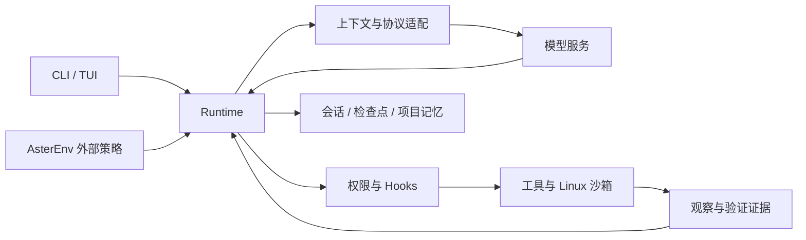

# Aster

**面向本地代码仓库的轻量 Coding Agent，让读代码、修改、验证和恢复共用一条执行链路。**

[](https://github.com/prossiblezero/Aster/actions/workflows/tests.yml)


[快速开始](#快速开始) · [使用方式](#使用方式) · [配置](docs/configuration.md) · [源码教程](docs/learning/README.md) · [评测](docs/benchmark.md) · [优化历程](docs/optimization-history.md)

Aster 用 Python 将模型、上下文、工具、权限、测试和持久状态连接起来。你可以在终端中让它理解项目、实现功能、修复问题，也可以通过配套教程与固定评测集研究一个 Coding Agent 如何工作。

项目重点是模型提出动作之后的工程：工具有没有真正执行，测试是否覆盖当前修改，历史压缩后能否回读证据，中断后能否继续。CLI、TUI 和外部策略接口都经过同一个 Runtime。

## 能做什么

- **在仓库里完成任务**：读取和搜索文件、精确修改、执行命令，使用 pytest、unittest 或 Node 内置测试进行正式验证。
- **持续协作**：中文 TUI 支持审批、追问、取消、恢复、会话分支和模型切换；CLI 适合一次性任务。
- **管理长任务**：按实际请求估算上下文预算，归档较长观察，保存检查点，并校验恢复时的工作区变化。
- **积累项目知识**：保留带来源和适用范围的记忆，处理用户纠正、修复经验与过期信息；记忆更新不会训练模型权重。
- **按需委派**：只读子任务可独立调查与审查，交付带行号的源码证据；父子共享预算，父任务负责整合和最终验证。
- **研究与复现**：提供固定题目、工作区 fixture、独立评分器、确定性回放和外部策略环境。

默认从单 Agent 和九个核心工具开始。项目记忆默认开启；模型自主委派、并行只读工具批次和依赖环境复用需显式配置。当前仍是研究与开发中的项目，适用边界见下文。

## 快速开始

### 1. 安装

推荐 **Ubuntu 24.04 / Python 3.12+ / Git**。命令和正式测试的隔离依赖 Linux Landlock 与 libseccomp；容器和 WSL2 也需要宿主内核支持。macOS、原生 Windows 尚不属于完整执行路径的验证平台。

```bash
# Ubuntu / Debian：准备 Python 虚拟环境和沙箱运行库
sudo apt-get update
sudo apt-get install -y python3-venv libseccomp2 git

git clone https://github.com/prossiblezero/Aster.git
cd Aster
python3 -m venv .venv
source .venv/bin/activate
python -m pip install --upgrade pip
python -m pip install -e '.[dev,docs]'
```

只使用 Agent 时可安装 `python -m pip install -e .`；`dev` 提供测试与检查工具，`docs` 提供教程网站构建依赖。也可用 [environment.yml](environment.yml) 创建 Conda 环境。

处理 JavaScript 或 Go 项目时，另行安装对应工具链，例如 Ubuntu 上的 `sudo apt-get install -y nodejs npm golang-go`。Aster 的命令 PATH 为当前 Python 环境的 `bin`、`/usr/bin` 和 `/bin`，不继承登录 Shell 的 PATH；nvm、用户目录或 CI 缓存中的工具链不会自动进入沙箱。完整回归需要 Node 和 Go，详见[执行环境](docs/execution-environment.md#工具链安装位置)。

先做一次**不调用模型 API**的检查：

```bash
aster --help
python docs/learning/run_examples.py 00
python -m pytest -q -m smoke
```

示例会真实读取临时文件并保存检查点，最终显示 `phase=completed, turn=2, step=1`。首次使用 tokenizer 可能下载词表；它不需要模型 API Key。

### 2. 配置模型

```bash
cp .env.example .env
```

编辑 `.env`，填入你实际可用的服务地址、模型 ID 和 API Key：

```dotenv
ASTER_PROTOCOL=responses
ASTER_BASE_URL=https://api.openai.com/v1
ASTER_API_KEY=your-api-key
ASTER_MODEL=your-model-id
```

`your-model-id` 和 `your-api-key` 都是占位符，必须替换。支持 `responses`、`chat`、`anthropic` 三种协议；兼容服务的 URL 与模型名称以服务商为准。目前流式输出仅支持 `responses`。真实模型调用会产生服务商费用。

`.env` 从**启动命令所在目录**读取，与 `--cwd` 指定的任务目录不同。跨目录使用时建议显式传 `--env-file`。密钥、会话和运行产物均由 `.gitignore` 排除。

### 3. 开始使用

```bash
# 持续对话：在交互终端中启动
aster --cwd /path/to/your/project

# 一次性任务
aster --cwd /path/to/your/project \
  '阅读项目，说明入口、主要模块和测试运行方法'

# 指定配置文件，从任何目录启动
aster --env-file /path/to/Aster/.env --cwd /path/to/your/project \
  '修复这个问题，补充必要的回归检查并运行测试'
```

首次使用可从 `--read-only` 调查开始。默认审批策略为 `ask`，默认要求沙箱可用；沙箱内命令默认不能联网，模型 API 请求不受此开关影响。环境不支持沙箱时，请按[执行环境说明](docs/execution-environment.md)处理；关闭沙箱会改变执行能力和隔离保证。

## 使用方式

### 终端交互

直接运行 `aster` 或 `aster-tui` 打开 TUI。常用命令如下，完整列表可在界面中输入 `/help` 查看。

| 命令 | 用途 |
| --- | --- |
| `/new [目录]`、`/sessions` | 创建或切换独立会话 |
| `/tree`、`/branch 位置ID` | 浏览历史并从选定位置继续 |
| `/cancel`、`/continue` | 停止或继续当前任务 |
| `/history`、`/resume latest` | 查找并恢复已保存运行 |
| `/model`、`/model local` | 查看配置好的模型并在空闲时切换 |
| `/context`、`/usage` | 查看上下文与模型用量 |
| `/agents` | 启动、查看、补问或取消只读子任务 |
| `/memory`、`/skills` | 查看项目记忆和可用技能 |
| `/plan 任务`、`/plan-exit` | 进入只读规划或返回执行 |

CLI 可用运行结束时显示的 `run_id` 续接：

```bash
aster --cwd /path/to/your/project --resume RUN_ID \
  '继续处理尚未完成的测试'
```

恢复会检查原配置与工作区。外部编辑使用 `--adopt-workspace`，显式切换模型使用 `--allow-model-change`；详见[会话说明](docs/sessions.md)。会话分支改变对话历史，不会自动把磁盘文件回退到旧版本。

### 多模型和本地服务

复制 [aster.example.toml](aster.example.toml) 为 `aster.toml`，替换模型名、预算和地址。配置中只存凭据的环境变量名：

```bash
aster --config aster.toml --profile remote --cwd /path/to/your/project
# TUI 中可输入 /model local 切换到已启动的本地兼容服务
```

Aster 不启动模型服务器。模型切换会验证可移植历史；不支持转换的服务专有状态会明确拒绝。协议契约测试与真实服务兼容性是不同层次，不能据此承诺兼容任意网关。

### 工具、技能和记忆

默认核心工具：

```text
list_files  read_file  search  write_file  patch_file
run_shell   run_tests  git_diff  tool_load
```

计划、Memory、Skills、Worker 等工具按需加载。项目技能放在 `.skills/<name>/SKILL.md`，格式见 [Skills 指南](docs/skills.md)。检查点、事件和项目记忆保存在目标工作区的 `.aster/`。

任务默认最多 40 个工具步骤和 40 轮模型请求，可用 `--max-steps`、`--max-turns` 调整。后台记忆学习也会消耗模型用量；开启 Worker 后，父子共用任务预算。`max_workers=0` 禁止模型自主创建子任务，但 TUI 仍允许用户显式启动最多两个只读子任务。

## 架构



| 目录 | 内容 |
| --- | --- |
| [`src/aster/`](src/aster/) | Runtime、协议、工具、沙箱、上下文、会话、记忆与 TUI |
| [`tests/`](tests/) | 不调用真实模型的工程与回归测试 |
| [`scripts/`](scripts/) | 基础任务、机制、上下文与恢复评测驱动 |
| [`datasets/`](datasets/) | 固定任务、初始文件、独立检查、来源与许可 |
| [`evaluations/`](evaluations/) | 子任务、跨会话记忆及 SWE-bench 核心评测入口 |
| [`docs/`](docs/README.md) | 使用指南、架构、16 章源码教程与优化历程 |
| [`learn_web/`](learn_web/) | 从教程生成本地网站的构建器与静态资源 |

评测结果、原始轨迹、下载缓存、源码快照和个人文档不随仓库发布。评测时生成的文件留在本地，默认进入 `artifacts/` 或被忽略的结果目录。

## 开发与评测

```bash
# 工程检查：全量测试不调用真实模型
python -m ruff check src tests scripts evaluations learn_web/build.py learn_web/tests
python -m pytest -q

# 从题目、初始仓库和参考动作走通一次真实执行与独立评分
python scripts/benchmark.py --task debug-and-fix \
  --env-file /dev/null --output artifacts/quickstart

# 构建教程网站
python learn_web/build.py
python -m http.server 8000 --directory learn_web
```

真实模型评测的预算、命令和评分边界见[评测指南](docs/benchmark.md)。离线参考回放证明执行链与评分器可用，不是模型自主解题成绩。历史实验使用过的开发题也不应再标作未见测试集。

## 设计与优化历程

[优化历程](docs/optimization-history.md)按时间与问题组织，记录从首个 Runtime 到当前实现的关键取舍：

- 如何修复工具状态、正式测试和完成条件之间的不一致；
- 为什么采用可回读归档与按请求预算压缩；
- 怎样让会话恢复、模型切换和子会话历史保持一致；
- 委派为何可能更慢、更贵，以及交付、预算、等待与验证责任如何调整；
- 项目记忆如何从原文摘录发展为有来源的知识与有界后台学习；
- 如何减少工具往返和重复记忆成本，同时保留失败与证据边界。

这里保留决策与适用范围，逐轮原始结果留在本地归档。源码阅读可从[课程目录](docs/learning/README.md)或[模块地图](docs/module-layout.md)开始。

## 当前边界与来源

Aster 的主要验证平台是 Linux。正式验证目前支持 pytest、unittest 和 Node 内置测试；普通 Shell 命令成功不等于获得正式测试证据。子任务和记忆的效果依赖任务，项目不承诺通用的成功率或降本比例。

后训练接口已提供 rollout 环境、SFT 导出及 GRPO 数据契约；训练器、优化器与模型权重训练尚未实现。详见[后训练设计](docs/post-training-design.md)。

Aster 是独立 Python 实现，设计参考见 [NOTICE.md](NOTICE.md)。评测数据遵循各自来源许可，见 [datasets/SOURCES.md](datasets/SOURCES.md)；第三方数据许可不代表项目本体已获得同样授权。项目本体目前尚未指定开源许可证。
