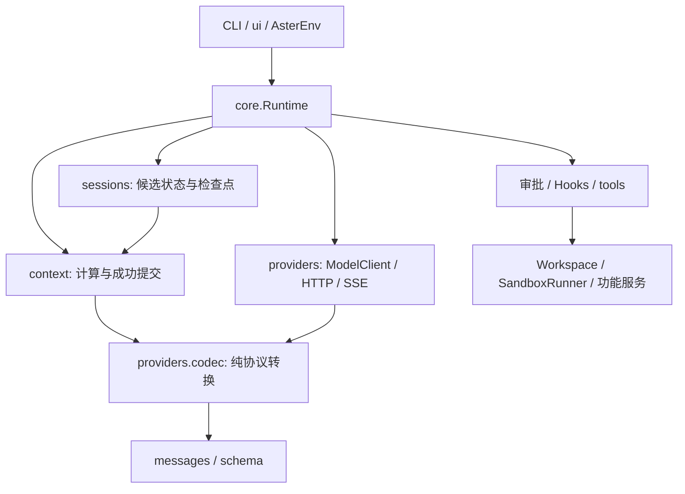

# 实施记录与验收契约

Aster 是独立重构的轻量 Coding Agent，不导入 pico/nexa 包。保留统一 Runtime、会话工作记忆、Hooks、任务恢复与跨运行记忆维护；提供后训练所需的环境接口，目前没有 SFT 或 GRPO 训练代码。本轮问题、修复取舍与验收条件见 [修复计划](repair-plan.md)。

## 工程结构

Python 3.12、conda `aster`、`src/aster` 包布局。当前目录与导入规则见 [模块整理说明](module-layout.md)，前一轮验证记录见 [源码重构结果](src-refactor-results.md)。Pydantic 校验边界数据，标准库管理状态与文件，httpx 请求模型，Textual 展示界面，tiktoken 估算输入长度。CLI、TUI、自主运行和外部策略动作均进入同一个 Runtime，避免每种入口各自实现权限与验证逻辑。



运行事件与模型历史分开保存：前者用于审计，后者保留调用协议所需的配对和元数据。记忆的短期状态只属于 `RunState`，跨运行条目单独持久化。`.aster` 等控制目录不向模型工具开放直接写入。

Linux 沙箱采用 Landlock、seccomp 和过滤后的临时工作区副本。当前回退版本不依赖 bubblewrap，命令应使用工作区相对路径。`required` 模式隔离不可用就拒绝执行；主动选择 `best_effort` 或 `off` 的行为见 [配置说明](configuration.md)，不将降级运行描述成具有相同隔离保证。

## 当前实现与验证边界

2026-10-12 最后一轮集中修复未满足保留门槛，生产源码已回退至 `c6b651d`，与最早达到 15/20 的冻结清单一致。该成绩包含五题故障补测；后续上下文计量、路径映射、检查点 v3、缓存键和测试反馈改动均已退出当前生产版本，实验源码及证据保留于[最终修复与回退报告](../evaluations/final-repair-20261012/REPORT.md)。工作区现有会话保持原样。

下面的“验证”指可运行的检查入口。实际通过数、真实模型失败样本和逐题对照统一保存在 [评测说明及报告](benchmark.md)，避免多份文档重复维护数字。

| 组件 | 当前实现 | 验证与仍需区分的边界 |
|---|---|---|
| 模型协议 | Responses、Chat、Anthropic 的请求适配、原生工具与元数据、usage、分类错误和有界重试 | `test_context_provider.py` 验证协议与错误契约；真实模型使用 GPT-5.6 Luna / Responses，另两种协议未宣称实机通过 |
| 工具分发 | 工作区工具处理文件/搜索/图像/进程；工作流工具处理计划、待办、记忆、技能和 Worker；diff 使用运行文本基线 | `test_runtime_repairs.py` 与 Harness 回归覆盖实际路由；按需加载改变展示集合，不绕过权限 |
| 安全边界 | 路径、符号链接、敏感文件、控制目录、只读、写入范围、进程网络和取消；禁止规则优先 | `test_safety.py`、`test_interaction_workers.py` 及机制场景检查具体边界；前缀规则不是通用 Shell 静态分析器 |
| 上下文 | 对实际协议请求及工具 schema 估算预算；完整调用组裁剪；过大必需输入明确拒绝 | `test_context_provider.py` 与上下文压力数据；本地估计与远端 usage 分开，未实现上下文策略自进化 |
| 运行治理 | 有进展不误停、有界恢复、Hooks、完成契约、验证失效、一次性收尾 | `test_runtime_repairs.py`、`test_review_regressions.py`；Hook 被调用与任务受益分开测试 |
| 恢复与审计 | 保存文本基线、文件指纹、调用组、恢复次数、状态和验证结果；恢复时检查漂移 | 修改/新增/恢复与漂移场景；不恢复操作系统进程，不从旧哈希伪造文本基线 |
| 记忆 | 默认启用持久记忆、演化与自动整理；带真实来源和适用范围的摘录、事实、方法；任务后有界自动提炼、并行生成/边界提交、来源与版本冲突检查、真实回执、按实际应用反馈及快照回滚 | `test_memory_maintenance.py`、`test_memory_knowledge.py`、`test_memory_feedback_contract.py`、`test_memory_evolution.py` 及来源洗白回归；[前期知识对照](../evaluations/memory-knowledge-20261005/REPORT.md)、[自动学习十题](../evaluations/memory-sleep-20261005/REPORT.md)与机制检查分别报告，不将来源认证或测试反馈视为语义正确性和因果证明 |
| 交互与 Worker | TUI/CLI 真正等待批准和答案；后台取消；Worker 消息下一轮交付、并发回收、权限继承 | 无显示窗口的 Textual 交互测试；子任务共享工作区且写入范围受限，无递归子树；保留工作记忆，不写共享持久记忆 |
| RL 环境接口 | 独立临时 episode、统一动作执行、步骤/轮数限制、终态保护、宿主独立奖励验证器 | `test_rl_contract.py`、Runtime 与终态竞态回归；没有验证器就没有成功奖励，终态前等待 Worker 清理 |
| 评测 | 数据与执行器分离；独立验证、参考行为检查、固定真实模型名单、模块对照与失败归档 | 见 `datasets/`、主任务/机制/鲁棒性专项执行器和 [评测说明](benchmark.md)；参考动作通过不等于真实模型通过 |
| 学习材料 | 从数据契约到完整运行，再进入评测、可靠性、记忆与环境接口的分阶段导读 | [学习入口](learning/README.md) 的命令与当前代码对应；后训练章节在训练实现后再写 |

2026-10-07 的[降耗改造](cost-optimization-20261007.md)增加随 `run_tests` 提交的临时 Python 测试，保留原有沙箱和正式验证要求；父任务预算收尾保留工具定义，由执行入口阻止新动作；后台用输入指纹和记忆内容版本跳过已处理的相同材料。默认自动学习继续开启，没有新增配置或运行依赖。机制检查见 `test_inline_verification.py`、`test_memory_maintenance.py` 与原有上下文、Worker 回归。

## 验证命令

在项目根目录运行：

```bash
conda activate aster
python -m ruff check src scripts tests
python -m pytest -q
python scripts/benchmark.py --output artifacts/local-scripted
python scripts/benchmark_mechanisms.py --output artifacts/local-mechanisms
```

真实模型评测会调用 `.env` 中的服务，不输出凭证；使用固定任务名单，成功与失败均保留。协议切换、模型能力、Harness 稳定性、记忆收益和工具展示成本分别统计，不能合成一个没有清楚分母的“总成功率”。

## 保留的轻量边界

- Context 使用固定预算和裁剪规则；规则 Dream 保留确定性停用，异步整理沿用当前模型且不自动重试。后台调用计入预算，父任务临近调用或 token 上限时转入最终交付；检查未满足则保留部分完成状态。不增加语义裁判或额外模型服务。
- 文本 diff 与内容哈希各司其职；多文件回写经过完整检查后逐文件替换，不宣称事务级原子提交。
- Worker 共享工作区和宿主 Hooks，权限只能收窄；有状态插件按 `run_id` 区分不同运行。
- `AsterEnv` 只负责环境和奖励接口；调用者负责训练/评测分离与可信验证器隔离。现有评测任务不直接进入训练集。
- 取消停止本地请求等待与执行进程，不保证远端供应商立即停止生成或不产生费用。

提交记录用于回退代码，历史评测产物保留用于比较。旧记忆经兼容读取后标记待审查，旧活动 checkpoint 缺少恢复必需信息则明确拒绝；不靠清空用户记忆掩盖结构迁移问题。
