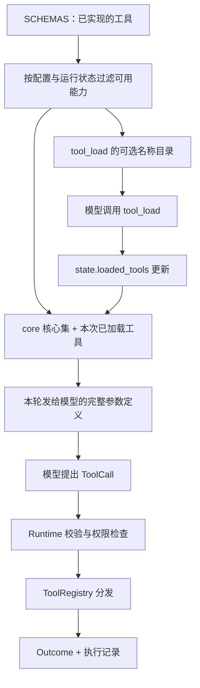

# 03 · 工具系统：先知道有什么，再拿到调用说明

> 一句话：模型负责提出动作，Harness 负责把动作变成有边界、可检查的执行结果。

上一章：[模型协议](02-model-protocols.md) · [目录](README.md) · 下一章：[权限与沙箱](04-permissions-sandbox.md)

## 从一个具体问题开始

你让 Agent 修改 `calculator.py`。它需要读文件、修改文件、运行测试；通常不需要同时看见记忆维护、规划、子任务通信、图片读取的全部参数说明。
如果每轮都发送所有工具的 JSON Schema，模型要为当前用不到的能力付出上下文成本。
反过来，只在提示词里写“你可以管理待办”，却没有参数契约和执行入口，模型也无法真正使用它。

Aster 将这个问题分成三件事：**系统实现了什么、当前配置允许什么、这一轮向模型展示什么**。
这三个集合分别由注册表、配置和按需加载状态决定。



## 先认识一份工具契约

打开 [tools/schemas.py](../../src/aster/tools/schemas.py)，先看 `ReadFile`，再看 `SCHEMAS`、`definitions()`。
下面是 `ReadFile` 的字段部分，范围校验留在源码中：

```python
class ReadFile(Record):
    path: str
    start: int = Field(default=1, ge=1)
    end: int = Field(default=200, ge=1)
```

`path` 是工作区内的文件路径；`start`、`end` 是从 1 开始、两端都包含的行号。
`ge=1` 表示必须大于等于 1；未传的参数由默认值补齐。
额外的校验器拒绝倒置的范围，以及 `end - start > 2000` 的读取范围。
Pydantic 在执行前校验这些约束。

`SCHEMAS` 中每个条目包含参数类型、用途描述和副作用类别。例如：

```python
"read_file": (ReadFile, "Read a UTF-8 file line range; prefer one wide read (150-400 lines) to adjacent narrow ones.", "read")
```

| 名称 | 它回答的问题 | 在哪里使用 |
|---|---|---|
| `ReadFile` | 调用者必须传哪些参数？ | 生成 Schema，同时验证实际参数 |
| description | 什么时候应该选这个工具？ | 发给模型的用途说明 |
| `effect` | 是读取、写入、进程执行还是内部状态操作？ | 权限策略的输入；批次预检也靠它认出只读调用 |
| `ToolCall.call_id` | 这是哪一次调用？ | 调用与结果配对、重复调用编号检查 |
| `Outcome.status` | 成功、错误、阻止、超时还是取消？ | Runtime 后续决策 |
| `Outcome.reason` | 为什么没有按预期完成？ | 可比较的原因名称，如 `invalid_arguments` |
| `Outcome.content` | 模型实际看见什么？ | 写入工具结果与后续上下文；发给模型前由 [view.py](../../src/aster/context/view.py) 渲染成纯文本 |
| `Outcome.data` | 哪些结构化信息留给 Harness 使用？ | 文件摘要、分页游标、验证结果等 |

`Record` 在 [schema.py](../../src/aster/schema.py) 中禁止未知字段。
工具实现因而不必到处写 `args.get("path")`，也不会悄悄吞掉模型拼错的参数名。只有两个只读工具故意放宽这条规则，见后文。

模型收到的不是 Pydantic 原样生成的 JSON Schema，而是 `compact_schema()` 整理后的版本：去掉 `title`，内联 `$defs`，把可选字段的 `anyOf [..., null]` 折成普通类型，去掉模型碰不到的边界（如 `minLength: 1`）。参数仍由 Pydantic 校验，核心工具定义因此从 1,975 降到 1,638 个 token（[harness-v15.md 第 3 节](../harness-v15.md)）。
GPT 上这部分几乎总命中缓存，省钱很少；价值在开源模型，它们的聊天模板会把这段 JSON 原样贴进每个提示，32k 窗口里每个 token 都占地方。`definitions()` 还会按配置改写：`tool_load` 的枚举只列尚未加载的可用名称。

`run_shell` 依据实际退出状态报告结果。组合命令应通过 `&&` 或显式传递退出码保留关键步骤的失败，不能让最后成功的清理命令掩盖前面的错误。

写入工具的参数也按整批边界验证。例如 `patch_file` 的 `edits` 是一组不重叠、各自唯一匹配的 `{old_text, new_text}`；任一项缺失、不唯一或重叠时整批拒绝，不会先应用前几项。
模型同一轮返回的多个调用是另一种“整批”，[`Runtime._execute_batch`](../../src/aster/core/runtime.py) 先预检所有参数。当时（2026-10-17 之前）一个调用参数无效，整批都不执行；后来（`98f0cfb`）改为：其余有效调用**全是只读**（`SCHEMAS` 里 effect 为 `read`）时照常执行，只给错误的那个返回 `invalid_arguments`；只要有一个会写文件、执行进程或改变内部状态，整批仍不执行，其余调用得到 `batch_validation_failed`。
只读调用被跳过没有保护作用，只会让模型白丢一轮（sphinx-9230 一次 12 个调用的探索批次就这样作废，[harness-v12.md 第 3 节](../harness-v12.md)）；带副作用的调用常相互依赖，“部分执行”会让模型难以判断哪些已经发生。先读后改和成功后的新鲜证据因此仍是调用者责任。

## 展示策略与执行职责

`CORE_TOOLS` 是**展示策略**：默认包含 `list_files`、`read_file`、`search`、`write_file`、`patch_file`、`run_shell`、`run_tests`、`git_diff` 和 `tool_load`，最多 9 项。
“最多”是因为没有批准入口、处于只读模式等情况还会隐藏其中部分工具。其余能力（待办与计划、记忆、技能、归档回读、图片、常驻服务、Worker 等）通过 `tool_load` 按需加入。
`tool_profile="all"` 会展示全部**当前可用**工具，并不会把关闭的能力重新打开。

`WorkspaceTools` 与 `WorkflowTools` 是**执行职责**：前者操作仓库文件或进程，后者操作当前任务的状态和协作能力。
例如，`todo_add` 要改的是 `RunState.todos`；`git_diff` 需要本次任务的初始快照，也走工作流分发；`service_start` 要启动进程，属于前者。
所以“核心工具”不等于“工作区工具”，两套划分解决不同问题。
`ToolRegistry.execute()` 的分发逻辑仍然很短：复用 Runtime 已预检过的参数（否则现场校验），再按名字交给 `WorkflowTools` 或 `WorkspaceTools`；外部 MCP 工具另走一条分支，见 [mcp.md](../mcp.md)。

工具可用性统一由 [tools/availability.py](../../src/aster/tools/availability.py) 判断，供工具展示、`tool_load` 和直接执行预检共用；执行时仍要另过具体参数的权限与审批检查。
真正的外部入口是 [Runtime.step()](../../src/aster/core/runtime.py)。它还要完成可用性、参数、权限、Hooks、证据记录和状态更新。
业务集成应调用 `Runtime.step()`；直接实例化某个工具处理器会绕开这一层治理。

## 按需加载到底加载了什么

模型起初能看到 `tool_load` 的参数，其中 `names` 的枚举列出了当前可加载的名称。
调用 `tool_load(names=["todo_add"])` 后，Aster 把名称写入 `state.loaded_tools`；**下一次模型请求**的 `tools` 列表才包含 `todo_add` 的完整说明。
这里的“加载”是把已有工具的定义加入后续请求。

这与 learn-workbuddy 的“先发现，再加载，再执行”共享思路；Aster 在下一轮直接调用具体工具。

`loaded_tools` 管理模型可见性，授权由运行时配置和权限策略决定。
Python 调用者通过 `Runtime.step()` 提交一个已注册、当前可用但未加载的工具时，Runtime 仍会正常校验执行。
配置关闭的能力则无论是否加载、是否使用 `all`、是否直接调用，都要被拒绝。

## 工具结果要回答模型的下一个问题

模型读完结果通常还要问一个问题，结果里没有答案，它就多花一个回合。2026-10-16 至 10-19 的一组改动让结果直接带上答案；起因是 fresh30 轨迹中 v13 每次运行（30 题）约有 14.5 个回合因工具调用被拦截而整轮作废，主要是 `patch_nonunique` 和 `search` 参数无效（[v14 方案 A.1](../v14-and-agent-rl-plan.md)）。

| 模型接着会问 | 工具现在怎么回答 | 在哪里 |
|---|---|---|
| 我改的那几行现在什么样？ | `patch_file` 成功后回显改动行（前后各 2 行，最多 80 行） | `edit_preview` |
| 为什么没匹配上？ | 找不到 `old_text` 时给出最接近的当前行；匹配多处时列出每处起始行 | `closest_lines` |
| 只是空白不同，也要重发吗？ | 整行只差空白且唯一匹配时直接应用，并注明 `matched ignoring whitespace differences` | `tolerant_span` |
| 命中行周围是什么？ | `search` 的 `context`（上限 10）；每个文件一个标题，`12:` 命中行、`11-` 上下文，重叠部分只显示一次，`--` 表示间隔 | `grouped_matches` |
| 想看第 N 行附近 | `read_file` 接受单个 `line`，读 `line-20` 到 `line+60`；超过 24,000 个字符时提示从哪一行继续 | `ReadFile.lenient` |
| 测试通过了，我改了什么？ | 通过的验证结果末尾附上本次改动：不超过 80 行给完整 diff，否则给每个文件的 +/- 行数 | `Runtime._change_summary` |

**宽容只给只读工具。** `Search.lenient` 与 `ReadFile.lenient` 在字段校验之前修正常见的小失误：`search` 把值粘进字段名（`"regex=false,": ...`）、`context` 超限（截到 10）；`read_file` 的单个 `line`；两者都丢弃未知字段。读错一次只多花一个回合；写入工具若也去猜参数，猜错就会改错地方，所以仍然严格拒绝。`patch_file` 唯一的宽容是 `tolerant_span`，沿用 Codex `apply_patch` 中 `seek_sequence` 的回退顺序（精确、忽略行尾空白、忽略行首行尾空白），多处匹配一律拒绝。
工具描述建议对多个文件“并行调用”，指模型在同一轮里发出多个编辑调用，Runtime 仍按顺序执行写入；只有全是 `read_file`、`search`、`list_files` 的批次才可能并发（`read_parallelism`，默认 1）。

**模型看到的是渲染后的文本。** 历史里仍保存完整的 JSON 记录，审计、恢复和上下文预算读它；组装请求时，`render_output` 把它渲染成纯文本：出错时一行 `[error: tests_failed]` 式的状态行，然后是原文，空结果写成 `[no matches]` 而不是看似“完成”的空白。原来整条记录原样发出，每条结果平均多出约 111 个 token（pi 是 2 个）（[harness-v15.md 第 1 节](../harness-v15.md)）。

这些反馈设计来自轨迹审查。真实任务中的请求数和成本按题比较，方法见[第 14 章](14-evaluation.md)。

## 哪些调用算正式验证

`run_tests` 和 `run_shell` 中识别出的测试命令共用 [testing.py](../../src/aster/tools/testing.py)，结果绑定当前工作区摘要。

| 命令类型 | 示例 | 证据如何使用 |
|---|---|---|
| 有逐用例报告的框架 | pytest、unittest、Jest、go test | 保存每个用例的身份与结果；失败由同一用例重新通过来消除 |
| 按命令聚合的框架报告 | Node `--test`、SymPy 原生报告 | 失败按命令保留，重跑原命令确认 |
| 项目构建加测试命令 | `make test`、`cmake --build build && ctest`、`cargo test` | 退出码决定本次验证状态 |
| 内联断言脚本 | `run_tests.code`、`python -c '…assert…'`、Python heredoc | 作为一个测试运行，结果决定本次验证状态 |

2026-10-18（`1fec769`）之前，Shell 自测不更新正式验证，模型需要换入口重跑；现在两个入口共享证据路径。`_shell_tests` 会剥离末尾仅用于显示的 `2>&1`、`| tail -N`、`| head -N`，再运行实际测试命令。

项目命令仅接受以 `&&` 串联的普通命令，其中至少一步运行测试。`lint` 等检查可参与构建链，但单独运行只检查代码风格。含 `||`、任意管道或 `;` 的命令留在普通 Shell 路径，因为最终退出码可能来自别的动作。

小改动可通过 `run_tests.code` 在临时副本中加入测试；含顶层 `assert` 的脚本会包装为一个用例。退出码与脚本共用编号无法标识具体失败用例，因此只影响当前验证状态；真实用例失败的保留、既有失败的复跑与最终交付检查统一见[第 08 章](08-hooks-and-completion.md)。

## 需要常驻的进程：service_start

`run_shell` 的每条命令返回时，运行器都会结束它的整个进程组，后台进程活不到下一次工具调用。old20 里的 kv-store-grpc 要求交付后服务仍在运行，v12 的 4 次运行全部失败；v13 加入 `service_start` 后，两次 old20 运行都通过了（开发集上的现象，不是留出结论；[harness-v13.md 第 2.1 节](../harness-v13.md)）。

`service_start`、`service_status`、`service_stop` 是三个按需加载的工具，不在核心集里。`service_start(name, command, keep_running=False)` 用同一个 Landlock/seccomp 启动器，在独立会话中启动命令，等待 2 秒，报告进程是否还活着以及日志末尾；`service_stop` 先发 SIGTERM，必要时再发 SIGKILL。它在哪里运行、需要什么条件、任务结束时怎么处理，属于权限与沙箱的问题，见[下一章](04-permissions-sandbox.md)。

## 离线实验：观察工具列表如何变化

从项目根目录运行，先执行 `conda activate aster`。
把下面完整 Python 代码保存到 `/tmp/aster_lesson03.py`，再运行 `python /tmp/aster_lesson03.py`。
它直接驱动真实 Runtime，不调用模型；所有运行文件保存在自动清理的临时目录。

```python
# 可运行实验
import asyncio
import json
import tempfile
from pathlib import Path

from aster.config import Settings
from aster.core.runtime import Runtime
from aster.schema import TaskSpec, ToolCall


def names(runtime):
    return {item["name"] for item in runtime.tool_definitions()}


async def main():
    with tempfile.TemporaryDirectory() as directory:
        runtime = Runtime(
            Path(directory),
            Settings(approval="auto", memory_enabled=False, max_workers=0),
        )
        runtime.start(TaskSpec(prompt="了解工具加载"))
        before = names(runtime)
        print("初始完整工具数:", len(before))
        assert "todo_add" not in before

        read_file = next(item for item in runtime.tool_definitions() if item["name"] == "read_file")
        assert "title" not in json.dumps(read_file["parameters"])
        print("read_file 的参数:", sorted(read_file["parameters"]["properties"]))

        loaded = await runtime.step(
            ToolCall(name="tool_load", arguments={"names": ["todo_add"]})
        )
        print("加载结果:", loaded.status)
        print("新增工具:", sorted(names(runtime) - before))
        assert names(runtime) - before == {"todo_add"}

        item = await runtime.step(
            ToolCall(name="todo_add", arguments={"content": "阅读工具实现"})
        )
        print("待办状态:", item.data["status"])
        assert item.data["status"] == "pending"

        runtime.settings.tool_profile = "all"
        print("all 暴露 memory_store:", "memory_store" in names(runtime))
        blocked = await runtime.step(
            ToolCall(name="memory_retrieve", arguments={"query": "工具"})
        )
        print("直接调用关闭的能力:", blocked.status, blocked.reason)
        assert blocked.reason == "memory_disabled"

        invalid = await runtime.step(
            ToolCall(name="read_file", arguments={"path": "a.py", "start": 0})
        )
        print("错误行号:", invalid.reason)
        assert invalid.reason == "invalid_arguments"


asyncio.run(main())
```

预期输出：

```text
初始完整工具数: 9
read_file 的参数: ['end', 'path', 'start']
加载结果: success
新增工具: ['todo_add']
待办状态: pending
all 暴露 memory_store: False
直接调用关闭的能力: blocked memory_disabled
错误行号: invalid_arguments
```

这里的 9 只是本实验配置下的数量，不是每个运行都固定 9 个工具；实验中给了 `approval="auto"`，因此允许展示写文件、运行命令等核心能力。
`read_file` 的定义里没有 `title`，也没有 `line`：`line` 是运行时宽容接受的，见下一个实验。


## 练习与核对

1. 把 `memory_enabled=False` 改成 `True`，`all` 下会发生什么？
2. 如果一次 `tool_load` 同时申请 `todo_add` 和已关闭的 `memory_store`，是否应该只加载前者？
3. `read_file` 和 `todo_list` 都是“读取”，为什么不放进同一个执行器？
4. 为什么 `run_shell("pytest -q 2>&1 | tail -5")` 会成为正式验证，`run_shell("pytest -q | tee out.txt")` 却不会？
5. 一个批次包含 `[read_file（合法）, todo_add（合法）, search（缺少 pattern）]`，会发生什么？

<details>
<summary>参考答案</summary>

1. `all` 会展示当前可用的记忆工具；实验中关于“关闭能力”的断言需要相应修改。
2. 当前实现拒绝整次加载请求，返回 `tool_unavailable`，不留下半成功的 `loaded_tools` 更新。
3. 副作用类型都是 `read`，但依赖不同。前者依赖仓库，后者依赖计划与待办状态；权限类别不等于模块职责。
4. `2>&1` 和 `| tail -N` 只改变显示，去掉后运行的是裸命令。`| tee` 不在可去掉的范围内：管道让退出码变成 `tee` 的，Aster 不去猜，于是它只是一条普通 Shell 命令。
5. 整批都不执行。`todo_add` 的 effect 是 `state`，不满足“其余调用全是只读”，所以另两个调用得到 `batch_validation_failed` 和 `invalid_arguments`。

</details>

工具列表的变化可以在一个离线实验里看清；结果预览、批次预检和测试识别可继续读 [test_tool_feedback.py](../../tests/test_tool_feedback.py)、[test_command_tests.py](../../tests/test_command_tests.py) 与 [test_tool_contracts.py](../../tests/test_tool_contracts.py)。

下一章把“可以提出调用”进一步变成“允许执行，而且只能影响允许的范围”。
