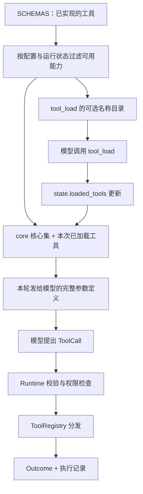

# 03 · 工具系统：先知道有什么，再拿到调用说明

> 一句话：模型负责提出动作，Harness 负责把动作变成有边界、可检查的执行结果。

上一章：[模型协议](02-model-protocols.md) · [目录](README.md) · 下一章：[权限与沙箱](04-permissions-sandbox.md)

## 从一个具体问题开始

你让 Agent 修改 `calculator.py`。它需要读文件、修改文件、运行测试；通常不需要同时看见记忆维护、规划、子任务通信、图片读取的全部参数说明。
如果每轮都发送所有工具的 JSON Schema，模型要为当前用不到的能力付出上下文成本。
反过来，只在提示词里写“你可以管理待办”，却没有参数契约和执行入口，模型也无法真正使用它。

Aster 将这个问题分成三件事：**系统实现了什么、当前配置允许什么、这一轮向模型展示什么**。
三个集合有联系，但不能合成一个列表。



## 先认识一份工具契约

打开 [tools/schemas.py](../../src/aster/tools/schemas.py)，先看 `ReadFile`，再看 `SCHEMAS`、`definitions()`。
下面是 `ReadFile` 的字段部分，范围校验留在源码中：

```python
class ReadFile(Record):
    path: str
    start: int = Field(default=1, ge=1)
    end: int = Field(default=200, ge=1)
```

`path` 是工作区内的文件路径；`start`、`end` 是从 1 开始、两端都包含的行号。
`ge=1` 表示必须大于等于 1；未传的参数由默认值补齐。
额外的校验器拒绝倒置的范围，以及 `end - start > 2000` 的读取范围。
这不是一句给模型的建议：即使模型生成错误参数，Pydantic 也会在执行前拒绝。

`SCHEMAS` 中每个条目包含参数类型、用途描述和副作用类别。例如：

```python
"read_file": (ReadFile, "Read a UTF-8 file with a bounded line range.", "read")
```

| 名称 | 它回答的问题 | 在哪里使用 |
|---|---|---|
| `ReadFile` | 调用者必须传哪些参数？ | 生成 Schema，同时验证实际参数 |
| description | 什么时候应该选这个工具？ | 发给模型的用途说明 |
| `effect` | 是读取、写入、进程执行还是内部状态操作？ | 权限策略的输入 |
| `ToolCall.call_id` | 这是哪一次调用？ | 调用与结果配对、重复调用编号检查 |
| `Outcome.status` | 成功、错误、阻止、超时还是取消？ | Runtime 后续决策 |
| `Outcome.reason` | 为什么没有按预期完成？ | 可比较的原因名称，如 `invalid_arguments` |
| `Outcome.content` | 模型实际看见什么？ | 写入工具结果与后续上下文 |
| `Outcome.data` | 哪些结构化信息留给 Harness 使用？ | 文件摘要、分页游标、验证结果等 |

`Record` 在 [schema.py](../../src/aster/schema.py) 中禁止未知字段。
工具实现因而不必到处写 `args.get("path")`，也不会悄悄吞掉模型拼错的参数名。

`run_shell` 依据实际退出状态报告结果。组合命令应通过 `&&` 或显式传递退出码保留关键步骤的失败，不能让最后成功的清理命令掩盖前面的错误。`run_tests` 则要求有效的结构化测试结果；它不会自动判断测试是否覆盖完整需求，测试仍应调用真实实现或公开入口。

写入工具的参数也按整批边界验证。例如 `patch_file` 的 `edits` 是一组不重叠、各自唯一匹配的 `{old_text, new_text}`；任一项缺失、不唯一或重叠时整批拒绝，不会先应用前几项。还要区分两种“整批”：`patch_file` 是同一文件内的原子参数/匹配校验；模型同轮返回多个工具调用时，Runtime 会先对整个调用批次做 schema 预检，只要一个调用参数无效，整个批次都不执行。先读后改和成功后的新鲜证据因此仍是调用者责任。

启用 `reuse_environment` 后，正式 Python 测试使用可信测试运行器，并自动加入受控 `.venv` 的依赖路径；直接调用 `python -m unittest` 或 `python -m pytest`，不要增加 `.venv/bin/` 或环境变量前缀，也不要在正式验证前删除依赖。失败的可写 Shell 若丢弃了复用环境，结果会带 `environment_discarded=true` 和重装提示。Shell 中自测成功不会更新正式验证状态，完成反馈会明确要求调用 `run_tests`。

## 两种分类，不要交叉理解

`CORE_TOOLS` 是**展示策略**：默认包含文件列表、读取、搜索、写入、补丁、命令、测试、差异和 `tool_load`，最多 9 项。
“最多”是因为没有批准入口、处于只读模式等情况还会隐藏其中部分工具。
`tool_profile="all"` 会展示全部**当前可用**工具，并不会把关闭的能力重新打开。

`WorkspaceTools` 与 `WorkflowTools` 是**执行职责**：前者操作仓库文件或进程，后者操作当前任务的状态和协作能力。
例如，`todo_add` 要改的是 `RunState.todos`；`git_diff` 需要本次任务的初始快照，也走工作流分发。
所以“核心工具”不等于“工作区工具”，两套划分解决不同问题。

`ToolRegistry.execute()` 的完整分发逻辑很短：

```python
async def execute(self, call: ToolCall) -> Outcome:
    if call.name in WORKFLOW_TOOLS:
        return await self.workflow.execute(call)
    return await self.workspace.execute(call)
```

真正的外部入口是 [Runtime.step()](../../src/aster/core/runtime.py)。它还要完成可用性、参数、权限、Hooks、证据记录和状态更新。
业务集成应调用 `Runtime.step()`；直接实例化某个工具处理器会绕开这一层治理。

## 按需加载到底加载了什么

模型起初能看到 `tool_load` 的参数，其中 `names` 的枚举列出了当前可加载的名称。
调用 `tool_load(names=["todo_add"])` 后，Aster 把名称写入 `state.loaded_tools`；**下一次模型请求**的 `tools` 列表才包含 `todo_add` 的完整说明。
没有下载插件，没有动态导入 Python，也没有额外创建一个 Agent。

这与 learn-workbuddy 的“先发现，再加载，再执行”共享思路，但 Aster 选择下一轮直接调用具体工具。
它没有另设一个接收任意参数的通用延迟执行工具。

注意一个实现边界：`loaded_tools` 管理模型可见性，**不充当授权凭证**。
Python 调用者通过 `Runtime.step()` 提交一个已注册、当前可用但未加载的工具时，Runtime 仍会正常校验执行。
配置关闭的能力则无论是否加载、是否使用 `all`、是否直接调用，都要被拒绝。

## 离线实验：观察工具列表如何变化

从项目根目录运行，先执行 `conda activate aster`。
把下面完整 Python 代码保存到 `/tmp/aster_lesson03.py`，再运行 `python /tmp/aster_lesson03.py`。
它直接驱动真实 Runtime，不调用模型；所有运行文件保存在自动清理的临时目录。

```python
# 可运行实验
import asyncio
import tempfile
from pathlib import Path

from aster.config import Settings
from aster.runtime import Runtime
from aster.schema import TaskSpec, ToolCall


def names(runtime):
    return {item["name"] for item in runtime.tool_definitions()}


async def main():
    with tempfile.TemporaryDirectory() as directory:
        runtime = Runtime(
            Path(directory),
            Settings(approval="auto", memory_enabled=False, max_workers=0),
        )
        runtime.start(TaskSpec(prompt="了解工具加载"))
        before = names(runtime)
        print("初始完整工具数:", len(before))
        assert "todo_add" not in before

        loaded = await runtime.step(
            ToolCall(name="tool_load", arguments={"names": ["todo_add"]})
        )
        print("加载结果:", loaded.status)
        print("新增工具:", sorted(names(runtime) - before))
        assert names(runtime) - before == {"todo_add"}

        item = await runtime.step(
            ToolCall(name="todo_add", arguments={"content": "阅读工具实现"})
        )
        print("待办状态:", item.data["status"])
        assert item.data["status"] == "pending"

        runtime.settings.tool_profile = "all"
        print("all 暴露 memory_store:", "memory_store" in names(runtime))
        blocked = await runtime.step(
            ToolCall(name="memory_retrieve", arguments={"query": "工具"})
        )
        print("直接调用关闭的能力:", blocked.status, blocked.reason)
        assert blocked.reason == "memory_disabled"

        invalid = await runtime.step(
            ToolCall(name="read_file", arguments={"path": "a.py", "start": 0})
        )
        print("错误行号:", invalid.reason)
        assert invalid.reason == "invalid_arguments"


asyncio.run(main())
```

预期输出：

```text
初始完整工具数: 9
加载结果: success
新增工具: ['todo_add']
待办状态: pending
all 暴露 memory_store: False
直接调用关闭的能力: blocked memory_disabled
错误行号: invalid_arguments
```

这里的 9 只是本实验配置下的数量，不是每个运行都固定 9 个工具。
实验中给了 `approval="auto"`，因此允许展示写文件、运行命令等核心能力；实验本身只操作临时状态。

## 练习与核对

1. 把 `memory_enabled=False` 改成 `True`，`all` 下会发生什么？
2. 如果一次 `tool_load` 同时申请 `todo_add` 和已关闭的 `memory_store`，是否应该只加载前者？
3. `read_file` 和 `todo_list` 都是“读取”，为什么不放进同一个执行器？

<details>
<summary>参考答案</summary>

1. `all` 会展示当前可用的记忆工具；实验中关于“关闭能力”的断言需要相应修改。
2. 当前实现拒绝整次加载请求，返回 `tool_unavailable`，不留下半成功的 `loaded_tools` 更新。
3. 副作用类型都是 `read`，但依赖不同。前者依赖仓库，后者依赖计划与待办状态；权限类别不等于模块职责。

</details>

## 到这一章为止，我们证明了什么

我们证明了定义、展示和执行各有可检查的路径，以及配置关闭的能力不会被 `all` 重新暴露。
工具按需加载是否节省真实模型费用，还取决于目录大小、调用次数和 provider 的计费方式；本实验没有测量这项收益。
更完整的回归入口是 [test_tool_contracts.py](../../tests/test_tool_contracts.py)，其中也覆盖恢复后的工具列表和计划模式。

下一章把“可以提出调用”进一步变成“允许执行，而且只能影响允许的范围”。
