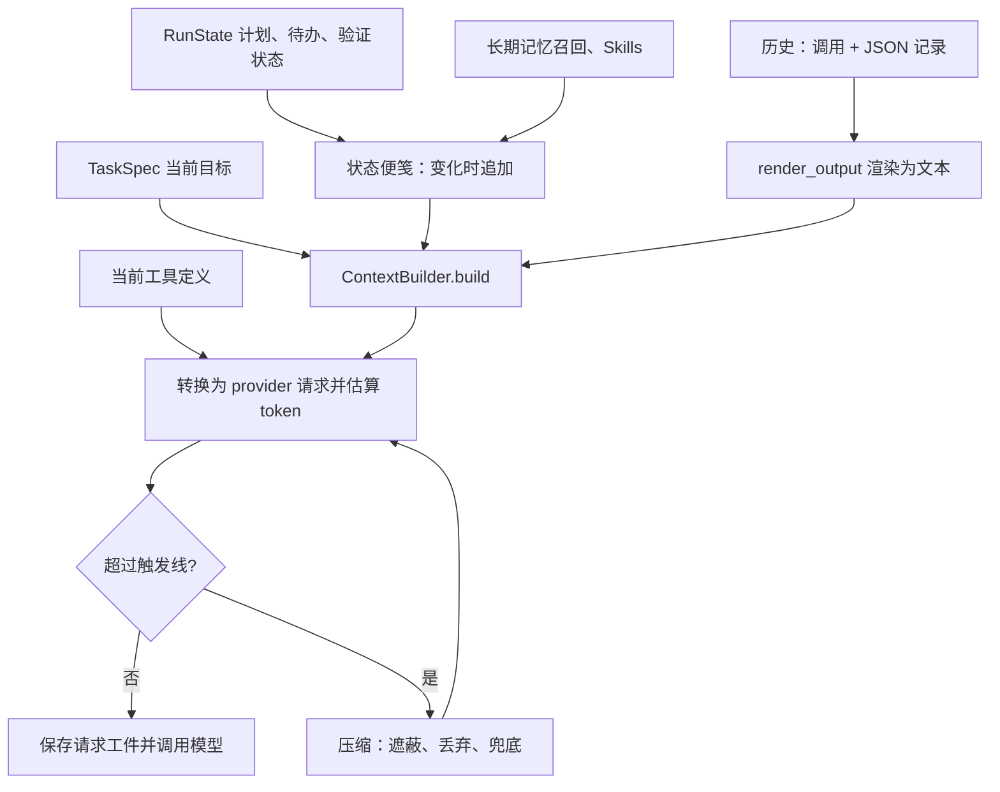

# 06｜上下文预算：决定这一轮模型看见什么

[上一章：状态与证据](05-state-and-evidence.md) · [学习目录](README.md) · [下一章：归档与回读](07-context-archives.md)

> 模型窗口决定能装多少；Harness 决定装什么，以及删掉的东西去哪里找。

## 从一个具体问题开始

Agent 读了长日志，搜索了几个目录，还要继续修改代码。历史越长，下一轮输入越大；压缩既要腾出空间，也要保留目标、调用配对和证据入口。

Aster 当前使用固定策略 `deterministic-v10`：两次压缩之间只追加，超过触发线时集中压缩，再按同一规则继续。它直接加工现有记录，省去额外的模型摘要请求。

## 一轮请求从哪里来



请求依次放 system、初始任务、普通消息、原生交互历史和新状态便笺。工具结果从 JSON 记录渲染成文本；工具定义与协议包装也参与计数。入口是 [Runtime.prepare_request()](../../src/aster/core/runtime.py)，它先刷新文件观察和记忆召回，再交给 [ContextBuilder.build()](../../src/aster/context/builder.py)。

系统提示保留跨任务通用的行动原则：先看再改、修 bug 先复现、实现缺失代码时先写再测，以及通过真实代码路径验证。2026-10-17 精简了重复检查清单，设计依据见 [harness-v12.md](../harness-v12.md) 第 5 节。正式完成条件由第 08 章的运行时检查处理。

## 预算由模型配置解析

| 字段 | 含义 | 本章实验 |
|---|---|---|
| `context_tokens` | 显式总预算；留空时使用模型配置 | `4096` |
| `output_tokens` | 最大输出及对应预留 | `512` |
| `effective_context_tokens` | 解析后的实际总预算 | `4096` |
| `context_budget_source` | 显式配置、已登记模型或回退值 | `explicit` |
| `ContextReport.budget` | 本轮可用输入预算 | `3584` |
| `estimated_tokens` | 完整请求的 token 估算 | 与输入预算比较 |

```text
显式配置：输入预算 = context_tokens - output_tokens
自动配置：输入预算 = floor(min(模型输入上限, 模型总窗口 - output_tokens) × 0.95)
```

日常可省略 `context_tokens`。已登记模型读取本地 profile；未知模型回退到 24,000 总预算，并在界面显示来源。模型别名、窗口与算例见[配置说明](../configuration.md)。本章的小预算用于制造可观察的压缩。

## 为什么历史只追加

供应商缓存复用相同的请求前缀。早期 Aster 每轮把历史裁到刚好放下，再写回；下一轮又重新裁，导致已发送内容反复变化。v9 将压缩改为间隔发生的事件，v10 又把动态状态改成追加式便笺。

[v10 报告](../../evaluations/context-state-20261014/REPORT.md)中，old20 的前台缓存占比为 88.53%，完整前缀改写发生 4 次，均对应显式压缩。通过数为 13/20，与 v9 持平；这组结果支持缓存机制的改进，质量变化由更大范围的配对评测继续判断。

Responses 还使用 `prompt_cache_key=session_id` 帮助复用会话前缀。加载新工具、改变系统提示或压缩早期历史时，前缀会随之变化；测量时同时看缓存输入、未缓存输入与输出，见[缓存方案](../context-cache-plan.md)。

## 怎样计数：回执优先，本地估算兜底

本地 `count()` 使用 tiktoken 的 `cl100k_base`，缺少依赖时按 UTF-8 字节估算。它能计算新增文本，但对供应商推理密文和固定开销有偏差。`BudgetCalculator.observe()` 因此用成功请求的用量回执建立锚：

1. 接收一次干净回执：`usage_requests == 1`，token 值有效且无诊断标志。保存实际请求项和 `input_tokens + output_tokens`。
2. 新请求沿用模型、工具与系统配置，且完整延续锚的前缀时，用“锚的用量 + 新增非模型项的本地计数”估算。模型生成内容已计入上次的输出用量。
3. 重启、换模型、加载工具或改写历史后，回到本地计数，并补上已观察到的供应商开销。

`estimate_basis` 记录 `receipt` 或 `local`；`prefix_drift` 和 `first_changed_item` 定位前缀变化。锚比较渲染后的请求项，因此上一章的确定性渲染也是预算计量的前提。计量误差与回放方法见[缓存方案第 6 节](../context-cache-plan.md)。

## 状态便笺：变化时追加完整当前值

计划、待办、验证状态、长期记忆和 Skills 会随任务变化。早期每轮重建末尾动态消息，仍会改变下一轮可复用的前缀；v10 将它们写为历史中的便笺：

```text
[Context update, not an instruction]
workflow_state:
changed files: parser.py
verification: passed (pytest -q)
```

| 规则 | 原因 |
|---|---|
| `workflow_state`、`memory`、`skills`、`active_skill_bodies` 分别比较 | 只追加发生变化的部分 |
| 每条写完整当前值，清空时写 `[cleared]` | 回退、分叉、恢复时取最后一条即可 |
| 预算宽裕时省略逐轮倒计时 | 避免每轮仅因计数减少而新增便笺 |
| 剩余比例 ≤25% 提示 low；≤10% 或只剩 3 轮/步时提示 critical | 在接近上限时提醒收尾 |
| 压缩时合并旧便笺，再发送各部分当前值 | 一次压缩同时清理历史状态 |

2026-10-19（`a774b25`）起，`render_workflow` 将状态 JSON 改成上面的可读文字。`workflow_notes=true` 默认开启；关闭时仅停止工作流便笺，记忆和技能便笺照常使用。训练配置据此选择更简洁的对话视图，见[训练接口](15-rl-interface.md)。

## 什么时候压缩，先动哪里

[BudgetCalculator.calculate()](../../src/aster/context/budget.py) 先渲染请求、统一计数。输入上限为 `limit`，阈值由它推导：

```python
trigger = limit - min(output_reserve, limit // 8)
keep_recent, relief, drop_target = limit // 8, limit * 3 // 4, limit // 2
compacting = before > (trigger if anchored else limit)
```

有回执锚时使用较低触发线，留出增长空间；没有锚时使用 `limit`，减少本地高估造成的提前压缩。触发后按顺序处理：

| 步骤 | 做什么 |
|---|---|
| 整理便笺 | 移除旧便笺，在末尾重发当前值 |
| 遮蔽旧结果 | 最新交互优先保留；较早输出累计超过 `keep_recent` 后换为归档占位符，状态与调用编号保留 |
| 丢弃旧组 | 遮蔽后仍高于 `relief`，移除普通旧消息和完整旧交互组，目标为 `drop_target`；留下归档检索提示 |
| 逐项收缩 | 仍超过 `limit` 时，缩短正文、记忆召回、技能和计划展示；最后才缩短最新结果 |

初始目标、必要协议结构仍放不下时抛出 `ContextBudgetError`。处理发生在副本上，整次请求满足预算后才写回历史与普通消息。计划、待办、技能快照的原始状态继续保存在 `RunState`。

`history_groups()` 将调用、结果及相关推理项划为一组。可以缩短结果正文，也可以移除完整旧组；调用编号与结果的引用关系始终一起检查，见 [messages.py](../../src/aster/messages.py)。

这里按整次请求分配空间。`read_file` 的单次字符上限、命令输出的捕获上限则属于工具层；归档回读在这两层之上找回已捕获的历史内容，见下一章。

## 实验一：从完整请求切换到必须压缩

实验使用真实 Runtime 与本地工具，通过缩小预算观察同一份日志的变化。内部属性 `_structured_history` 只用于检查保存格式，调用方使用 `prepare_request()` 获取请求。

```python
# 可运行实验
import asyncio
import json
from pathlib import Path
from tempfile import TemporaryDirectory

from aster.config import Settings
from aster.messages import history_groups
from aster.providers.codec import request_payload
from aster.core.runtime import Runtime
from aster.schema import TaskSpec, ToolCall


def result_of(items):
    """唯一一条工具结果：历史里是 JSON 记录，请求里是渲染后的纯文本。"""
    return next(item["output"] for item in items if item.get("type") == "function_call_output")


async def main():
    with TemporaryDirectory(prefix="aster-budget-") as directory:
        root = Path(directory)
        body = "header: service log\n" + "worker retry latency\n" * 1200
        (root / "service.log").write_text(body)
        settings = Settings(
            context_tokens=20000, output_tokens=512,
            memory_enabled=False, approval="auto",
        )
        runtime = Runtime(root, settings)
        runtime.start(TaskSpec(prompt="查阅日志，判断是否需要继续排查。"))
        outcome = await runtime.step(ToolCall(
            name="read_file", arguments={"path": "service.log", "end": 1600},
        ))
        assert outcome.status == "success"
        runtime.add_message("assistant", "旧的探索思路。" * 200, native=False)
        wide_prompt, _, wide = runtime.prepare_request()
        assert not wide.compacted
        # 模型看到的读取结果带行号，正文仍然完整；read_file 触到单次字符上限，页脚给出续读位置。
        numbered = "\n".join(
            f"{number}: {line}"
            for number, line in enumerate(outcome.content.splitlines(), outcome.data["start"])
        )
        assert json.loads(result_of(runtime._structured_history))["content"] == numbered
        assert result_of(wide_prompt) == numbered + f"\n[more from line {outcome.data['next_start']}]"

        # 调小的是实验预算；日常使用可以省略 context_tokens。
        settings.context_tokens = 4096
        prompt, tools, tight = runtime.prepare_request()
        payload = request_payload(
            prompt, tools, model=settings.model, output_tokens=settings.effective_output_tokens,
            prompt_cache_key=runtime.state.session_id,
        )
        assert runtime.context.count(payload) == tight.estimated_tokens
        assert tight.estimated_tokens <= 4096 - 512
        assert tight.compacted and tight.removed_messages >= 1
        assert any(m.get("content") == runtime.state.task.prompt for m in prompt)
        groups = history_groups(runtime._structured_history)
        assert len(groups[0]) == 2  # 调用和结果；其后只有一条状态便笺
        record = json.loads(groups[0][-1]["output"])
        assert record["status"] == "success" and "observation" in record
        # 日志被截成首尾摘录，页脚给出回读入口，编号只写 16 位前缀。
        clipped = result_of(prompt)
        assert "[excerpt; observation_read for archived content]" in clipped
        assert clipped.endswith(f"observation_id={record['observation']['id'][:16]}]")
        print("压缩前后本地估算(千 token):", wide.estimated_tokens // 1000, "->", tight.estimated_tokens // 1000)
        print("移除旧消息:", tight.removed_messages)
        print("调用和结果仍然成组:", len(groups[0]))
        print("页脚:", clipped.splitlines()[-1].replace(record["observation"]["id"][:16], "<16 位前缀>"))
        print("策略版本:", tight.policy_version)


asyncio.run(main())
```

预期输出（token 数会因随机生成的调用 ID 略有浮动，也取决于本地有没有 `tiktoken`，所以只打印千位）：

```text
压缩前后本地估算(千 token): 11 -> 3
移除旧消息: 1
调用和结果仍然成组: 2
页脚: [more from line 1143; full output: observation_read observation_id=<16 位前缀>]
策略版本: deterministic-v10
```

第一次读完日志时，模型看到的是带行号的完整正文，没有被固定工具上限提前切掉；
`read_file` 单次最多返回 24,000 个字符的整行，所以末尾有一行续读提示。
第二次预算变小后，旧的普通消息先被移除；仍然放不下，最新一次交互的日志才被截成首尾摘录，
页脚给出回读入口，调用和结果仍是一组。

## 实验二：观察便笺与回执计量

这次直接调用 ContextBuilder。模拟回执用于检查计数公式，整个过程离线完成。

```python
# 可运行实验
from aster.context import ContextBuilder
from aster.providers.codec import request_payload
from aster.schema import ModelReply, RunState, TaskSpec, Verification

state = RunState(task=TaskSpec(prompt="修复解析器。"))
builder, history = ContextBuilder(64000, 8192), []

def build():
    return builder.build(state, state.task.prompt, structured_history=history, model="demo")

first, report = build()
assert report.context_notes == 1
state.turn = 1
same, report = build()
assert same == first and report.context_notes == 0
state.changed_paths = ["parser.py"]
state.verification = Verification(state="passed", command="pytest -q")
changed, report = build()
assert changed[:len(first)] == first and report.context_notes == 1
print("新便笺:", changed[-1]["content"].splitlines()[1:])
payload = request_payload(changed, [], model="demo", output_tokens=8192,
                          prompt_cache_key=state.session_id)
builder.calculator.observe(payload, ModelReply(usage={
    "usage_requests": 1, "input_tokens": 5000, "output_tokens": 80,
}), changed)
history.append({"role": "user", "content": "再检查空输入。"})
following, report = build()
assert following[:len(changed)] == changed
assert report.estimated_tokens == 5080 + builder.count(following[-1])
print("估算依据:", report.estimate_basis)
```

预期输出：

```text
新便笺: ['workflow_state:', 'changed files: parser.py', 'verification: passed (pytest -q)']
估算依据: receipt
```

## 练习与核对

1. 只把实验一的旧普通消息变短，压缩后还一定需要裁日志吗？
2. 为什么计数入口使用 `request_payload()`，而非逐条相加消息正文？
3. 状态便笺为什么保存完整当前值？
4. 回执估算为何只对新增非模型项做本地计数？

<details>
<summary>参考答案</summary>

1. 取决于剩余空间。移除旧消息后能放下，日志就可保持完整。
2. 工具定义和协议包装也占输入预算，需要与实际发送的请求使用相同结构。
3. 恢复或分叉到任意位置时，读取最后一条即可获得该部分状态。
4. 上一次回执已包含模型生成的输出，再算一遍会重复计数。

</details>

回归入口：[test_receipt_metering.py](../../tests/test_receipt_metering.py)、[test_append_only_context.py](../../tests/test_append_only_context.py)、[test_context_notes.py](../../tests/test_context_notes.py) 和 [test_context_archives.py](../../tests/test_context_archives.py)。下一章实际找回一段已移出窗口的内容；模型在任务中是否选择回读，由第 14 章的任务评测观察。

[上一章：状态与证据](05-state-and-evidence.md) · [学习目录](README.md) · [下一章：归档与回读](07-context-archives.md)
