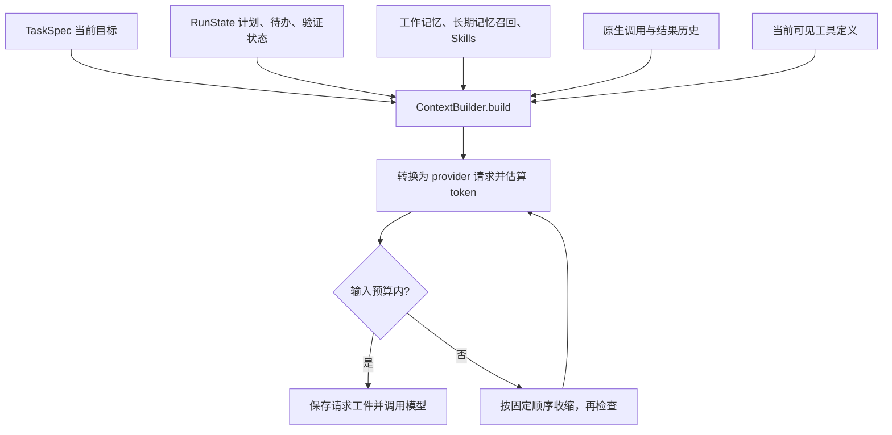

# 06｜上下文预算：决定这一轮模型看见什么

[上一章：状态与证据](05-state-and-evidence.md) · [学习目录](README.md) · [下一章：归档与回读](07-context-archives.md)

> 模型窗口决定能装多少；Harness 决定装什么，以及删掉的东西去哪里找。

读完本章，你应该能沿着 `Runtime.prepare_request()` 找到一次请求的组成，
说明为什么 Aster 不再给每条工具输出设置固定 token 上限，
并用一个离线实验检查压缩后的请求预算和工具调用配对。

## 从一个具体问题开始

Agent 刚读了两千行日志，又搜索了三个目录，接着还要修改代码。
下一轮若把历史原样带上，可能超出模型输入窗口；如果不分内容直接截断，
又可能把真正的错误行删掉，甚至只留下工具结果而丢掉对应调用。

所以“上下文管理”不是把字符串变短这一件事。
它至少要同时回答：当前目标有没有保留、下一步需要的状态还在不在、
请求是否合法、模型能否找回移出窗口的证据。

Aster 当前采用固定策略 `deterministic-v4`。
`deterministic` 表示同样的输入和预算按照同样规则处理；`v4` 是策略版本标记。
这里没有额外调用 LLM 生成摘要，也没有让 Agent 自行训练或修改压缩策略。

## 这一轮请求从哪里来



注意最后参与计数的不是只有聊天消息。
工具的 JSON Schema、system 提示、模型协议包装和输出上限参数都在序列化请求中。
工具描述越长，留给任务证据的位置也就越少，这与第 03 章的按需加载直接相关。

[Runtime.prepare_request()](../../src/aster/runtime.py) 的入口如下，节选：

```python
# 源码节选：每次准备请求都刷新预算，避免换模型后沿用旧值。
self.context.budget = self.settings.effective_context_tokens
self.context.output_reserve = self.settings.effective_output_tokens
self._refresh_observations()
memory_text = self._memory_text(state.task.prompt)
working_memory = self.memory.working_section(state.working_memory)
```

`_refresh_observations()` 检查文件证据是否过期；例如用户在外部修改了文件，
旧文件摘要就不能继续当作现状使用。
随后 `ContextBuilder.build()` 组装请求，返回 `prompt` 和 `ContextReport`。

## 预算不需要用户每次手算

[Settings](../../src/aster/config.py) 中最容易混淆的几个字段如下。

| 字段 | 含义 | 示例 |
|---|---|---|
| `context_tokens` | 显式总预算，包含输入和输出预留；`None` 表示用模型配置 | 实验设为 `4096` |
| `output_tokens` | 本次模型生成的最大输出及对应预留空间 | `512` |
| `effective_context_tokens` | 解析后的实际总预算 | 显式配置时为 `4096` |
| `context_budget_source` | 预算来源：显式、已登记模型或未知模型回退 | `explicit`、`model_profile`、`fallback` |
| `ContextReport.budget` | 这一轮允许的输入预算 | `4096 - 512 = 3584` |
| `estimated_tokens` | 序列化请求的本地 token 估算 | 应不超过 `budget` |

正常运行可以省略 `context_tokens`。已登记模型使用代码里的窗口、输入和输出上限，
输入侧再保留 5% 余量；未知模型使用 24,000 总预算，并在界面显示回退来源。
这是本地模型配置表，不是自动询问任意网关的能力接口；新模型或别名需要正确配置。
模型配置表及算例见[配置说明](../configuration.md)。

核心公式是：

```text
显式配置：输入预算 = context_tokens - output_tokens
自动配置：输入预算 = floor(min(模型输入上限, 模型总窗口 - output_tokens) × 0.95)
```

`count()` 优先用 `tiktoken` 的 `cl100k_base` 编码；没有依赖时按 UTF-8 字节数估算。
这不是每一种模型的精确 tokenizer，因此不能把本地数直接叫作 API 计费 token。
也不要把本章为了触发压力而设置的几千 token 当作日常推荐上限。

## 超预算后，具体先动哪里

[ContextBuilder.build()](../../src/aster/context.py) 每收缩一次就重新构造请求并计数。
能装下就立即停，不会为了追求漂亮压缩率继续删。

1. **先做准备。** 校验原生工具历史，给可归档的文本结果落盘；不超预算就保留完整正文。
2. **删普通旧消息。** 先删不属于原生历史、不是 `user`、也没有 `important=True` 的普通消息。
3. **处理旧历史组。** 按时间选择可移除的旧原生历史组；有较大工具正文时先缩短，否则删除整组。纯 assistant 文本也可能组成一个旧组。
4. **让可重建的附加文本让位。** 依次收缩长期记忆召回、技能目录、已加载技能正文、工作记忆展示。
5. **收缩工作流说明。** 缩短计划和未完成待办的长描述，保留待办身份；最后仍装不下就明确停止。

步骤 3 中，最近一次工具交互优先保留。没有可处理的旧交互时，
最近交互的结果正文也可能被缩短，但不把调用 ID、结果状态等协议外壳切坏。
这不是“最近结果永不裁剪”的保证。

步骤 2 的“普通消息”尤其值得注意：模型原生历史中已经保存的 assistant/tool 内容，
不会又作为 `state.messages` 的重复副本塞进请求。
`important` 是普通消息的删除保护标记，不是给所有文本无限预算的通行证。

步骤 4 缩短的是发送给模型的展示，`RunState.working_memory` 的原数据仍在。
计划、待办也有独立状态，而不是只能从一段旧聊天里猜测。

下面是裁剪分支的真实节选，省略了后续分支：

```python
if index is not None:
    messages.pop(index)
    removed += 1
elif candidates:
    item = max(
        candidates,
        key=lambda x: self.count(self._output_record(x["output"])["content"]),
    )
    body_size = self.count(self._output_record(item["output"])["content"])
```

`index` 指可移除普通消息的位置，`candidates` 是当前候选交互中可缩短的工具结果。
这里的 `96` token 等内部阈值用于避免对过短正文反复加工，
不是给每个工具预先设置一个统一上限。旧的 `tool_output_tokens` 配置已移除。

## 调用和结果为什么要成组

考虑模型并行发起两次读取：`call-A` 和 `call-B`。
返回顺序可以不同，但两个结果都必须有对应调用，调用也不能没有结果。

```text
一个交互组：reasoning（若存在）→ call-A、call-B → result-B、result-A
可以：缩短 result-A.content；必要时移除整个旧组
不可以：只移除 call-A，却保留 result-A
```

[history_groups()](../../src/aster/provider.py) 校验非空 ID、重复调用、孤儿结果、
重复结果和未完成批次，并把相关推理项放进相同裁剪组。
`ContextBuilder` 先在历史副本上处理，整次请求满足预算后才更新正式历史。
格式出错会抛出 `ContextHistoryError`，不会把不合法请求送给模型碰运气。

## 动手：从“能完整放下”切换到“必须压缩”

先完成[第 00 章](00-quickstart.md)的安装，然后在项目根目录激活环境。
将下面完整代码保存到 `/tmp/aster-context-budget-lesson.py`，执行：

```bash
conda run --no-capture-output -n aster python /tmp/aster-context-budget-lesson.py
```

实验只调用真实 Harness 和本地工具，不调用模型 API；临时日志和运行工件自动清理。
`_structured_history` 是内部属性，本实验只读它来检查协议，并不教调用方手动拼装生产请求。

```python
# 可运行实验
import asyncio
import json
from pathlib import Path
from tempfile import TemporaryDirectory

from aster.config import Settings
from aster.provider import history_groups, request_payload
from aster.runtime import Runtime
from aster.schema import TaskSpec, ToolCall

async def main():
    with TemporaryDirectory(prefix="aster-budget-") as directory:
        root = Path(directory)
        body = "header: service log\n" + "worker retry latency\n" * 1200
        (root / "service.log").write_text(body)
        settings = Settings(
            context_tokens=20000, output_tokens=512,
            memory_enabled=False, approval="auto",
        )
        runtime = Runtime(root, settings)
        runtime.start(TaskSpec(prompt="查阅日志，判断是否需要继续排查。"))
        outcome = await runtime.step(ToolCall(
            name="read_file", arguments={"path": "service.log", "end": 1600},
        ))
        assert outcome.status == "success"
        runtime.add_message("assistant", "旧的探索思路。" * 200, native=False)
        wide_prompt, _, wide = runtime.prepare_request()
        assert not wide.compacted
        assert json.loads(runtime._structured_history[-1]["output"])["content"] == outcome.content

        # 调小的是实验预算；日常使用可以省略 context_tokens。
        settings.context_tokens = 4096
        prompt, tools, tight = runtime.prepare_request()
        payload = request_payload(
            prompt, tools, model=settings.model, output_tokens=settings.effective_output_tokens,
        )
        assert runtime.context.count(payload) == tight.estimated_tokens
        assert tight.estimated_tokens <= 4096 - 512
        assert tight.compacted and tight.removed_messages >= 1
        assert any(m.get("content") == runtime.state.task.prompt for m in prompt)
        groups = history_groups(runtime._structured_history)
        assert len(groups) == 1 and len(groups[0]) == 2
        record = json.loads(groups[0][-1]["output"])
        assert record["status"] == "success" and "observation" in record
        print("压缩前本地估算:", wide.estimated_tokens)
        print("压缩后本地估算:", tight.estimated_tokens, "/", tight.budget)
        print("移除旧消息:", tight.removed_messages)
        print("调用和结果仍然成组:", len(groups[0]))
        print("策略版本:", tight.policy_version)

asyncio.run(main())
```

一次执行得到：

```text
压缩前本地估算: 9449
压缩后本地估算: 2617 / 3584
移除旧消息: 1
调用和结果仍然成组: 2
策略版本: deterministic-v4
```

每次生成的调用 ID、证据标识不同，工具描述和依赖版本也可能变化，
token 数会略有变化；重要的是断言一直成立。
第一次读完日志时，正文没有被固定工具上限提前切掉；第二次预算变小后，
旧的普通消息被移除，日志留下有界摘录与归档引用，调用和结果仍是一组。

`report.removed_messages` 统计移除的消息/协议项数量，不是“删除了多少事实”。
`report.compacted=True` 也只说明上下文发生收缩，不能独立证明模型仍能完成任务。
真实任务通过率和成本需要另测，见[上下文评测结果](../context-results.md)和[第 14 章](14-evaluation.md)。

## 练习与参考答案

**练习 1：只把实验中的旧普通消息变短，压缩后一定还会裁日志吗？**

不一定。是否裁日志取决于删完普通消息后整次请求是否仍超预算。
你可以把 `context_tokens` 调到刚好容纳工具全文的附近，观察 `compacted` 和正文。
不要假设“触发压缩”等于“必须截断每条工具输出”。

**练习 2：为什么不能只对 `prompt` 中的字符串逐条相加？**

协议转换和工具 schema 也占空间。
实验使用 `request_payload()` 得到与当前协议一致的完整请求，再交给同一个计数器检查。

**练习 3：预算小到当前目标和必要状态本身都放不下，Aster 会怎样？**

抛出 `ContextBudgetError`；自主运行把它记为 `context_budget_exceeded` 并停止。
它不会偷偷裁掉当前请求，也不会自动新增一次摘要模型调用。

## 本章的边界

这里证明的是预算控制和协议完整性，不是有损压缩后的语义无损。
旧结果正文移出窗口之后，模型能否发现需要回读、是否读到关键证据，
仍属于任务层面的能力；下一章会把“可以找回”这条路径跑通。

源码继续读：[context.py](../../src/aster/context.py)、[provider.py](../../src/aster/provider.py)。
对应合同检查见 [test_context_archives.py](../../tests/test_context_archives.py)
和 [test_protocol_pairing.py](../../tests/test_protocol_pairing.py)。
本章借鉴 learn-claude-code 的“问题 → 机制 → 实验”组织；Aster 的压缩顺序与无 LLM 策略以自己的源码为准。

[上一章：状态与证据](05-state-and-evidence.md) · [学习目录](README.md) · [下一章：归档与回读](07-context-archives.md)
