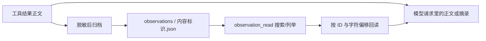

# 07｜归档与回读：让移出窗口的证据仍然可找

[上一章：上下文预算](06-context-budget.md) · [学习目录](README.md) · [下一章：Hooks 与任务完成](08-hooks-and-completion.md)

> 上下文是手边的工作台，归档是可查找的资料柜；柜子里存的必须是当时那份证据。

本章解决上一章留下的问题：日志被压短，关键错误恰好在中间，怎么办？
你将亲手执行“读取 → 压缩 → 搜索归档 → 分页回读”，
并区分历史证据、当前文件与长期记忆。

## 为什么不能让 Agent 重新跑一次命令

重新读取一个没有变化的源码文件通常可行。
但诊断命令的输出可能只出现一次：临时文件已删除、测试环境已清理，
或者再次执行命令就会产生新的副作用。
因此“反正能重跑”不能作为所有工具结果的压缩方案。

Aster 在缩短正文之前，把已经捕获的文本结果存入当前运行的归档目录；命令输出先受 `run_shell` 的 4 MiB 捕获上限，模型可见预览还受 8192 字符上限约束。超过捕获上限的内容从未进入观察归档，不能靠归档恢复。
模型请求只保留有界摘录与引用；即使整组旧交互后来被移除，
仍可用 `observation_read` 搜索这个运行留下的归档。
这里的 observation 就是“工具当时返回的一份观察结果”。

## 一份结果会经过哪些地方



当前运行的工件布局如下；`run_id` 是运行标识，`observation_id` 是归档标识。

```text
workspace/.aster/runs/<run_id>/
├── checkpoint.json
├── trace.jsonl
├── requests/
│   └── <轮次>-<请求哈希>.json
└── observations/
    └── <observation_id>.json
```

这三个存储目的不同：`trace.jsonl` 用于复盘发生过什么，
`checkpoint.json` 用于恢复运行状态，`observations` 用于让模型找回历史工具正文。
归档工具不会任意搜索检查点、完整 trace 或其他运行的文件。续聊时，经授权的同一 session 祖先观察 ID 可以被读取；这仍不是任意跨 run 读取，权限和 session 关系必须由 Runtime 检查。

## 先归档，再替换正文

[EvidenceStore.archive_observation()](../../src/aster/evidence.py) 的关键代码节选：

```python
record = self.redactor.value(
    {"run_id": run_id, "call_id": call_id, "tool": tool, "content": content},
    mask_fields=False,
)
observation_id = digest(json.dumps(record, sort_keys=True, ensure_ascii=False))
```

`call_id` 指向产生这份观察的那次工具调用；`tool` 说明它来自哪个工具。
内容标识对脱敏后的来源与正文一起计算 SHA-256，
所以同一段文本来自不同调用时，也不会被误认为完全相同的证据。
重复归档同一份记录可以复用文件。

完整正文指工具已经返回的、经过脱敏的正文，
不意味着突破工具自身的读取边界：例如 `read_file` 只读指定行范围，
归档不会自动补齐没有读过的整个源文件。

归档成功后，压缩结果可以携带：

```json
{
  "status": "success",
  "reason": "",
  "evidence_id": "这次执行证据的标识",
  "content": "开头摘录……结尾摘录",
  "observation": {"id": "64 位十六进制标识", "characters": 42035}
}
```

这里展示的是结构示意，字段值不是可用于请求的真实 ID。
`status`、`reason`、`evidence_id` 等结果外壳仍然保留。
`observation.id` 则用于取回被省略的正文，两种 ID 的职责不同。

如果写盘失败，压缩不能先破坏原始历史再说。
`ContextBuilder` 在副本上处理，满足预算后才提交历史变化；
已写出的部分归档可能留下，但正式上下文不会变成半截的新版本。

## 回读的两种模式

模型先通过 `tool_load` 加载 `observation_read` 的完整定义，随后选择模式：

| 请求字段 | 不传 `observation_id` | 传入 `observation_id` |
|---|---|---|
| `query` | 对当前 run 归档做字面文本搜索；续聊时也可读取经授权的同 session 祖先观察；空串表示列举 | 从 `offset` 开始查找字面文本；空串表示直接取页 |
| `offset` | 跳过多少条匹配记录 | 从正文的第几个字符开始 |
| `limit` | Runtime 最多返回 10 条引用 | 每页 1–1000 个字符 |
| 结果中的 `next_offset` | 下一页记录偏移 | 下一页字符偏移；结束时为 `null` |
| 结果中的 `total` | 匹配记录总数 | 这份正文的总字符数 |

这里按**字符**分页，不按 token 分页；`offset` 不是字节位置。
数据先按清晰的字符边界取页，准备模型请求时再由整次请求预算控制。
中文一个字符和它的 UTF-8 字节数、token 数可能不同，不要混用单位。

搜索没有引入向量数据库；当前轻量实现按字面字符串扫描当前 run 归档，或扫描 Runtime 显式授权的同 session 祖先观察。它不是任意历史 run 的搜索。
搜索结果有 `match_offset`，指明命中位置，模型可以直接从那里取页。
底层存储接口还返回 `sha256`、`tool`、`call_id`；
Runtime 的模型可见结果会省掉部分重复来源字段，完整来源仍在归档和 trace 中。

## 已取的一页还被压短，游标怎么办

假设工具读出了从字符 100 开始的 800 个字符，原本 `next_offset=900`。
整次请求超预算后，如果模型最终只看见前 200 个字符，
下一页必须从 300 开始。若仍写 900，中间 600 个字符就被悄悄跳过了。

[ContextBuilder._clip_tool_output()](../../src/aster/context.py) 的分页分支节选：

```python
elif len(page.get("content", "")) > 1:
    page["content"] = page["content"][: len(page["content"]) // 2]
    page["next_offset"] = page["offset"] + len(page["content"])
```

普通日志摘录可以保留首尾；有游标的正文页保留连续前缀并更新游标，
这样模型知道自己真正看到了哪里。
`todo_list`、`skill_load` 的文本分页也遵守这个原则。
归档回读的结果不会再次被递归归档，避免“归档的归档”持续膨胀。

## 动手：把日志中间的那条错误找回来

完成[第 00 章](00-quickstart.md)安装后，将完整代码保存为
`/tmp/aster-context-archives-lesson.py`，在项目根目录执行：

```bash
conda run --no-capture-output -n aster python /tmp/aster-context-archives-lesson.py
```

本实验只用本地工具；开头与结尾的重复日志把一次性标记推到正文中间。
它使用 `Runtime.step()` 手动给动作，是机制演示，不声称验证模型会自主决定回读。

```python
# 可运行实验
import asyncio
import json
from pathlib import Path
from tempfile import TemporaryDirectory

from aster.config import Settings
from aster.runtime import Runtime
from aster.schema import TaskSpec, ToolCall

async def main():
    with TemporaryDirectory(prefix="aster-archive-") as directory:
        root = Path(directory)
        witness = "ONE-TIME-729: payment retry exhausted"
        source = "routine prefix " * 1500 + witness + " routine suffix" * 1500
        path = root / "diagnostic.txt"
        path.write_text(source)
        runtime = Runtime(root, Settings(
            context_tokens=4096, output_tokens=512,
            memory_enabled=False, approval="auto",
        ))
        runtime.start(TaskSpec(prompt="找出历史诊断中的 ONE-TIME 标记。"))
        read = await runtime.step(ToolCall(
            name="read_file", arguments={"path": "diagnostic.txt"},
        ))
        assert read.status == "success"
        prompt, tools, report = runtime.prepare_request()
        assert report.compacted and witness not in json.dumps(prompt)
        assert "observation_read" not in {tool["name"] for tool in tools}
        loaded = await runtime.step(ToolCall(
            name="tool_load", arguments={"names": ["observation_read"]},
        ))
        assert loaded.status == "success"

        found = await runtime.step(ToolCall(
            name="observation_read", arguments={"query": "ONE-TIME-729"},
        ))
        assert found.status == "success"
        matches = json.loads(found.content)["observations"]
        assert len(matches) == 1
        reference = matches[0]
        page_result = await runtime.step(ToolCall(
            name="observation_read", arguments={
                "observation_id": reference["id"],
                "offset": reference["match_offset"], "limit": 80,
            },
        ))
        page = json.loads(page_result.content)
        assert page_result.status == "success" and page["content"].startswith(witness)
        assert page["next_offset"] == page["offset"] + len(page["content"])

        # 磁盘文件后来变了，归档仍然记录当时实际看到的文本。
        path.write_text("current diagnosis: service recovered")
        historical = runtime.evidence.read_observation(
            runtime.state.run_id, reference["id"], query="ONE-TIME-729", limit=80,
        )
        fresh = await runtime.step(ToolCall(
            name="read_file", arguments={"path": "diagnostic.txt"},
        ))
        assert historical["content"].startswith(witness)
        assert fresh.content == "current diagnosis: service recovered"
        print("归档命中数:", len(matches))
        print("历史证据:", page["content"][:len(witness)])
        print("本页字符数:", len(page["content"]))
        print("最新文件:", fresh.content)

asyncio.run(main())
```

预期输出：

```text
归档命中数: 1
历史证据: ONE-TIME-729: payment retry exhausted
本页字符数: 80
最新文件: current diagnosis: service recovered
```

第一条断言先确认完整关键句已不在压缩后的请求中，
随后从当前 run（或经授权的同 session 祖先）的归档找回它；否则“回读成功”可能只是再次看到从未被裁掉的内容。
最后更改磁盘文件，展示历史证据和当前事实可以同时成立。

## 归档不等于新鲜读取，也不等于 Memory

| 机制 | 回答的问题 | 生命周期与用途 |
|---|---|---|
| `read_file` | 这个文件现在是什么内容？ | 建立当前文件的读取证据，供后续编辑校验 |
| `observation_read` | 当时某次工具具体返回了什么？ | 当前 run 的历史观察，或经授权的同 session 祖先观察；不能据此声称文件仍未变化 |
| 工作记忆 | 这次任务里已经掌握了哪些简要事实？ | `RunState.working_memory`，随检查点恢复 |
| 长期记忆 | 下一次任务还可能用到哪些经验？ | 独立记忆系统，详见第 10、11 章 |

工具描述和系统提示都说明归档是不可信观察数据，不能晋升成系统指令。
回读一条旧文件记录不会更新 `read_evidence`，
所以它不能绕过“编辑前先检查当前文件”的约束。

## 练习与参考答案

**练习 1：把搜索词改成不存在的 `MISSING-999`，应该得到什么？**

列表模式返回空的 `observations` 和 `total=0`，不是编造一条近似结果。
若已知 ID 后在正文里搜索不到，存储接口返回 `matched=False` 和空正文。

**练习 2：完整工具交互都被压缩删除了，还能回读吗？**

可以通过不传 ID 的搜索/列举模式发现归档。
引用不需要永远占据活跃上下文中的一个位置，但模型仍需要有线索主动搜索。
“存储可找回”不能替代“模型成功找回”的任务评测。

**练习 3：有人改写了归档 JSON 中的 `content`，会怎样？**

`read_observation()` 重新校验记录归属、字段类型和内容标识。
校验失败会抛出 `observation_integrity_error`；工具层把它报告为
`observation_unavailable`，不会把修改后的文本当作已验证的原始证据。
这项哈希检查不是针对拥有全部本地写权限者的防篡改安全承诺。

## 本章的边界

归档解决了证据外置、定位和完整性检查，没有解决模型永远不忘线索的问题。
归档也可能被用户清理或发生磁盘错误，下一次准备请求需要的引用不可用时会明确失败。
Aster 没有把“有磁盘归档”宣传成无限上下文或所有内容永久无损。

继续读 [EvidenceStore](../../src/aster/evidence.py)、
[WorkflowTools.execute()](../../src/aster/tools/workflow.py) 和
[归档合同测试](../../tests/test_context_archives.py)。
更大的真实任务结果见[上下文评测](../context-results.md)。

[上一章：上下文预算](06-context-budget.md) · [学习目录](README.md) · [下一章：Hooks 与任务完成](08-hooks-and-completion.md)
