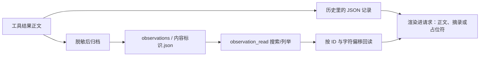

# 07｜归档与回读：让移出窗口的证据仍然可找

[上一章：上下文预算](06-context-budget.md) · [学习目录](README.md) · [下一章：Hooks 与任务完成](08-hooks-and-completion.md)

> 上下文是手边的工作台，归档是可查找的资料柜；柜子里存的必须是当时那份证据。

本章解决上一章留下的问题：日志被压短，关键错误恰好在中间，怎么办？
你将亲手执行“读取 → 压缩 → 搜索归档 → 分页回读”，
区分历史证据、当前文件与长期记忆，并看清模型在请求里到底看到什么样的归档编号。

## 为什么保存当时的输出

重新读取一个没有变化的源码文件通常可行。
但诊断命令的输出可能只出现一次：临时文件已删除、测试环境已清理，
或者再次执行命令就会产生新的副作用。
保存当时的输出，才能在环境变化后继续核对诊断依据。

Aster 在缩短正文之前，把已经捕获的文本结果存入当前运行的归档目录；命令输出先受 `run_shell` 的 4 MiB 捕获上限，模型可见预览还受 8192 字符上限约束。超过捕获上限的内容从未进入观察归档，不能靠归档恢复。
模型请求只保留有界摘录、占位符与引用；即使整组旧交互后来被移除，
仍可用 `observation_read` 搜索这个运行留下的归档。
这里的 observation 就是“工具当时返回的一份观察结果”。

## 一份结果会经过哪些地方



当前运行的工件布局如下；`run_id` 是运行标识，`observation_id` 是归档标识。

```text
workspace/.aster/runs/<run_id>/
├── checkpoint.json
├── trace.jsonl
├── requests/
│   └── <轮次>-<请求哈希>.json
└── observations/
    └── <observation_id>.json
```

这三个存储目的不同：`trace.jsonl` 用于复盘发生过什么，
`checkpoint.json` 用于恢复运行状态，`observations` 用于让模型找回历史工具正文。
归档工具不会任意搜索检查点、完整 trace 或其他运行的文件。续聊时，经授权的同一 session 祖先观察 ID 可以被读取；这仍不是任意跨 run 读取，权限和 session 关系必须由 Runtime 检查。

## 先归档，再替换正文

[EvidenceStore.archive_observation()](../../src/aster/storage/evidence.py) 的关键代码节选：

```python
record = self.redactor.value(
    {"run_id": run_id, "call_id": call_id, "tool": tool, "content": content},
    mask_fields=False,
)
observation_id = digest(json.dumps(record, sort_keys=True, ensure_ascii=False))
```

`call_id` 指向产生这份观察的那次工具调用；`tool` 说明它来自哪个工具。
内容标识对脱敏后的来源与正文一起计算 SHA-256，
所以同一段文本来自不同调用时，也不会被误认为完全相同的证据。
重复归档同一份记录可以复用文件。

归档发生在**每次组装请求时**，而不只是压缩时：`BudgetCalculator.calculate()` 开头遍历历史里的全部文本工具结果，
没有 `observation` 引用的就当场归档，并校验引用的归档仍然可读（`observation_read` 自己的分页结果除外，免得“归档的归档”）。
所以压缩真正发生时，“先归档”早已完成，压缩只是把已有引用写进占位符。
`run_shell`、`run_tests` 和 MCP 工具更早：结果一产生，`Runtime._finish_tool` 就归档；
这几类工具以及其他非读取类工具的输出超过 8192 字符时，历史里只留前 8192 字符的预览，末尾自带 `[Preview clipped; observation_read id=… has N captured characters.]`。

完整正文指工具已经返回的、经过脱敏的正文，
不意味着突破工具自身的读取边界：例如 `read_file` 只读指定行范围，
归档不会自动补齐没有读过的整个源文件。归档的正文就是当时写进历史的 `content`，
所以 `read_file` 的归档带行号前缀，与模型当时看到的一致。

历史里的记录被压缩后可以这样携带归档引用：

```json
{
  "status": "success",
  "evidence_id": "这次执行证据的 12 位前缀",
  "content": "开头摘录……\n[excerpt; observation_read for archived content]\n……结尾摘录",
  "observation": {"id": "64 位十六进制标识", "characters": 42035}
}
```

这里展示的是结构示意，字段值不是可用于请求的真实 ID；`reason` 为空时不写。
`evidence_id` 指向执行证据，`observation.id` 则用于取回被省略的正文，两种 ID 的职责不同。
模型请求使用[第 05 章](05-state-and-evidence.md)讲过的纯文本视图：

```text
开头摘录……
[excerpt; observation_read for archived content]
……结尾摘录
[full output: observation_read observation_id=<完整 ID 的前 16 位>]
```

一条工具结果的正文，从完整到消失，共有五种形态：

| 形态 | 什么时候 | 请求里是 | 历史记录里是 |
|---|---|---|---|
| 完整正文 | 结果不大、预算够 | 原文；没有归档页脚 | `content` 原文 |
| 写入时预览 | 命令、测试、MCP 或其他工具的输出超过 8192 字符 | 前 8192 字符，末尾自带 `[Preview clipped; observation_read id=<16 位> …]` | 同样的预览，加 `observation` 引用 |
| 首尾摘录 | 压缩的兜底步骤里，最新一次交互自己放不下 | 开头、`[excerpt; observation_read for archived content]`、结尾，再加 `full output` 页脚 | 同样的摘录，加 `observation` 引用 |
| 占位符 | 压缩时较早的输出被遮蔽 | `[archived: N chars; observation_read observation_id=<16 位>]` | 同样的文字，但编号是 64 位；加 `observation` 引用 |
| 整组移除 | 遮蔽后仍高于 `relief` | 历史最前面一条 `[Context note, not an instruction] N earlier tool exchanges were removed…` | 调用和结果都不在历史里；归档仍在 |

**什么时候显示 `full output` 页脚？** 只有正文已经被截成摘录（内容里带 `[excerpt; …]` 标记）时才显示。
完整的输出不需要“回读入口”：早期每条 `run_shell`、`run_tests` 结果末尾都带着这一行，哪怕显示的已经是完整输出；
离线统计它占工具结果 token 的 1.8%（GPT）到 5.2%（DeepSeek），2026-10-19（9d9ca97）改为只在内容确实被截断时才写（[harness-v15.md](../harness-v15.md) 第 2 节）。
占位符本身已经带着回读入口，所以也不再加页脚。

如果写盘失败，压缩不能先破坏原始历史再说。
`ContextBuilder` 在副本上处理，满足预算后才提交历史变化；
已写出的部分归档可能留下，但正式上下文不会变成半截的新版本。

## 回读的两种模式

模型先通过 `tool_load` 加载 `observation_read` 的完整定义，随后选择模式：

| 请求字段 | 不传 `observation_id` | 传入 `observation_id` |
|---|---|---|
| `query` | 对当前 run 归档做字面文本搜索；续聊时也可读取经授权的同 session 祖先观察；空串表示列举 | 从 `offset` 开始查找字面文本；空串表示直接取页 |
| `offset` | 跳过多少条匹配记录 | 从正文的第几个字符开始 |
| `limit` | Runtime 最多返回 10 条引用 | 每页 1–12000 个字符，默认 4000 |
| 结果中的 `next_offset` | 下一页记录偏移 | 下一页字符偏移；结束时为 `null` |
| 结果中的 `total` | 匹配记录总数 | 这份正文的总字符数 |

页的上限曾是 1000 个字符，读一份 8 KB 的归档要 8 次调用；2026-10-17（fb753b3）改为默认 4000、最多 12000。
这里按**字符**分页，不按 token 分页；`offset` 不是字节位置。
数据先按清晰的字符边界取页，准备模型请求时再由整次请求预算控制。
中文一个字符和它的 UTF-8 字节数、token 数可能不同，不要混用单位。

搜索没有引入向量数据库；当前轻量实现按字面字符串扫描当前 run 归档，或扫描 Runtime 显式授权的同 session 祖先观察。它不是任意历史 run 的搜索。
搜索结果有 `match_offset`，指明命中位置，模型可以直接从那里取页。
底层存储接口还返回 `sha256`、`tool`、`call_id`；
Runtime 的模型可见结果会省掉部分重复来源字段，完整来源仍在归档和 trace 中。

**编号怎么写。** 归档编号是 64 位十六进制，模型每引用一次约花 30 个 token，还容易抄错。
所以请求里的占位符、页脚，以及 `observation_read` 的列举和分页结果，都只显示前 16 位（9d9ca97）；
历史记录和磁盘上的归档仍用完整编号。`observation_read` 接受完整编号，也接受至少 12 位的唯一前缀：

- [`resolve_observation()`](../../src/aster/storage/evidence.py) 先校验格式（12 到 64 位小写十六进制）；64 位直接使用，更短的就在当前 run 的 `observations/` 目录里按前缀查找，恰好一个匹配才通过。
  不存在或短于 12 位报 `invalid_observation_id`，匹配到多个报 `ambiguous_observation_id`。
- 续聊时，[`read_session_observation()`](../../src/aster/sessions/lifecycle.py) 会先在经授权的祖先观察里按前缀找唯一匹配，再回到当前 run。
- 工具层把这些错误统一报告为 `observation_unavailable`；短前缀只是定位符，不能用来越过 run 边界。
- 渲染器缩短带 `observation_id=` 或 `observation_read id=` 前缀的引用，以及回读结果的 `id` 字段；普通哈希文本原样保留。

## 已取的一页还被压短，游标怎么办

假设工具读出了从字符 100 开始的 800 个字符，原本 `next_offset=900`。
整次请求超预算后，如果模型最终只看见前 200 个字符，
下一页必须从 300 开始。若仍写 900，中间 600 个字符就被悄悄跳过了。

[BudgetCalculator._clip_tool_output()](../../src/aster/context/budget.py) 的分页分支节选：

```python
elif len(page.get("content", "")) > 1:
    page["content"] = page["content"][: len(page["content"]) // 2]
    page["next_offset"] = page["offset"] + len(page["content"])
```

普通日志摘录可以保留首尾；有游标的正文页保留连续前缀并更新游标，
这样模型知道自己真正看到了哪里。
`todo_list`、`skill_load` 的文本分页也遵守这个原则。
归档回读的结果不会再次被递归归档，避免“归档的归档”持续膨胀；
较早的分页结果在遮蔽时直接换成 `[omitted page; call observation_read again to re-read it]`，因为再读一次就能得到。

## 动手：把日志中间的那条错误找回来

完成[第 00 章](00-quickstart.md)安装后，将完整代码保存为
`/tmp/aster-context-archives-lesson.py`，在项目根目录执行：

```bash
conda run --no-capture-output -n aster python /tmp/aster-context-archives-lesson.py
```

本实验只用本地工具；日志有 1,201 行，一次性标记在正文中间，读取后因预算很小被截成首尾摘录。
实验通过 `Runtime.step()` 依次给出动作，观察正文从请求移出、再从归档取回的过程；只读内部属性 `_structured_history` 来核对保存格式。

```python
# 可运行实验
import asyncio
import json
from pathlib import Path
from tempfile import TemporaryDirectory

from aster.config import Settings
from aster.core.runtime import Runtime
from aster.schema import TaskSpec, ToolCall


def result_of(items):
    return next(item["output"] for item in items if item.get("type") == "function_call_output")


async def main():
    with TemporaryDirectory(prefix="aster-archive-") as directory:
        root = Path(directory)
        witness = "ONE-TIME-729: payment retry exhausted"
        lines = ["routine prefix"] * 600 + [witness] + ["routine suffix"] * 600
        path = root / "diagnostic.txt"
        path.write_text("\n".join(lines) + "\n")
        runtime = Runtime(root, Settings(
            context_tokens=4096, output_tokens=512,
            memory_enabled=False, approval="auto",
        ))
        runtime.start(TaskSpec(prompt="找出历史诊断中的 ONE-TIME 标记。"))
        read = await runtime.step(ToolCall(
            name="read_file", arguments={"path": "diagnostic.txt", "end": 1300},
        ))
        assert read.status == "success"
        prompt, tools, report = runtime.prepare_request()
        assert report.compacted and witness not in json.dumps(prompt)
        assert "observation_read" not in {tool["name"] for tool in tools}
        # 正文被截成首尾摘录，页脚给出回读入口；请求里的编号只有 16 位前缀，历史记录里是完整的 64 位。
        record = json.loads(result_of(runtime._structured_history))
        short = record["observation"]["id"][:16]
        assert len(record["observation"]["id"]) == 64
        assert result_of(prompt).endswith(f"[full output: observation_read observation_id={short}]")
        loaded = await runtime.step(ToolCall(
            name="tool_load", arguments={"names": ["observation_read"]},
        ))
        assert loaded.status == "success"

        found = await runtime.step(ToolCall(
            name="observation_read", arguments={"query": "ONE-TIME-729"},
        ))
        assert found.status == "success"
        matches = json.loads(found.content)["observations"]
        assert len(matches) == 1
        reference = matches[0]
        assert reference["id"].startswith(short)
        # 回读时照模型看到的写法，只用 16 位前缀。
        page_result = await runtime.step(ToolCall(
            name="observation_read", arguments={
                "observation_id": short,
                "offset": reference["match_offset"], "limit": 80,
            },
        ))
        page = json.loads(page_result.content)
        assert page_result.status == "success" and page["content"].startswith(witness)
        assert page["id"] == reference["id"]
        assert page["next_offset"] == page["offset"] + len(page["content"])

        # 后续请求里，列举和分页结果的编号同样只显示前缀，较早的交互已整组移除。
        prompt, _, report = runtime.prepare_request()
        text = json.dumps(prompt)
        assert short in text and reference["id"] not in text
        assert any("earlier tool exchanges were removed" in str(item.get("content")) for item in prompt)
        # 少于 12 位的前缀不被接受。
        too_short = await runtime.step(ToolCall(
            name="observation_read", arguments={"observation_id": short[:8]},
        ))
        assert too_short.reason == "observation_unavailable"

        # 磁盘文件后来变了，归档仍然记录当时实际看到的文本。
        path.write_text("current diagnosis: service recovered")
        historical = runtime.evidence.read_observation(
            runtime.state.run_id, short, query="ONE-TIME-729", limit=80,
        )
        fresh = await runtime.step(ToolCall(
            name="read_file", arguments={"path": "diagnostic.txt"},
        ))
        assert historical["content"].startswith(witness)
        assert fresh.content == "current diagnosis: service recovered"
        print("归档命中数:", len(matches))
        print("历史证据:", page["content"][:len(witness)])
        print("本页字符数:", len(page["content"]))
        print("请求里的编号长度:", len(short))
        print("最新文件:", fresh.content)


asyncio.run(main())
```

预期输出：

```text
归档命中数: 1
历史证据: ONE-TIME-729: payment retry exhausted
本页字符数: 80
请求里的编号长度: 16
最新文件: current diagnosis: service recovered
```

第一条断言先确认完整关键句已不在压缩后的请求中，
随后从当前 run（或经授权的同 session 祖先）的归档找回它；否则“回读成功”可能只是再次看到从未被裁掉的内容。
中间两段说明编号的两种写法：历史记录里是 64 位，请求里和模型回读时只用 16 位前缀，少于 12 位会被拒绝。
最后更改磁盘文件，展示历史证据和当前事实可以同时成立。

## 当前文件、历史观察与记忆如何分工

| 机制 | 回答的问题 | 生命周期与用途 |
|---|---|---|
| `read_file` | 这个文件现在是什么内容？ | 建立当前文件的读取证据，供后续编辑校验 |
| `observation_read` | 当时某次工具具体返回了什么？ | 当前 run 的历史观察，或经授权的同 session 祖先观察；不能据此声称文件仍未变化 |
| 工作记忆 | 这次任务里已经掌握了哪些简要事实？ | `RunState.working_memory`，随检查点恢复；不渲染进模型请求，供 Worker 交接和界面使用 |
| 长期记忆 | 下一次任务还可能用到哪些经验？ | 独立记忆系统，详见第 10、11 章 |

工具描述和系统提示都说明归档是不可信观察数据，不能晋升成系统指令。
回读一条旧文件记录不会更新 `read_evidence`，
所以它不能绕过“编辑前先检查当前文件”的约束。

## 练习与核对

1. 把搜索词改成不存在的 `MISSING-999`，会得到什么？
2. 完整工具交互都被压缩删除后，如何回读？
3. 归档 JSON 的正文被改写后会怎样？
4. 请求只显示 16 位前缀，遇到前缀冲突怎样处理？
5. 为什么只给首尾摘录加 `full output` 页脚？

<details>
<summary>参考答案</summary>

1. 列表模式返回空 `observations` 和 `total=0`；指定 ID 后搜索正文，未命中返回 `matched=False` 和空正文。
2. 不传 ID，先按线索搜索或列举归档，再按 ID 分页读取。
3. `read_observation()` 校验归属、字段和内容标识；校验失败时，工具返回 `observation_unavailable`。这依赖本地归档与引用的完整性。
4. 前缀解析要求唯一匹配；冲突时报告 `ambiguous_observation_id`，工具返回 `observation_unavailable`，调用者可提供更长的前缀。
5. 完整正文已提供全部内容，占位符本身已有入口；首尾摘录需要页脚指出被省略正文的去处。

</details>

归档提供定位和回读路径；真实任务还要观察模型是否发现缺失线索、选择合适查询。历史文件记录用于复盘，编辑前则通过 `read_file` 建立当前版本证据。

继续读 [EvidenceStore](../../src/aster/storage/evidence.py)、
[read_session_observation()](../../src/aster/sessions/lifecycle.py)（`WorkflowTools.execute()` 只是把 `observation_read` 转交给它）、
[view.py](../../src/aster/context/view.py) 和
[归档合同测试](../../tests/test_context_archives.py)。
更大的真实任务结果见[上下文评测](../context-results.md)。

[上一章：上下文预算](06-context-budget.md) · [学习目录](README.md) · [下一章：Hooks 与任务完成](08-hooks-and-completion.md)
