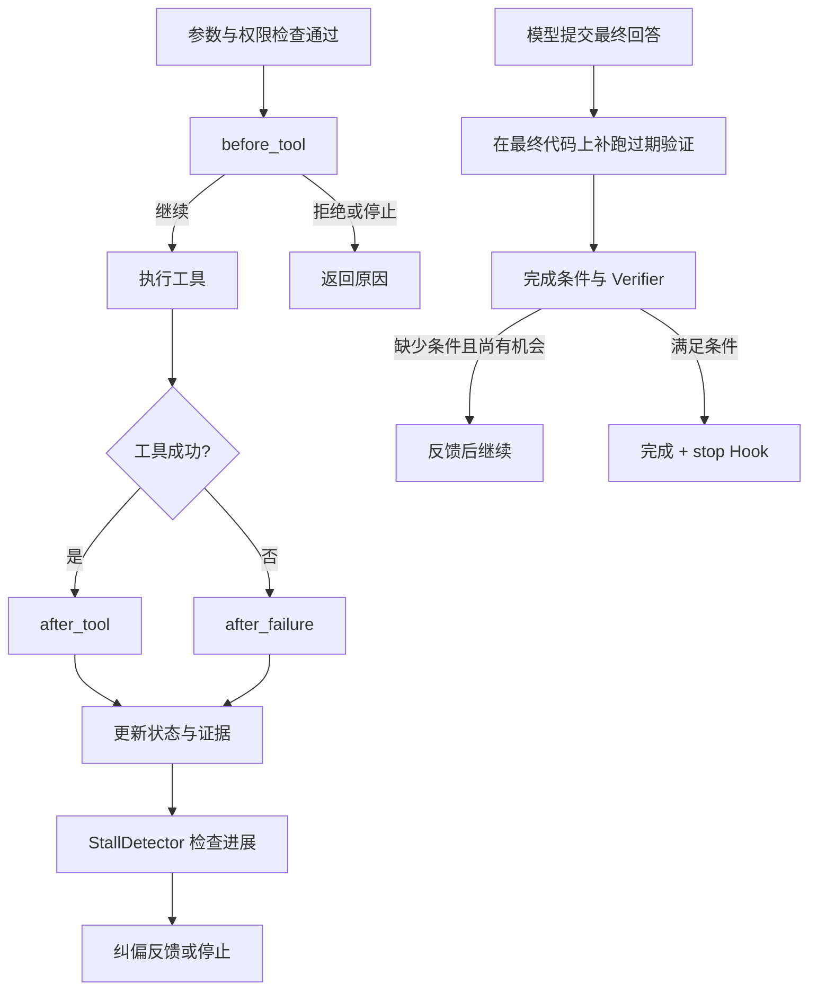

# 08 · Hooks 与运行纠偏：让执行和交付都有反馈

> 一句话：Hooks 加入局部规则，停滞检测提示换路，完成检查核对本次交付的要求。

上一章：[上下文归档](07-context-archives.md) · [目录](README.md) · 下一章：[检查点恢复](09-checkpoint-resume.md)

## 主循环之外，还要检查什么

Agent 连续读取同一个文件，再宣布“已修复”，协议上可能完全正常。要解释这种运行，需要分别看动作是否合规、执行是否有进展、交付条件是否满足。Aster 在现有生命周期中安排了三个入口：



## Hooks：四个可选方法

[Hooks](../../src/aster/core/hooks.py) 接收普通 Python 对象，插件只需实现用到的方法。`HookResult` 包含 `action`、`feedback` 和 `metadata`，执行动作由 `continue`、`deny`、`stop` 表达。

| 回调 | 时机 | 用途 |
|---|---|---|
| `before_tool(state, call)` | 参数与权限检查通过，执行前 | 添加业务约束 |
| `after_tool(state, call, outcome)` | 处理器返回成功后 | 提供下一轮提示 |
| `after_failure(state, call, outcome)` | 处理器返回非成功结果后 | 提供补救建议 |
| `stop(state)` | 正式完成或停止时 | 收尾通知 |

执行前检查直接返回的结果进入运行记录，执行后回调只处理真正进入工具处理器的调用。前置 Hook 异常转为拒绝；后置异常转为 `hook_error` 反馈，已产生的动作保留在结果中。插件运行在宿主 Python 进程内，适合接入受信任的业务规则。

## 停滞检查：动作与结果一起比较

[StallDetector](../../src/aster/core/recovery.py) 在小窗口内记录工具名、参数摘要和结果摘要。文件内容变了，同样的读取就得到不同结果；出现 `changed_paths` 时清空旧窗口。

| 原因 | 检查形态 |
|---|---|
| `repeated_identical` | 连续两次动作、结果都相同 |
| `oscillation` | 最近四次是 A、B、A、B，两个动作不同 |
| `output_loop` | 最近三次结果相同，且当前结果失败 |

检测到停滞后，在 `max_recovery` 次额度内清空窗口并提示换方法；额度耗尽后以 `stall_recovery_exhausted` 停止。`max_recovery=0` 表示首次检测就停止。这个启发式识别重复模式，具体下一步仍由模型选择。

## 完成条件怎样确定

`TaskSpec` 的 `require_observation`、`require_edit`、`require_verification` 分别要求观察、改动与有效验证。显式值优先；未设置时由 [Verifier.infer()](../../src/aster/core/verifier.py) 从请求推断。`final()` 还检查需验收的待办和指定产物。

2026-10-20（`476f09f`）修正了请求推断：英文按整词匹配，`dispatch` 中的 `patch`、`suffix` 中的 `fix` 均是普通文本；“是怎么实现的”归为提问。“不要修改代码”约束工作区操作，“实现算法但不要修改原始数据”约束解法性质，两者分别处理。示例与回归见 [test_requirement_inference.py](../../tests/test_requirement_inference.py)。

| `completion` | 条件不足时 | 最终状态 |
|---|---|---|
| `strict`（默认） | 最多要求补做 `max_final_revisions` 次，默认 2 | 仍不足则 `completion_requirements_failed` |
| `warn` / `soft` | 同样有限补做 | 可按 `completed_with_warning` 交付 |
| `off` | 跳过补做反馈 | 仍计算结果：满足条件为 `verified`，否则带警告 |

评测脚本通常显式要求每题修改并验证，产品默认按提示推断；比较设置时，要把这两个层次一起记录。

## 失败如何保留，又如何消除

先跑整个模块发现 `test_old_api` 失败，再单跑新用例通过，旧失败仍需处理。`verification_failures` 跨编辑、继续任务和 checkpoint 恢复保留，按证据来源消除：

| 证据来源 | 失败怎样保存 | 后续怎样确认 |
|---|---|---|
| pytest、unittest、Jest、go test 等逐用例报告 | 用例 ID → 命令 | 同一用例重新通过 |
| Node `--test`、SymPy 原生报告 | 按原命令聚合 | 原命令重新成功 |
| 项目构建加测试命令的退出码 | 仅设置当前验证为 `failed` | 后续有效验证可更新状态 |
| 共用 `InlineScript::test_script` 的断言脚本 | 同上 | 同上 |

关键在于能否识别“同一个检查”。具名用例可以持续跟踪；退出码和共享脚本编号只能描述这次执行，硬把它们记为待清除的失败，会让已经改用正确测试入口的任务卡在旧命令上。2026-10-18 的 `68d69d3`、`edd563d` 据此调整规则，见 [harness-v13.md](../harness-v13.md) 第 4、8 节。

正式验证有两个入口：`run_tests`，以及 `run_shell` 中识别出的测试命令。2026-10-09 的旧教程曾写“Shell 成功不更新正式验证”；2026-10-18（`1fec769`）起两者共用 [testing.py](../../src/aster/tools/testing.py)，省去换工具再跑一次的往返。项目命令接受普通命令的 `&&` 链；风格检查单独运行不算行为测试。`run_tests` 还接受 `code`、`python -c` 与 heredoc 形式的断言脚本。

测试在一次性副本中运行。新建的构建产物、缓存和不发布的文件随副本清理；改写或删除已有文件会使本次运行受阻，失败记录继续保留，通过结果则不用于清除旧失败。相应修复见 `68ea98f` 和 [test_command_tests.py](../../tests/test_command_tests.py)。

只因禁网而失败的测试按运行时证据归入 `environment_failures`，最终列为未验证。分类需要真实网络调用帧及网络不可达、解析失败等条件；连接被拒可能是任务要求的服务未启动，仍按普通失败处理。

## 既有失败与最终代码复跑

测试在原始代码上也失败，可能是环境问题，也可能正是本次任务要修的问题。v11 曾让模型声明既有失败，2026-10-17 撤回；当前把基线证据采集与交付条件分开，见 [harness-v12.md](../harness-v12.md) 第 5 节。

1. 遇到新失败用例，运行时在恢复为任务初始文本的副本上复跑同一命令。`failure_signature()` 提取异常并归一化内存地址、临时路径；退出码与临时 `code` 测试不走这条基线比较。
2. 相同签名写入 `preexisting_failures`，绑定被测工作区指纹，先反馈给模型处理。
3. 只有任务已有改动、完成检查反馈过至少一次，而且最终代码上的失败签名仍相同时，才作为既有失败列入结果、停止阻塞交付。

后续编辑会使旧证据过期。模型准备给最终文本时，`recheck_preexisting()` 自动重跑过期的既有失败；最后一次通过命令因收尾编辑失效时，也由运行时补跑。这样保留最终代码检查，同时省去让模型再发一次相同测试命令的往返。回归入口是 [test_preexisting_failures.py](../../tests/test_preexisting_failures.py)。

待解决项通过 `[Context update]` 便笺告诉模型；完整记录留在状态与 trace。测试通过时附带本次短 diff 或改动摘要，帮助模型直接整理交付。

## 完成检查的实测作用

[2026-10-20 对照报告](../../evaluations/acceptance-ablation-20261020/REPORT.md)在 GPT × fresh30b 上比较严格评测设置、产品默认和关闭三组。fresh30b 已用于分析轨迹，此轮按开发集对照解释；严格组复用较早运行，供应商故障按预定规则共同剔除。

| 共同可比的 14 题 | 严格评测设置 | 产品默认 | 关闭 |
|---|---:|---:|---:|
| 独立通过 | 13 | 13 | 13 |
| 请求数 | 123 | 105 | 119 |
| 已知费用估算（美元等价） | 0.683 | 0.645 | 0.687 |

补做次数在三组可读取终态中分别为 3、4、0，没有救回任务。关闭组 30 题中有 8 题以 `provider_error` 结束，其余 22 题有 19 题为 `verified`、3 题带警告交付；终态分布可由 [comparison.json](../../evaluations/acceptance-ablation-20261020/comparison.json)复算。强模型大多自行满足了当前交付条件。

共同题目中，关闭组比默认多 13.3% 请求、已知费用高 6.5%；全表成本下降的约 61.4% 来自压缩器一题因供应商故障提前结束。因此本轮没有测出检查带来的质量收益，也没有测出关闭它的成本收益。产品保留默认设置，作为低成本的保险并标明未满足的完成条件；弱模型是否更受益，仍待验证。

更早的[2026-10-09 自动补丁复核实验](../../evaluations/swebench-review-20261009/REPORT.md)也未提高十题子集的通过数，最终移除了自动追加复核。这两次实验说明，是否值得多加一步检查，应看它实际改变了哪些任务的结果。

## 离线实验：三个机制分别做了什么

激活 `aster` 环境，将代码保存为 `/tmp/aster_lesson08.py`，运行 `python /tmp/aster_lesson08.py`。
实验直接提交动作，依次观察 Hook、完成检查与停滞反馈。

```python
# 可运行实验
import asyncio
import tempfile
from pathlib import Path

from aster.config import Settings
from aster.core.hooks import HookResult, Hooks
from aster.core.runtime import Runtime
from aster.schema import TaskSpec, ToolCall


class LocalRule:
    def __init__(self):
        self.stops = 0

    def before_tool(self, state, call):
        if call.arguments.get("path") == "private.txt":
            return HookResult("deny", "lesson_private_file")
        return HookResult()

    def after_tool(self, state, call, outcome):
        return HookResult(feedback="已经获得观察结果，请据此回答。")

    def stop(self, state):
        self.stops += 1
        return HookResult()


async def main():
    with tempfile.TemporaryDirectory() as directory:
        root = Path(directory)
        (root / "note.txt").write_text("answer = 42", encoding="utf-8")
        rule = LocalRule()
        runtime = Runtime(root, Settings(approval="auto"), hooks=Hooks([rule]))
        runtime.start(TaskSpec(
            prompt="查看 note.txt", require_observation=True,
            require_edit=False, require_verification=False,
        ))
        runtime.finalize("还没有读，但我认为完成了")
        print("提前收尾:", runtime.state.phase, runtime.state.final_revisions)
        assert runtime.state.phase == "running"

        denied = await runtime.step(
            ToolCall(name="read_file", arguments={"path": "private.txt"})
        )
        print("局部规则:", denied.status, denied.reason)
        assert denied.reason == "lesson_private_file"
        await runtime.step(ToolCall(name="read_file", arguments={"path": "note.txt"}))
        assert any("已经获得观察结果" in x["content"] for x in runtime.state.messages)
        runtime.finalize("note.txt 中的 answer 是 42。")
        print("观察后收尾:", runtime.state.phase, "stop 次数:", rule.stops)
        assert runtime.state.phase == "completed" and rule.stops == 1

        stalled = Runtime(root, Settings(approval="auto", max_recovery=1))
        stalled.start(TaskSpec(prompt="演示重复观察"))
        for index in range(4):
            await stalled.step(ToolCall(name="read_file", arguments={"path": "note.txt"}))
            if index == 1:
                print("首次重复:", stalled.state.phase, "repeated_identical" in stalled.state.feedback)
        print("再次重复:", stalled.state.stop_reason)
        assert stalled.state.stop_reason == "stall_recovery_exhausted"


asyncio.run(main())
```

预期输出：

```text
提前收尾: running 1
局部规则: blocked lesson_private_file
观察后收尾: completed stop 次数: 1
首次重复: running True
再次重复: stall_recovery_exhausted
```

## 离线实验二：有身份与匿名的验证证据

在支持 Landlock/seccomp 的 Linux 环境中运行。先通过 Shell 运行 pytest，再比较项目命令与内联脚本的失败记录。

```python
# 可运行实验
import asyncio
import tempfile
from pathlib import Path

from aster.config import Settings
from aster.core.runtime import Runtime
from aster.schema import TaskSpec, ToolCall


def start(root):
    (root / "app.py").write_text("VALUE = 0\n")
    (root / "test_value.py").write_text("from app import VALUE\n\ndef test_value():\n    assert VALUE == 1\n")
    (root / "test_other.py").write_text("def test_other():\n    assert True\n")
    (root / "check_tests.sh").write_text("test -f ok.txt\n")  # 项目自带的测试命令，只看退出码
    runtime = Runtime(root, Settings(approval="auto", memory_enabled=False, sandbox="required"),
                      approval_callback=lambda *_: True)
    runtime.start(TaskSpec(prompt="Fix VALUE", require_verification=True))
    return runtime


async def tool(runtime, name, **arguments):
    return await runtime.step(ToolCall(name=name, arguments=arguments))


async def main():
    with tempfile.TemporaryDirectory() as directory:
        runtime = start(Path(directory))
        state = runtime.state
        shell = await tool(runtime, "run_shell", command="echo hello")
        print("普通 shell 命令:", shell.status, "验证状态", state.verification.state)
        shell = await tool(runtime, "run_shell", command="python -m pytest -q test_value.py 2>&1 | tail -5")
        print("run_shell 里的 pytest:", shell.reason, "是正式验证", shell.data.get("shell_verification"))
        print("具名用例失败留下的义务:", sorted(state.verification_failures))
        await tool(runtime, "run_tests", command="python -m pytest -q test_other.py")
        print("  另一个测试通过后验证状态:", state.verification.state)

    with tempfile.TemporaryDirectory() as directory:
        root = Path(directory)
        runtime = start(root)
        state = runtime.state
        await tool(runtime, "run_tests", command="sh check_tests.sh")
        print("退出码失败留下的义务:", sorted(state.verification_failures), "验证状态", state.verification.state)
        script = 'python -c "from app import VALUE; assert VALUE == 1, VALUE"'
        await tool(runtime, "run_tests", command=script)
        print("断言脚本失败留下的义务:", sorted(state.verification_failures), "验证状态", state.verification.state)
        (root / "app.py").write_text("VALUE = 1\n")
        (root / "ok.txt").write_text("ok\n")
        await tool(runtime, "run_tests", command="sh check_tests.sh")
        print("修复后再跑一条项目测试命令:", state.verification.state)


asyncio.run(main())
```

预期输出：

```text
普通 shell 命令: success 验证状态 missing
run_shell 里的 pytest: tests_failed 是正式验证 True
具名用例失败留下的义务: ['pytest: test_value::test_value']
  另一个测试通过后验证状态: failed
退出码失败留下的义务: [] 验证状态 failed
断言脚本失败留下的义务: [] 验证状态 failed
修复后再跑一条项目测试命令: passed
```

## 练习与核对

1. 删除 `LocalRule.after_tool` 后，停滞检测与完成检查还会运行吗？
2. 把 `max_recovery` 改为 0，实验一何时停止？
3. 为什么另一条测试通过，不能清除 `test_value` 的失败？
4. 既有失败停止阻塞交付前需要哪些条件？
5. 完成检查的对照实验支持怎样的产品判断？

<details>
<summary>参考答案</summary>

1. 会。Hook 方法可选，停滞与完成检查是独立机制；删去对应反馈断言即可。
2. 第二次相同读取触发停滞后停止。
3. 失败绑定真实用例身份，需要同一用例重新通过；退出码与匿名脚本则只更新本次验证状态。
4. 任务已有改动、检查反馈过至少一次、失败在当前代码上仍与原始代码签名相同。
5. 共同可比题目的质量相同，关闭也未省钱；保留默认检查用于完成反馈与状态标注，弱模型收益另测。

</details>

下一章讨论进程中断后的恢复：如何把这些状态和证据接续起来。
