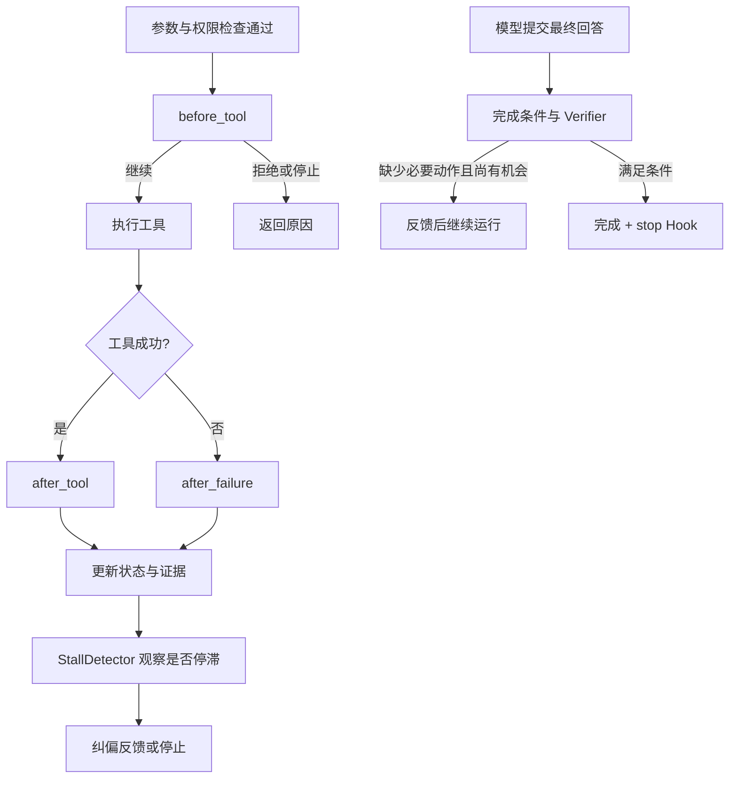

# 08 · Hooks 与运行纠偏：让错误动作和过早收尾有反馈

> 一句话：Harness 可以拒绝动作、指出停滞和检查收尾，但下一步怎么解决问题仍要由决策者选择。

上一章：[上下文归档](07-context-archives.md) · [目录](README.md) · 下一章：[检查点恢复](09-checkpoint-resume.md)

## 为什么主循环能运行，还需要这些机制

一个 Agent 连续读取同一个没有变化的文件，然后宣布“已经修好了”，但它一次也没有修改文件。
主循环的协议可能完全正确：每个调用都有结果，API 没有报错，最后还有一段通顺的回答。
任务却并未完成。

Aster 没有为此增加一套独立编排框架，而是在已有生命周期里放置三个不同的检查点：
Hooks 用于注入局部规则，`StallDetector` 识别重复无进展，完成检查阻止缺少必要证据的收尾。
它们协作，但不能笼统地都称为“Hooks”。



## Hooks 是四个可选方法

打开 [hooks.py](../../src/aster/core/hooks.py)。插件是一个普通 Python 对象，只实现需要的方法即可，没有必须继承的基类。
`Hooks([plugin])` 将它接入 Runtime；默认 `Hooks()` 不会凭空执行任何业务插件。

| 回调 | 调用时机 | 常见用途 |
|---|---|---|
| `before_tool(state, call)` | 参数、能力和权限检查通过之后，工具执行之前 | 拒绝额外的业务禁区 |
| `after_tool(state, call, outcome)` | 工具处理器返回成功之后 | 加入下一轮需要看到的提示 |
| `after_failure(state, call, outcome)` | 工具处理器返回非成功结果之后 | 对失败提供明确的补救建议 |
| `stop(state)` | 正式完成或停止时 | 一次性的收尾通知 |

注意 `after_failure` 不是捕获所有拒绝的全局异常处理器。
参数、权限、新鲜读取等执行前检查直接返回时，还没有进入这对执行后回调；最终结果仍会进入 Runtime 的执行记录。

返回值是源码中的小数据类：

```python
@dataclass(frozen=True)
class HookResult:
    action: str = "continue"
    feedback: str = ""
    metadata: dict = field(default_factory=dict)
```

`action="deny"` 在执行前拒绝当前动作，`"stop"` 请求停止，`"continue"` 继续。
执行后的 `feedback` 会作为重要反馈加入后续上下文；执行前 `deny` 的反馈则作为拒绝原因返回。
`metadata` 是插件结果的附加字典，聚合器会合并它，但当前 Runtime 没有把它当作通用状态更新协议，不能指望随便写一个字段就改变运行。

前置 Hook 抛异常时，`_safe()` 返回 `deny`，不能因为规则执行失败反而放行。
后置 Hook 出错会产生 `hook_error:...` 反馈；已完成的工具副作用不会因此被自动撤销。
这些 Hook 是受信任的宿主 Python 代码，不是给不可信插件提供的安全隔离容器。

## 停滞检查比较的是动作和结果

[recovery.py](../../src/aster/core/recovery.py) 中的 `StallDetector.observe()` 保存一个小窗口。
每个记录由工具名、参数摘要、结果摘要构成；结果摘要包括 `status`、`reason`、`content`。
所以同一个文件读取两次，如果内容真的变了，不会被当成相同结果。

| 原因 | 检查形态 | 例子 |
|---|---|---|
| `repeated_identical` | 连续两次相同动作、相同结果 | 一直读未变化的同一文件 |
| `oscillation` | 最近四次是 A、B、A、B，A 与 B 的动作不同 | 在两个相同失败策略间往返 |
| `output_loop` | 最近三次结果相同，且当前是失败 | 更换参数却始终得到同一种失败 |

如果工具报告了 `changed_paths`，检测器清空旧窗口，因为出现了可观察的文件进展。
这些规则是轻量启发式，并不理解任务的全部语义；确有必要的重复读取也可能触发提醒。

检测发生在 Runtime 更新状态后。还有 `max_recovery` 次机会时，Runtime 清空检测窗口，加入重要提示：

```text
Recovery required (repeated_identical). Change approach and use fresh evidence.
```

用完机会后仍重复，就以 `stall_recovery_exhausted` 停止。
`max_recovery=0` 表示检测到停滞就停止，并不是关闭检测器。
这里由 Harness 识别问题并给出反馈；它没有在后台替模型写好下一步补丁。

## “我要结束了”仍需检查条件

`TaskSpec` 可以要求 `require_observation`、`require_edit`、`require_verification`，分别对应观察过仓库、产生过改动、存在有效验证结果。
`completion_feedback()` 检查这些必要条件；`Runtime.finalize()` 负责反馈、次数限制和最终决策。
正式 `Verifier` 还会检查任务要求的产物等细节，参见 [verifier.py](../../src/aster/core/verifier.py)。

`max_final_revisions` 控制缺少条件时最多退回多少次。默认是 2 次，不是无限反思。
`completion="strict"` 在最终检查不通过时停止；`warn` 和 `soft` 当前走相同的宽松分支，重试后可带警告结束。
`off` 不发起补做提示，但仍计算并记录最终验证结果；它不意味着“从此一律有验证成功证据”。

`run_shell` 成功只表示这条命令返回成功，不会更新正式验证证据；需要通过 `run_tests` 生成结构化、绑定当前工作区的正式检查。正式检查通过也不等于教程语义已经正确，更不等于隐藏测试或外部产品验收通过。运行完成检查也不等同于隐藏测试：它只证明当前任务的运行要求。

## 离线实验：三个机制分别做了什么

激活 `aster` 环境，将代码保存为 `/tmp/aster_lesson08.py`，运行 `python /tmp/aster_lesson08.py`。
本实验直接提交动作，目的是看见确定的控制行为，没有模拟“模型自主发现问题”的成绩。

```python
# 可运行实验
import asyncio
import tempfile
from pathlib import Path

from aster.config import Settings
from aster.core.hooks import HookResult, Hooks
from aster.core.runtime import Runtime
from aster.schema import TaskSpec, ToolCall


class LocalRule:
    def __init__(self):
        self.stops = 0

    def before_tool(self, state, call):
        if call.arguments.get("path") == "private.txt":
            return HookResult("deny", "lesson_private_file")
        return HookResult()

    def after_tool(self, state, call, outcome):
        return HookResult(feedback="已经获得观察结果，请据此回答。")

    def stop(self, state):
        self.stops += 1
        return HookResult()


async def main():
    with tempfile.TemporaryDirectory() as directory:
        root = Path(directory)
        (root / "note.txt").write_text("answer = 42", encoding="utf-8")
        rule = LocalRule()
        runtime = Runtime(root, Settings(approval="auto"), hooks=Hooks([rule]))
        runtime.start(TaskSpec(
            prompt="查看 note.txt", require_observation=True,
            require_edit=False, require_verification=False,
        ))
        runtime.finalize("还没有读，但我认为完成了")
        print("提前收尾:", runtime.state.phase, runtime.state.final_revisions)
        assert runtime.state.phase == "running"

        denied = await runtime.step(
            ToolCall(name="read_file", arguments={"path": "private.txt"})
        )
        print("局部规则:", denied.status, denied.reason)
        assert denied.reason == "lesson_private_file"
        await runtime.step(ToolCall(name="read_file", arguments={"path": "note.txt"}))
        assert any("已经获得观察结果" in x["content"] for x in runtime.state.messages)
        runtime.finalize("note.txt 中的 answer 是 42。")
        print("观察后收尾:", runtime.state.phase, "stop 次数:", rule.stops)
        assert runtime.state.phase == "completed" and rule.stops == 1

        stalled = Runtime(root, Settings(approval="auto", max_recovery=1))
        stalled.start(TaskSpec(prompt="演示重复观察"))
        for index in range(4):
            await stalled.step(ToolCall(name="read_file", arguments={"path": "note.txt"}))
            if index == 1:
                print("首次重复:", stalled.state.phase, "repeated_identical" in stalled.state.feedback)
        print("再次重复:", stalled.state.stop_reason)
        assert stalled.state.stop_reason == "stall_recovery_exhausted"


asyncio.run(main())
```

预期输出：

```text
提前收尾: running 1
局部规则: blocked lesson_private_file
观察后收尾: completed stop 次数: 1
首次重复: running True
再次重复: stall_recovery_exhausted
```

## 练习与核对

1. 删除 `LocalRule` 的 `after_tool` 方法，其他三个能力还能运行吗？
2. 把 `max_recovery` 改成 0，运行何时结束？
3. 规则回放中开关纠偏后结果不同，能否直接写成“模型自主改错率提高”？

<details>
<summary>参考答案</summary>

1. 能。方法是可选的；需要删除实验中对应反馈的断言。插件既不实现停滞检测，也不实现最终完成检查。
2. 第二次相同读取触发检测后结束，后续调用返回 `run_terminal`。
3. 不能。规则回放证明检测、反馈和停止机制按约定运行；真实模型能否利用反馈，需要保持任务与条件一致的模型对照实验。

</details>

本章的控制思路类似 claw0 将不同失败交给不同层处理：先说清是哪类问题，再限定恢复动作和次数。
Aster 没有照搬它的密钥轮换或摘要模型，而是保留与当前轻量 Harness 相关的有限恢复机制。
下一章讨论另一种“恢复”：进程中断后，如何从磁盘状态继续任务。
