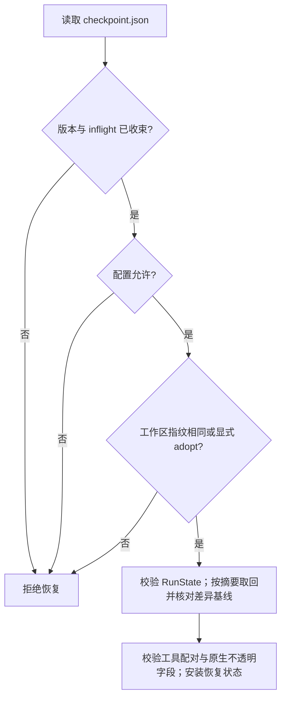

# 09｜检查点与恢复：继续一个任务之前先确认世界没变

[上一章：Hooks 与任务完成](08-hooks-and-completion.md) · [学习目录](README.md) · [下一章：分层记忆](10-layered-memory.md)

> 恢复的不只是聊天内容，还有“做到哪里、依据是什么、哪些动作不能再做一次”。

本章接着第 05 章的运行状态和第 07 章的落盘证据，解释如何恢复一次任务。
读完之后，你应该能说清检查点保存了什么、什么时候允许保存，
以及为什么有时正确的恢复行为是拒绝继续。

## 为什么只存 messages 不够

假设 Agent 已经读过 `app.py`，修改了两个文件，并且测试通过。
此时进程退出。如果只恢复聊天文本，新的 Runtime 不知道测试对应哪版文件、
已经消耗了多少步、还有哪些待办，更不知道某次写入是否已经执行过。

即使恢复了这些字段，工作区也可能在重启前被用户改过。
如果还拿旧测试结果证明新代码正确，就把恢复做成了误信旧状态。
Aster 因而把任务状态、原生协议历史、运行配置和工作区指纹绑定在一个检查点里。

## 一次恢复的检查顺序



`Runtime.resume()` 委托 [sessions.checkpoint.load_checkpoint()](../../src/aster/sessions/checkpoint.py)。真实入口首先加载并验证 checkpoint：

```python
saved = load_checkpoint(
    self.evidence,
    self.workspace,
    self.settings,
    run_id,
    allow_model_change=allow_model_change,
    adopt_workspace=adopt_workspace,
)
```

这是入口节选，不是完整恢复函数。`load_checkpoint` 返回后，`Runtime.resume` 会在检测到模型身份变化时委托 [prepare_model_history](../../src/aster/sessions/lifecycle.py) 对已保存历史执行 `canonicalize`，再运行 `_preview_context` 做新预算的上下文预检，并归档原生历史；通过这些校验后才安装转换后的历史和恢复状态。它还会完成工具配对、归档来源、skill 脱敏和工作区等检查。这里先验证再安装状态，避免失败时安装一半状态。
`allow_model_change=True` 只允许显式模型/协议转换：模型上下文预算和输出预算可以随新模型配置改变，但随后必须通过新预算的上下文预检；任务的 `steps`/`turns` 计数不会因此重置，安全/能力设置（以及该集合之外的运行设置）不能借此改变。`adopt_workspace=True` 才接受外部编辑，并要求重新读取/验证；它也不能绕过 inflight 工具副作用检查。两个标志都必须由调用者显式传入，不能靠更换 profile 偷换安全边界。
另外，当前 Runtime 若正在执行操作、有运行中的 worker，或者已有未结束任务，
不能直接覆盖成另一个运行；教学实验会使用一个新 Runtime 对象代表进程重启。

## 检查点里的每组字段负责什么

完整结构在 [save_checkpoint()](../../src/aster/sessions/checkpoint.py)（由 `Runtime._checkpoint()` 调用），
本章把容易混淆的字段按用途展开：

| 字段 | 保存的内容 | 少了它会怎样 |
|---|---|---|
| `state` | `RunState`：任务、阶段、计数、待办、验证、工作记忆等 | 只能靠聊天猜当前进度 |
| `structured_history` | provider 的原生历史和完整工具交互；保存的是完整记录，模型看到的纯文本视图由 [view.py](../../src/aster/context/view.py) 在组装请求时才渲染 | 工具结果可能失去调用；模型续接状态可能损坏 |
| `workspace_hash` | 当前受管理文件快照的整体指纹 | 无法判断恢复时工作区是否已经变化 |
| `workspace` | 路径到文件指纹的映射 | 少了用于分析差异的具体快照；恢复准入用整体 hash |
| `runtime_identity` | 不含密钥与 Base URL 的有效配置 | 权限、模型或预算变化可能被静默忽略 |
| `baseline` | 任务开始时文本与权限位基线（`initial_text`、`initial_modes`）的内容摘要；正文存在同一运行目录的 `baseline-<sha>.json` | 重启后的 diff 可能漏掉重启前的修改；第 08 章还用它还原“原始代码” |
| `recovery_used`、`stall_items` | 已使用纠偏次数与停滞检测窗口 | 重启可能重置纠偏预算，重复绕过限制 |

`state` 内还有几个恢复时特别重要的字段：

| `RunState` 字段 | 含义 |
|---|---|
| `step` / `turn` | 已执行工具步骤数 / 决策轮数；自主运行数模型请求，外部策略接口数策略动作；`resume` 加载后保留，不清零；`continue_task`/`prepare_continuation` 建立新 run 时从新边界重新计数 |
| `working_memory` | 本次运行的短期记忆，包括已读文件的简要信息 |
| `read_evidence` | 路径对应最近读取内容的指纹，用于新鲜度判断 |
| `used_call_ids` | 已经执行的调用标识，阻止相同 ID 被再次执行 |
| `verification` | 测试状态及其对应的工作区指纹和证据 |
| `verification_failures`、`preexisting_failures`、`baseline_signatures`、`last_passed_command` | 未解决的失败、与原始代码相同的既有失败（钉在被测的工作区指纹上）、已在原始代码上核对过的失败签名、最后一次通过的测试命令；恢复后继续生效，见第 08 章 |
| `loaded_tools`、`active_skills` | 已加载工具及技能身份；后续请求据此重建展示 |

工作记忆属于 `RunState`，没有第二套需要手动同步的 working memory。
关闭跨运行记忆 `memory_enabled=False`，也不会让这份任务状态消失。

`baseline` 只是一个摘要，原因在体积。任务开始时的全部文本与权限位在整个运行中不变，却可能很大（SymPy 仓库约 36 MB）；早先每个 checkpoint 都把它重新脱敏、写盘，再打包进会话快照；在 35 MB 的合成仓库上做性能分析，脱敏和会话提交分别花了 42 秒和 48 秒（[设计说明](../harness-v12.md)第 2 节）。现在 `save_baseline()` 把它按内容寻址只存一次，到 `runs/<run_id>/baseline-<sha>.json`；checkpoint v3 只带这个摘要，`load_baseline()` 读取时重新计算摘要，对不上就以 `checkpoint_baseline_digest_mismatch` 拒绝恢复。版本 1、2 的检查点把基线内联保存，仍可恢复。基线放在运行目录里，复制 `runs/<run_id>` 仍得到一个完整的单元。

## 工作区指纹检查到了什么

[Workspace.snapshot()](../../src/aster/storage/workspace.py) 遍历受管理文件，
对**文件权限位与内容**一起计算指纹，再由 `fingerprint()` 聚合路径映射。
文件新增、删除、内容改动、权限位改动都可能改变整体结果。

这是 Aster 自己的文件视图，不是对整台机器做磁盘快照。
`.aster`、`.git` 等受保护目录、依赖缓存和敏感路径不会被纳入普通工作区扫描。
所以仅仅新增 trace 行不会导致下一次恢复失败，环境变量和系统服务状态也不在检查范围内。

每个 checkpoint 都要算一次指纹，而早先每次都对整个仓库做两遍完整哈希（`snapshot` 和 `fingerprint`）：在 35 MB 合成仓库的性能分析里，这两项占了 140 秒中的 72 秒（[设计说明](../harness-v12.md)第 2 节）。现在 `snapshot()` 像 git index 那样复用摘要：文件的 `(mode, size, mtime_ns, ctime_ns, inode, dev)` 没变，就沿用上次的内容摘要，只重算变了的文件；checkpoint 也直接用刚算好的快照聚合指纹，不再算第二遍。遍历本身同样改成一次 `scandir`，忽略状态沿目录树继承，不再对每个文件逐级构造父路径来判断是否被 git 忽略。

复用的前提是 stat 信息真的代表内容，这里有一个陷阱：时间戳精度有限，同一个时间刻度里先后写两次，stat 看起来没有变化。所以最近 3 秒内（`RACY_WINDOW_NS`）改动过的文件永远不进缓存，每次重新哈希，这与 git 对待 “racy” 文件的思路相同。同样大小的改写即使用 `os.utime` 把 `mtime` 改了回去，`ctime` 也回不去，仍会被发现。这两条规则让提速没有削弱“工作区漂移必须被发现”这个恢复前提，对应的回归测试见 [test_harness_overhead.py](../../tests/test_harness_overhead.py)。

配置指纹也有类似边界。`Settings.identity()` 排除了 `api_key`、`base_url`，
并把自动预算解析成有效值；更换密钥不等于任务语义变化。它还排除了 `background_maintenance`、`oneshot_maintenance_seconds`：后台记忆整理何时启动是进程生命周期的选择，不是任务边界。后来新增的 `circuit_failures`、`circuit_cooldown`、`workflow_notes` 取默认值时也不写进 identity，没有这些字段的旧检查点因此仍然匹配。
默认情况下模型、协议、权限、沙箱或运行设置变化会触发拒绝；显式 `allow_model_change=True` 只为模型相关变化开启可移植历史转换。模型上下文预算和输出预算属于模型身份的一部分，可以随显式模型切换改变，但恢复会用新预算重新进行上下文预检；任务的 `steps`/`turns` 计数与安全/能力设置不会因此被重置或放宽。工作区漂移默认拒绝，只有显式 `adopt_workspace=True` 才能采用外部修改，并要求重新读取和验证；这不是自动合并。
Base URL 不参与一致性比较，因此恢复检查不是服务提供商身份认证。

## 什么时候写：完整交互的边界

不能在“调用已经写进历史，结果还没回来”的瞬间保存可恢复检查点。
[Runtime.checkpoint()](../../src/aster/core/runtime.py) 开头有保护条件，通过后才进入真正的 `_checkpoint()`：

```python
def checkpoint(self):
    if not self.state or self._in_turn or self._snapshot_sources is not None:
        return
    with self._timed("checkpoint"):
        self._checkpoint()
```

`_in_turn` 表示正在处理工具批次；此时先延迟写盘。
`_snapshot_sources` 非空，表示刚从会话树的某个历史位置载入、还没有续写成新的运行，也不写（见本章最后一节）。
`_checkpoint()` 一开始就调用 `history_groups(self._structured_history)` 校验历史，再计算快照和指纹。
在批次的 `finally` 中，若调用被取消而没有结果，Runtime 会补充
`status="cancelled"`、`reason="turn_interrupted"` 的结果，再校验和保存。
这个结果表示执行中断；工具可能已经产生副作用，恢复时还需核对执行记录与工作区。

第 02、06 章的调用/结果配对，在恢复这里仍然必须成立。
`history_groups()` 是复用的协议合同，不是为 checkpoint 再写一套宽松校验。

真正写盘由 [atomic_json()](../../src/aster/storage/evidence.py) 完成：
先在目标目录写临时文件，flush 后（默认还要 fsync）用 `os.replace()` 替换正式文件。
原子替换保护单个 JSON 文件的完整性，外部命令和工作区改动由各自的执行记录追踪。
`durable=False` 会跳过 fsync：重命名仍让进程崩溃时的读者只看到旧版本或新版本，但断电可能丢掉这次写入。哪些写入可以这样做，下一节回答。

## 写盘的代价：组提交，以及哪些写入不能省

一次任务要写几百个 checkpoint，而 fsync 并不便宜。2026-10-17 在任务容器里实测，overlayfs 上每次 fsync 要 88–225 ms（宿主机 1.4 ms），一个 checkpoint 触发好几次；真实运行中每次 checkpoint 约 1.08 秒、每个模型请求要做约 4 次 checkpoint，优化后每次约 124 ms（[设计说明](../harness-v12.md)第 2 节，[评测报告](../../evaluations/harness-v12-20261017/REPORT.md)第 4.1 节）。

于是 `Runtime._checkpoint()` 采用**组提交**：每个 checkpoint 仍然原子写入，但 fsync 至少间隔 `CHECKPOINT_SYNC_SECONDS`（5 秒）才做一次；Runtime 创建后的第一个 checkpoint 和任何终态则一定 fsync。会话库 `sessions.sqlite3` 也改为常驻一个连接（反复打开会在每次关闭时做一次 WAL checkpoint，也是一次 fsync），并使用 WAL 加 `synchronous=NORMAL`。语义因此分成两层：

- **进程退出**：已完成原子替换的检查点保持完整，SQLite 已提交事务保留在 WAL。
- **断电**：最近一组尚未 fsync 的进度可能丢失，恢复时用工作区指纹核对。5 秒是组提交间隔，终态仍强制同步。

恢复时再比较 `workspace_hash`。检查点与工作区若停在不同时间点，就提示采用当前文件并重新读取、验证；损坏的 JSON 在加载时报告错误。

放宽 fsync 的只有可以重建或追上的几类文件：checkpoint、请求快照和 `timings.json`。其余写入仍按默认逐次 fsync，其中有两类最关键，因为它们保护的不是“进度”，而是“不确定的副作用不会被重放”：

| 写入 | 作用 | 为什么不能丢 |
|---|---|---|
| `inflight.json` 在途标记 | 工具批次执行前写入，批次结束后删除 | 丢了它，崩溃后的恢复就看不出有一批调用可能已经生效，`assert_settled_tools` 无从拒绝 |
| 操作账本 `operations/<会话>/<键的哈希>.json`（[operations.py](../../src/aster/storage/operations.py)） | 写入或进程类工具（`write_file`、`run_shell`、`run_tests`，也包括 MCP 工具）执行前记 `pending`，结束后记 `settled` 和结果 | 用同一个幂等键再调用：已 `settled` 就回放当时的结果，不重新改文件，也不制造新的测试证据；仍是 `pending`（执行中进程崩溃、被取消、超时或结果不确定）就返回 `idempotency_uncertain`，拒绝再执行 |

`used_call_ids` 按调用 ID 去重；账本按**幂等键**（`idempotency_key`，缺省取调用 ID）去重，所以调用方换一个新的调用 ID 重试同一个操作也拦得住，并且它写在运行状态之外，不依赖 checkpoint 是否追上了现实。归档的工具输出、跨运行记忆（第 10 章）这类无法重建的内容，同样保持逐次 fsync。

trace 的追加是另一类开销：`emit()` 原来为取序号和哈希而重读整条 trace，流式事件很多时成了平方级。现在缓存每个 run 的尾部（文件大小、序号、哈希），文件大小对不上（说明有别的写者）才重读；1,500 次 emit 从 1.95 秒降到 0.09 秒。

这些优化用操作计数做回归检查：[test_harness_budget.py](../../tests/test_harness_budget.py) 用脚本化模型在 200 个文件的仓库里跑 16 步，统计哈希的字节数和 fsync 次数，不看时间，所以不受机器抖动影响；预算是仓库大小的 6 倍和每轮 4 次。在优化前的代码上，同样的脚本哈希了 136 MB、调用 fsync 137 次（[设计说明](../harness-v13.md)第 6 节）。

## 一个容易漏掉的细节：模型原生状态不能随意改字符

有些 provider 需要下一轮原样带回一段字符串；Harness 不解释它，称为“不透明字段”。
其中一段编码碰巧长得像密钥时，普通脱敏可能把它改坏，导致恢复后模型拒绝继续。
Aster 为检查点里的**明确协议位置**做保留，而不是放过所有同名字段。

| 协议位置 | 含义 | 保存要求 |
|---|---|---|
| Responses `reasoning.encrypted_content` | 服务端返回的加密推理状态 | 检查点原样保留 |
| Anthropic `thinking.signature` | thinking 块的签名 | 签名及其对应正文不能被静默改写 |
| Anthropic `redacted_thinking.data` | 服务端返回的不透明数据块 | 检查点原样保留 |

[EvidenceStore.save()](../../src/aster/storage/evidence.py) 默认仍然脱敏。
只有检查点调用 `preserve_native_history=True`，并且先调用
`validate_native_history()`：已出现 `[REDACTED]`、包含配置中已知凭据，
或签名 thinking 正文必须脱敏的记录会被拒绝。

工具结果里伪造一个 `signature` 字段不会获得这个例外。
请求审计副本与 trace 继续脱敏；恢复原生请求时使用保留协议字段的检查点历史。
这一设计属于协议续接正确性，不是让项目读取或解释模型私有推理。

## 动手：恢复进度，再故意制造两种漂移

将下面代码保存到 `/tmp/aster-checkpoint-lesson.py`，在完成安装的项目根目录运行：

```bash
conda run --no-capture-output -n aster python /tmp/aster-checkpoint-lesson.py
```

实验只用本地读取与待办工具。两个 Runtime 对象不共享 `state`，
第二个必须从 JSON 恢复；最后在临时目录改配置、改文件，验证默认拒绝分支；代码注释还会说明 `allow_model_change` 与 `adopt_workspace` 是显式入口，接受后仍必须做历史转换或 fresh read/验证。

```python
# 可运行实验
import asyncio
import json
from pathlib import Path
from tempfile import TemporaryDirectory

from aster.config import Settings
from aster.core.runtime import Runtime
from aster.schema import TaskSpec, ToolCall

async def main():
    with TemporaryDirectory(prefix="aster-resume-") as directory:
        root = Path(directory)
        path = root / "app.py"
        path.write_text("ANSWER = 42\n")
        settings = Settings(memory_enabled=False, approval="auto")
        first = Runtime(root, settings)
        first.start(TaskSpec(prompt="读取 app.py，记住之后还要解释 ANSWER。"))
        call = ToolCall(name="read_file", arguments={"path": "app.py"})
        assert (await first.step(call)).status == "success"
        assert (await first.step(ToolCall(
            name="todo_add", arguments={"content": "解释 ANSWER 的用途"},
        ))).status == "success"
        first.checkpoint()
        run_id = first.state.run_id
        checkpoint = first.evidence.path("runs", run_id, "checkpoint.json")
        saved = json.loads(checkpoint.read_text())
        # checkpoint v3 只带基线的摘要，基线正文按内容寻址存成同目录下的一个文件。
        baselines = list(checkpoint.parent.glob("baseline-*.json"))
        assert saved["checkpoint_version"] == 3 and "initial_text" not in saved and len(baselines) == 1
        print("检查点版本:", saved["checkpoint_version"], "基线文件:", len(baselines), "个")

        # 新对象代表重启后的进程，不共享 first.state。
        second = Runtime(root, settings)
        restored = second.resume(run_id)
        assert restored.step == 2 and restored.todos[0]["status"] == "pending"
        assert "app.py" in restored.working_memory
        assert second._structured_history == saved["structured_history"]  # 只读内部历史，观察恢复结果
        duplicate = await second.step(call)
        assert duplicate.reason == "duplicate_call_id"
        assert restored.step == 2
        print("恢复步数:", restored.step)
        print("待办:", restored.todos[0]["content"])
        print("重复调用:", duplicate.reason)

        changed_settings = Settings(memory_enabled=False, approval="auto", max_recovery=2)
        try:
            Runtime(root, changed_settings).resume(run_id)
        except ValueError as error:
            assert "runtime_identity_mismatch" in str(error)
            print("配置变化:", error)
        else:
            raise AssertionError("应拒绝不同运行边界")

        path.write_text("ANSWER = 99\n")
        # 默认拒绝工作区漂移；adopt_workspace=True 不是跳过 inflight 或验证。
        try:
            Runtime(root, settings).resume(run_id)
        except ValueError as error:
            assert "workspace_mismatch" in str(error)
            print("文件变化:", error)
        else:
            raise AssertionError("应拒绝旧工作区快照")

asyncio.run(main())
```

预期输出：

```text
检查点版本: 3 基线文件: 1 个
恢复步数: 2
待办: 解释 ANSWER 的用途
重复调用: duplicate_call_id
配置变化: runtime_identity_mismatch: max_recovery. Restore these explicit settings from the saved checkpoint; --allow-model-change permits only model settings, not safety or capability changes.
文件变化: workspace_mismatch
```

配置变化那一行列出了所有不一致的有效配置字段（这里只有 `max_recovery`），错误信息是英文原文。`allow_model_change=True` 只可用于模型相关的显式可移植转换；`adopt_workspace=True` 只接受外部编辑并要求重新读取/测试，不能重放未收束工具或 worker。

为什么重复调用检查要放在恢复之后？因为只在内存里维护“见过哪些 ID”不够，
重启一次就会丢掉。这个实验同时确认短期记忆、待办、原生历史和调用身份一起恢复。
副作用的重复执行由在途标记与操作账本另外处理。


## 练习与核对

1. 文件改动后又恢复原内容，能再次匹配检查点指纹吗？
2. 恢复 `phase="stopped"` 的检查点会自动继续吗？
3. 为什么在途标记要先于工具批次写入？
4. 增加 checkpoint 的 fsync 频率，会改变操作账本的重放规则吗？

<details>
<summary>参考答案</summary>

1. 文件集合、内容与权限位一致时可以匹配；指纹检查当前状态。
2. `resume()` 保留原阶段。要继续交互，需建立新的任务边界。
3. 先标记可能发生的动作，再执行并结算，崩溃恢复才有依据识别不确定副作用。
4. 操作账本与在途标记本就逐次同步；更频繁同步 checkpoint 改变的是进度持久化节奏。

</details>

## 恢复后的下一步

显式 `adopt_workspace` 接受当前文件并使旧读取、验证失效；它保留在途工具的结算检查。受控依赖环境按新进程重建，关联测试需要重跑。归档引用则在准备下一次请求时核对。各项检查都在回答同一个问题：保存的依据与当前执行环境是否仍一致。

对应合同检查见 [test_context_state.py](../../tests/test_context_state.py)、
[test_provider_events.py](../../tests/test_provider_events.py) 和
[test_runtime_repairs.py](../../tests/test_runtime_repairs.py)。
下一章把这里保存下来的 `working_memory` 放回完整记忆体系中讲清楚。

[上一章：Hooks 与任务完成](08-hooks-and-completion.md) · [学习目录](README.md) · [下一章：分层记忆](10-layered-memory.md)

## 会话树：历史路径与运行快照分开

会话包含多次用户请求，每次请求及处理是一次对话；存储节点则可以是消息、模型变更、压缩、分支摘要或恢复点。`RunState.turn` 仍是模型迭代数，不是用户对话数。

[`SessionTree`](../../src/aster/sessions/tree.py) 使用标准库 SQLite，以父指针保存不可变记录；对话编号只负责分组。恢复先沿选中位置的祖先路径重建历史，遇到压缩或模型转换记录就应用该处的替换历史，因此不会把兄弟分支混进请求。稳定工具批次边界的状态快照与记录一起提交；JSON checkpoint 继续导出并兼容旧数据。会话库保持一个常驻连接，使用 WAL 和 `synchronous=NORMAL`，原因见上文“写盘的代价”。

[`checkout`](../../src/aster/sessions/navigation.py) 先验证配置、工作区和未结算工具，再安装候选状态。它为选中历史创建新的运行 ID，并冻结允许读取的祖先观察，避免同一旧 run 后来产生的工具观察跨分支泄漏。副作用未知时仍拒绝恢复，不能通过会话树绕过。

树导航只恢复上下文和运行状态，不还原代码文件。`/tree` 可筛选稳定位置，`/branch ID --summary` 显式带入来源分支的摘录；摘录不是长期记忆，也不授权读取整个来源分支。操作与兼容边界见[会话使用说明](../sessions.md)。
