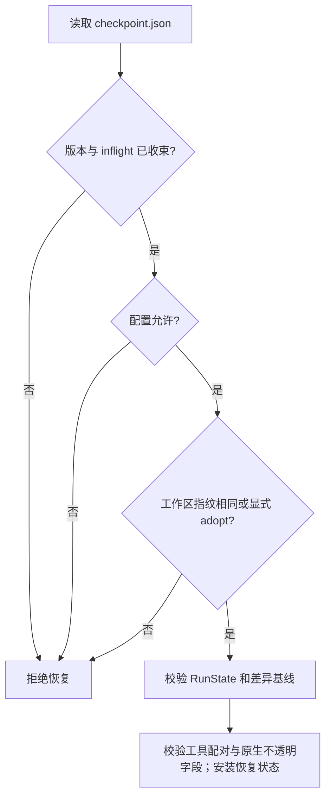

# 09｜检查点与恢复：继续一个任务之前先确认世界没变

[上一章：Hooks 与任务完成](08-hooks-and-completion.md) · [学习目录](README.md) · [下一章：分层记忆](10-layered-memory.md)

> 恢复的不只是聊天内容，还有“做到哪里、依据是什么、哪些动作不能再做一次”。

本章接着第 05 章的运行状态和第 07 章的落盘证据，解释如何恢复一次任务。
读完之后，你应该能说清检查点保存了什么、什么时候允许保存，
以及为什么有时正确的恢复行为是拒绝继续。

## 为什么只存 messages 不够

假设 Agent 已经读过 `app.py`，修改了两个文件，并且测试通过。
此时进程退出。如果只恢复聊天文本，新的 Runtime 不知道测试对应哪版文件、
已经消耗了多少步、还有哪些待办，更不知道某次写入是否已经执行过。

即使恢复了这些字段，工作区也可能在重启前被用户改过。
如果还拿旧测试结果证明新代码正确，就把恢复做成了误信旧状态。
Aster 因而把任务状态、原生协议历史、运行配置和工作区指纹绑定在一个检查点里。

## 一次恢复的检查顺序



`Runtime.resume()` 委托 [sessions.checkpoint.load_checkpoint()](../../src/aster/sessions/checkpoint.py)。真实入口首先加载并验证 checkpoint：

```python
saved = load_checkpoint(
    self.evidence,
    self.workspace,
    self.settings,
    run_id,
    allow_model_change=allow_model_change,
    adopt_workspace=adopt_workspace,
)
```

这是入口节选，不是完整恢复函数。`load_checkpoint` 返回后，`Runtime.resume` 会在检测到模型身份变化时委托 [prepare_model_history](../../src/aster/sessions/lifecycle.py) 对已保存历史执行 `canonicalize`，再运行 `_preview_context` 做新预算的上下文预检，并归档原生历史；通过这些校验后才安装转换后的历史和恢复状态。它还会完成工具配对、归档来源、skill 脱敏和工作区等检查。这里先验证再安装状态，避免失败时安装一半状态。
`allow_model_change=True` 只允许显式模型/协议转换：模型上下文预算和输出预算可以随新模型配置改变，但随后必须通过新预算的上下文预检；任务的 `steps`/`turns` 计数不会因此重置，安全/能力设置（以及该集合之外的运行设置）不能借此改变。`adopt_workspace=True` 才接受外部编辑，并要求重新读取/验证；它也不能绕过 inflight 工具副作用检查。两个标志都必须由调用者显式传入，不能靠更换 profile 偷换安全边界。
另外，当前 Runtime 若正在执行操作、有运行中的 worker，或者已有未结束任务，
不能直接覆盖成另一个运行；教学实验会使用一个新 Runtime 对象代表进程重启。

## 检查点里的每组字段负责什么

完整结构在 [Runtime.checkpoint()](../../src/aster/core/runtime.py)，
本章把容易混淆的字段按用途展开：

| 字段 | 保存的内容 | 少了它会怎样 |
|---|---|---|
| `state` | `RunState`：任务、阶段、计数、待办、验证、工作记忆等 | 只能靠聊天猜当前进度 |
| `structured_history` | provider 的原生历史和完整工具交互 | 工具结果可能失去调用；模型续接状态可能损坏 |
| `workspace_hash` | 当前受管理文件快照的整体指纹 | 无法判断恢复时工作区是否已经变化 |
| `workspace` | 路径到文件指纹的映射 | 少了用于分析差异的具体快照；恢复准入用整体 hash |
| `runtime_identity` | 不含密钥与 Base URL 的有效配置 | 权限、模型或预算变化可能被静默忽略 |
| `initial_text`、`initial_modes` | 任务开始时的文本与权限位基线 | 重启后的 diff 可能漏掉重启前的修改 |
| `recovery_used`、`stall_items` | 已使用纠偏次数与停滞检测窗口 | 重启可能重置纠偏预算，重复绕过限制 |

`state` 内还有几个恢复时特别重要的字段：

| `RunState` 字段 | 含义 |
|---|---|
| `step` / `turn` | 已执行工具步骤数 / 决策轮数；自主运行数模型请求，外部策略接口数策略动作；`resume` 加载后保留，不清零；`continue_task`/`prepare_continuation` 建立新 run 时从新边界重新计数 |
| `working_memory` | 本次运行的短期记忆，包括已读文件的简要信息 |
| `read_evidence` | 路径对应最近读取内容的指纹，用于新鲜度判断 |
| `used_call_ids` | 已经执行的调用标识，阻止相同 ID 被再次执行 |
| `verification` | 测试状态及其对应的工作区指纹和证据 |
| `loaded_tools`、`active_skills` | 已加载工具及技能身份；后续请求据此重建展示 |

工作记忆属于 `RunState`，没有第二套需要手动同步的 working memory。
关闭跨运行记忆 `memory_enabled=False`，也不会让这份任务状态消失。

## 工作区指纹检查到了什么

[Workspace.snapshot()](../../src/aster/storage/workspace.py) 遍历受管理文件，
对**文件权限位与内容**一起计算指纹，再由 `fingerprint()` 聚合路径映射。
文件新增、删除、内容改动、权限位改动都可能改变整体结果。

这是 Aster 自己的文件视图，不是对整台机器做磁盘快照。
`.aster`、`.git` 等受保护目录、依赖缓存和敏感路径不会被纳入普通工作区扫描。
所以仅仅新增 trace 行不会导致下一次恢复失败，环境变量和系统服务状态也不在检查范围内。

配置指纹也有类似边界。`Settings.identity()` 排除了 `api_key`、`base_url`，
并把自动预算解析成有效值；更换密钥不等于任务语义变化。
默认情况下模型、协议、权限、沙箱或运行设置变化会触发拒绝；显式 `allow_model_change=True` 只为模型相关变化开启可移植历史转换。模型上下文预算和输出预算属于模型身份的一部分，可以随显式模型切换改变，但恢复会用新预算重新进行上下文预检；任务的 `steps`/`turns` 计数与安全/能力设置不会因此被重置或放宽。工作区漂移默认拒绝，只有显式 `adopt_workspace=True` 才能采用外部修改，并要求重新读取和验证；这不是自动合并。
Base URL 不参与一致性比较，因此恢复检查不是服务提供商身份认证。

## 什么时候写：完整交互的边界

不能在“调用已经写进历史，结果还没回来”的瞬间保存可恢复检查点。
[Runtime.checkpoint()](../../src/aster/core/runtime.py) 开头有两个关键保护：

```python
if not self.state or self._in_turn:
    return
history_groups(self._structured_history)
```

`_in_turn` 表示正在处理工具批次；此时先延迟写盘。
在批次的 `finally` 中，若调用被取消而没有结果，Runtime 会补充
`status="cancelled"`、`reason="turn_interrupted"` 的结果，再校验和保存。
这个结果明确表示执行中断，不能把它解读为“工具肯定没有副作用”。

第 02、06 章的调用/结果配对，在恢复这里仍然必须成立。
`history_groups()` 是复用的协议合同，不是为 checkpoint 再写一套宽松校验。

真正写盘由 [atomic_json()](../../src/aster/storage/evidence.py) 完成：
先在目标目录写临时文件，flush、fsync 后用 `os.replace()` 替换正式文件。
这减少写到一半留下坏 JSON 的风险，不能把整个文件系统和外部命令变成一个事务。

## 一个容易漏掉的细节：模型原生状态不能随意改字符

有些 provider 需要下一轮原样带回一段字符串；Harness 不解释它，称为“不透明字段”。
其中一段编码碰巧长得像密钥时，普通脱敏可能把它改坏，导致恢复后模型拒绝继续。
Aster 为检查点里的**明确协议位置**做保留，而不是放过所有同名字段。

| 协议位置 | 含义 | 保存要求 |
|---|---|---|
| Responses `reasoning.encrypted_content` | 服务端返回的加密推理状态 | 检查点原样保留 |
| Anthropic `thinking.signature` | thinking 块的签名 | 签名及其对应正文不能被静默改写 |
| Anthropic `redacted_thinking.data` | 服务端返回的不透明数据块 | 检查点原样保留 |

[EvidenceStore.save()](../../src/aster/storage/evidence.py) 默认仍然脱敏。
只有检查点调用 `preserve_native_history=True`，并且先调用
`validate_native_history()`：已出现 `[REDACTED]`、包含配置中已知凭据，
或签名 thinking 正文必须脱敏的记录会被拒绝。

工具结果里伪造一个 `signature` 字段不会获得这个例外。
请求审计副本与 trace 继续脱敏，也不等于可以拿脱敏后的审计 JSON 直接恢复原生请求。
这一设计属于协议续接正确性，不是让项目读取或解释模型私有推理。

## 动手：恢复进度，再故意制造两种漂移

将下面代码保存到 `/tmp/aster-checkpoint-lesson.py`，在完成安装的项目根目录运行：

```bash
conda run --no-capture-output -n aster python /tmp/aster-checkpoint-lesson.py
```

实验只用本地读取与待办工具。两个 Runtime 对象不共享 `state`，
第二个必须从 JSON 恢复；最后在临时目录改配置、改文件，验证默认拒绝分支；代码注释还会说明 `allow_model_change` 与 `adopt_workspace` 是显式入口，接受后仍必须做历史转换或 fresh read/验证。

```python
# 可运行实验
import asyncio
import json
from pathlib import Path
from tempfile import TemporaryDirectory

from aster.config import Settings
from aster.core.runtime import Runtime
from aster.schema import TaskSpec, ToolCall

async def main():
    with TemporaryDirectory(prefix="aster-resume-") as directory:
        root = Path(directory)
        path = root / "app.py"
        path.write_text("ANSWER = 42\n")
        settings = Settings(memory_enabled=False, approval="auto")
        first = Runtime(root, settings)
        first.start(TaskSpec(prompt="读取 app.py，记住之后还要解释 ANSWER。"))
        call = ToolCall(name="read_file", arguments={"path": "app.py"})
        assert (await first.step(call)).status == "success"
        assert (await first.step(ToolCall(
            name="todo_add", arguments={"content": "解释 ANSWER 的用途"},
        ))).status == "success"
        first.checkpoint()
        run_id = first.state.run_id
        checkpoint = first.evidence.path("runs", run_id, "checkpoint.json")
        saved = json.loads(checkpoint.read_text())

        # 新对象代表重启后的进程，不共享 first.state。
        second = Runtime(root, settings)
        restored = second.resume(run_id)
        assert restored.step == 2 and restored.todos[0]["status"] == "pending"
        assert "app.py" in restored.working_memory
        assert second._structured_history == saved["structured_history"]
        duplicate = await second.step(call)
        assert duplicate.reason == "duplicate_call_id"
        assert restored.step == 2
        print("恢复步数:", restored.step)
        print("待办:", restored.todos[0]["content"])
        print("重复调用:", duplicate.reason)

        changed_settings = Settings(memory_enabled=False, approval="auto", max_recovery=2)
        try:
            Runtime(root, changed_settings).resume(run_id)
        except ValueError as error:
            assert "runtime_identity_mismatch" in str(error)
            print("配置变化:", error)
        else:
            raise AssertionError("应拒绝不同运行边界")

        path.write_text("ANSWER = 99\n")
        # 默认拒绝工作区漂移；adopt_workspace=True 不是跳过 inflight 或验证。
        try:
            Runtime(root, settings).resume(run_id)
        except ValueError as error:
            assert "workspace_mismatch" in str(error)
            print("文件变化:", error)
        else:
            raise AssertionError("应拒绝旧工作区快照")

asyncio.run(main())
```

预期输出：

```text
恢复步数: 2
待办: 解释 ANSWER 的用途
重复调用: duplicate_call_id
配置变化: runtime_identity_mismatch: <列出不一致的有效配置字段>
文件变化: workspace_mismatch

`allow_model_change=True` 只可用于模型相关的显式可移植转换；`adopt_workspace=True` 只接受外部编辑并要求重新读取/测试，不能重放未收束工具或 worker。
```

为什么重复调用检查要放在恢复之后？因为只在内存里维护“见过哪些 ID”不够，
重启一次就会丢掉。这个实验同时确认短期记忆、待办、原生历史和调用身份一起恢复。
但它不能证明“所有副作用都恰好执行一次”，后者还涉及外部系统事务与崩溃时间点。

## 练习与参考答案

**练习 1：把文件改坏，再改回原文本，恢复是否一定还会拒绝？**

若文件集合、内容和权限位均恢复一致，指纹可以再次匹配。
它检查当前状态是否一致，不追踪两次检查之间发生过的所有历史事件。

**练习 2：`phase="stopped"` 的检查点恢复后会自动继续吗？**

不会。`resume()` 按原值恢复阶段，`stopped`、`failed`、`completed` 都是终态。
本实验保存的是仍处于 `running`、但没有操作进行中的任务。
不要把“可恢复状态”误解成“把任何结束的运行强行变回运行中”。

**练习 3：为什么不能恢复 asyncio 中还在跑的 worker？**

检查点保存可序列化的任务状态，不保存 Python 协程栈、子进程或待决审批回调。
`resume()` 重建 `WorkerManager`，不会让已失去进程上下文的工作自动复活。
后续是否启动新工作应由恢复后的策略和当前证据决定。

## 本章的边界

目前恢复对工作区漂移默认拒绝；显式 `adopt_workspace` 只接受外部编辑，不自动合并或回滚，并会要求后续重新读取/验证。inflight 工具、包括 worker 的未收束状态具有不确定副作用，不能用 adopt 绕过 `assert_settled_tools`。
硬退出恰好发生在外部副作用之后、检查点之前，仍需根据证据人工或另起任务核查。受控依赖环境不跨进程恢复；若恢复导致 `reuse_environment` 环境重新创建，相关正式验证会失效并需重跑。
归档引用在下一次准备模型请求时继续检查可用性；检查点文件存在不代表所有关联工件永远可读。

对应合同检查见 [test_context_state.py](../../tests/test_context_state.py)、
[test_provider_events.py](../../tests/test_provider_events.py) 和
[test_runtime_repairs.py](../../tests/test_runtime_repairs.py)。
下一章把这里保存下来的 `working_memory` 放回完整记忆体系中讲清楚。

[上一章：Hooks 与任务完成](08-hooks-and-completion.md) · [学习目录](README.md) · [下一章：分层记忆](10-layered-memory.md)
