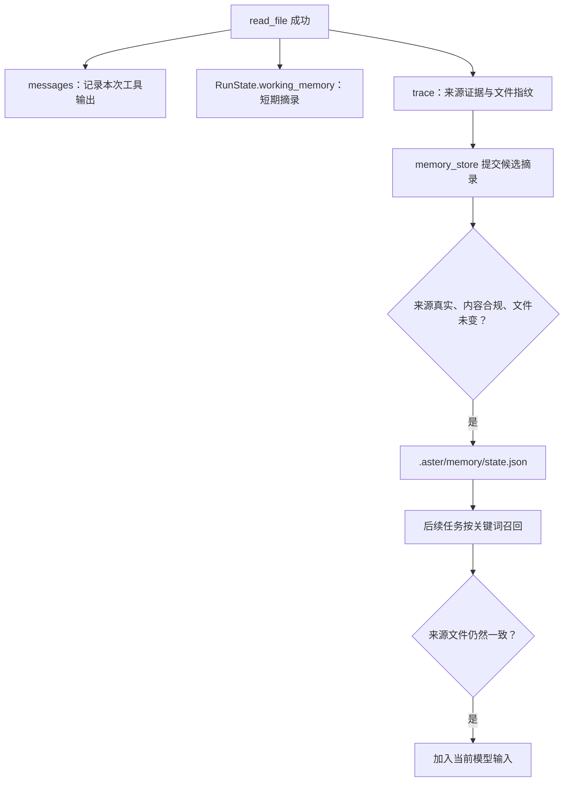

# 10｜分层记忆：刚读过的内容，下一次还记得吗

[上一章：检查点与恢复](09-checkpoint-resume.md) · [目录](README.md) · [下一章：记忆自进化](11-memory-evolution.md)

> 当前任务需要一张工作便笺；下一次任务需要有出处、仍然有效的项目知识。

读完本章，你应该能回答：`messages` 已经记录了工具结果，为什么还需要 `working_memory`？关闭长期记忆会不会让 Agent 失去短期记忆？哪些内容允许跨运行保存？

## 问题：记住所有聊天，不等于用好记忆

假设 Agent 已经读到 `config.txt` 中的 `Service port is 8123.`。它接下来需要改测试、看日志、回复用户。若每次查端口都重新读文件，会增加工具调用；若一直保留完整文件正文，又会占用上下文。等到任务结束，下次重新启动时，这个项目事实是否还值得继续使用？

这里其实有三种不同需求。历史要保留“刚才发生了什么”，工作记忆要快速提供“当前已经知道什么”，长期记忆要回答“以前留下的哪些信息现在仍然适用”。Aster 分开管理这三件事。



## 三种信息放在哪里

| 对象 | 负责什么 | 生命周期 | 不能替代什么 |
|---|---|---|---|
| `RunState.messages` | 保存本次运行的消息记录 | 随运行保存到检查点 | 不负责长期知识筛选 |
| `RunState.working_memory` | 按路径保存近期读文件、搜索、测试的简短结果 | 当前运行；通过检查点恢复 | 不保存完整原文，不等于消息协议历史 |
| `Memory.state["lessons"]` | 保存经过校验的跨运行项目摘录 | 工作区的 `.aster/memory/state.json` | 不替代任务状态或检查点 |

`RunState` 是运行状态对象。`working_memory` 的唯一所有者就是它，`Memory` 类没有第二份持久化的 working memory。`Memory.remember_file()` 接受外部传入的字典，只负责向那张工作便笺写入内容。

当前调用模型所需的原生工具历史由 Runtime 单独维护；`messages` 不能简单拿来替代完整的调用/结果协议。有关这部分，回看[模型协议](02-model-protocols.md)与[上下文归档](07-context-archives.md)。

## 顺着一次 read_file 读源码

从 [Runtime._step](../../src/aster/runtime.py) 搜索下面这段实际代码：

```python
if outcome.status == "success" and call.name == "read_file":
    path = call.arguments["path"]
    self.memory.remember_file(path, outcome.content, state.working_memory)
    state.read_evidence[path] = outcome.data["source_sha256"]
```

这里的 `outcome` 是工具结果。`content` 是展示给模型的文本，`data` 是程序消费的结构化信息；`source_sha256` 是读取时文件内容的哈希值，可用来判断后来是否发生变化。哈希值不是文件内容的摘要文字，而是内容指纹。

继续到 [Memory.remember_file](../../src/aster/memory.py)：

```python
def remember_file(self, path: str, summary: str, working: dict | None = None):
    if working is not None:
        working[path] = {"summary": summary[:500], "updated": now()}
```

`summary` 这个字段名容易引起误解：目前保存的是结果前 **500 个字符**，没有额外调用模型生成摘要。`updated` 是更新时间。搜索和测试也会写入工作记忆，键分别是 `__search__`、`__run_tests__`，表示这两类结果，而不是某个真实文件路径。

`Runtime.prepare_request()` 将工作记忆转成短文本，交给上下文构建器。它不是无限扩容的第二个上下文；最终输入仍受第 06 章介绍的全局预算约束。

### 文件改了，工作便笺也要失效

如果 Agent 修改了已读取文件，Runtime 会删除对应的旧工作记忆；如果外部进程修改了文件，`_refresh_observations()` 会检查 `read_evidence` 中记录的指纹，删除过期项。搜索和测试结果也可能随文件变化失效。

因此，“之前看过”不等于“现在仍然有效”。编辑前的 fresh read 检查与这里共享了文件指纹这个事实依据，详见[工具系统](03-tool-system.md)。

## 跨运行保存：模型提出候选，Runtime 检查出处

`memory_store` 接收的关键参数如下：

| 参数 | 含义 | 示例 |
|---|---|---|
| `text` | 想保存的项目摘录 | `Service port is 8123.` |
| `evidence_id` | 当前运行中一次成功读取的证据标识 | `read_file` 返回的 `Outcome.evidence_id` |
| `tags` | 便于关键词召回的标签，可省略 | `["service", "port"]` |

Runtime 不会因为模型写了一个 `evidence_id` 就相信它。`workflow_tool()` 会在当前运行的 trace 里找到对应的成功 `read_file`，取出当时观察到的文本与来源指纹，再调用 `Memory.record()`。

`Memory.record()` 继续检查：候选是否是观察结果中的原文摘录，是否含敏感信息、临时任务状态或绕过权限的指令，以及来源文件现在是否仍一致。比较摘录时会归一化空白，所以换行与连续空格不会制造无意义的差异。没有证据支持的自由总结会被拒绝。

通过检查后的记录包含：

| 字段 | 含义 |
|---|---|
| `id` | 由归一化文本计算的稳定标识，用于去重和更新 |
| `text`、`tags` | 摘录正文和召回关键词 |
| `provenance` | 来源运行、证据标识、证据类型和记录时间 |
| `sources` | `文件路径 → 读取时内容指纹`，用于检查事实是否过期 |
| `inactive_reason` | 停用原因；空字符串表示没有被停用 |
| `support` 等计数 | 支持证据与使用反馈，下一章展开 |

这是一份轻量项目知识库，当前最多保留 64 条记录。它没有向量数据库，也没有用另一个 LLM 判断语义是否一致。

### 更新和删除也要有清楚的语义

| 工具 | 做什么 |
|---|---|
| `memory_store` | 根据当前运行的读取证据保存摘录 |
| `memory_retrieve` | 查询仍然有效的相关摘录 |
| `memory_update` | 用新的读取证据替换指定 `lesson_id` 的内容 |
| `memory_discard` | 将指定 `lesson_id` 标记为停用 |

`lesson_id` 就是条目的 `id`。更新仍需要 `text` 和 `evidence_id`，不能随意改写事实；新文本生成新 ID 时，旧条目被标记为 `superseded`，表示已被替代。丢弃也保留原记录，并不是物理删除文件。模型可以调用这些工具维护内容，下一章的自动机制则主要维护排序与有效状态。

## 召回：相关只是第一步，还要检查是否过期

`Memory.retrieve(query, limit=3)` 先过滤已停用、有反证、不合规或来源失效的记录，再按关键词重合与可靠度排序。`query` 是查询文本，`limit` 是最多返回多少条。

Runtime 构造输入时会根据任务文本自动召回最多三条；模型也可以先通过 `tool_load` 加载 `memory_retrieve`，再提交更具体的查询。召回的项目知识作为背景数据进入上下文，不构成新的权限授权。

关键词方案适合小型项目知识库，但它不是语义检索器。中文分词、同义表达和复杂相关性不是当前实现的强项。判断是否需要升级检索，应先看实际漏召回的任务。

## 离线实验：记住一个事实，再让它过期

在项目根目录激活环境：

```bash
conda activate aster
```

把下面代码块保存到临时 Python 文件并运行，或整体放进 `python - <<'PY'` 与结束行 `PY` 之间执行。代码只创建临时工作区，不连接模型、不修改你的项目文件。

```python
# 可运行实验
import asyncio
from pathlib import Path
from tempfile import TemporaryDirectory

from aster.config import Settings
from aster.runtime import Runtime
from aster.schema import TaskSpec, ToolCall


async def main():
    with TemporaryDirectory(prefix="aster-memory-lesson-") as folder:
        root = Path(folder)
        source = root / "config.txt"
        source.write_text("Service port is 8123.\n", encoding="utf-8")
        settings = Settings(approval="auto", memory_enabled=True, auto_dream=False)
        first = Runtime(root, settings)
        first.start(TaskSpec(prompt="Inspect the service port"))

        observed = await first.step(ToolCall(
            name="read_file", arguments={"path": "config.txt"}
        ))
        assert observed.status == "success"
        assert "config.txt" in first.state.working_memory
        await first.step(ToolCall(
            name="tool_load", arguments={"names": ["memory_store"]}
        ))
        stored = await first.step(ToolCall(name="memory_store", arguments={
            "text": "Service port is 8123.",
            "evidence_id": observed.evidence_id,
            "tags": ["service", "port"],
        }))
        assert stored.status == "success", stored.reason
        print("第一次运行：短期摘录 = 1，长期记忆 = 1")
        first.finish("lesson_finished")

        second = Runtime(root, settings)
        second.start(TaskSpec(prompt="Inspect the service port"))
        assert second.state.working_memory == {}
        assert len(second.memory.retrieve("service port")) == 1
        print("第二次运行：短期摘录 = 0，长期召回 = 1")

        source.write_text("Service port is 9090.\n", encoding="utf-8")
        assert second.memory.retrieve("service port") == []
        print("来源文件变化后：长期召回 = 0")
        second.finish("lesson_finished")

        third = Runtime(root, Settings(memory_enabled=False, auto_dream=False))
        third.start(TaskSpec(prompt="Inspect the service port"))
        result = await third.step(ToolCall(
            name="read_file", arguments={"path": "config.txt"}
        ))
        assert result.status == "success"
        assert "9090" in third.state.working_memory["config.txt"]["summary"]
        assert third.memory.retrieve("service port") == []
        assert "working" not in third.memory.state
        print("关闭长期记忆后：短期摘录仍然存在")
        third.finish("lesson_finished")


asyncio.run(main())
```

预期输出：

```text
第一次运行：短期摘录 = 1，长期记忆 = 1
第二次运行：短期摘录 = 0，长期召回 = 1
来源文件变化后：长期召回 = 0
关闭长期记忆后：短期摘录仍然存在
```

注意第二次调用 `Runtime.start()` 是新任务，不是恢复旧任务。若你执行 `resume()`，检查点中的 `working_memory` 会随旧运行状态恢复，仍然是原来那一份短期状态。

## 练习：记住“看过的”还是“猜到的”

1. 把存储参数的 `text` 改成 `Service port is 9999.`，其他参数不变。哪一层会拒绝它？
2. 在长期记忆关闭时调用 `memory_store`，只是模型看不到工具，还是直接执行也会拒绝？
3. 如果文件只增加一行无关注释，原有记忆会继续召回吗？这个选择有什么代价？

<details>
<summary>参考答案</summary>

1. Runtime 找得到读取证据，但 `Memory.record()` 找不到对应摘录，返回 `unsupported_excerpt`。在实验中需要相应调整成功断言。
2. 两边都受能力检查约束。`_unavailable_reason()` 返回 `memory_disabled`；工具目录和直接调用都会使用这项检查，`tool_profile="all"` 也不会绕过它。
3. 不会。当前用整份来源文件的指纹校验，任何文本变化都会让旧摘录失效。这很保守，会牺牲一些命中率，但避免继续信任旧事实。它不是段落级依赖分析。

</details>

## 本章的验收点与边界

能解释实验的四行输出，比背下“分层记忆”这个词更重要。对应自动回归可阅读 [test_memory_evolution.py](../../tests/test_memory_evolution.py) 与 [test_runtime_repairs.py](../../tests/test_runtime_repairs.py)，重点搜索 `disabled_durable_memory` 和 `memory_cannot_launder`。

实验验证的是存储、隔离和失效机制，没有测模型任务成功率。跨运行记忆的收益应使用同题的开关对照，观察重复读取、额外调用和正确率；参见[评测章节](14-evaluation.md)。

下一章继续处理另一种老化：文件没变，某条建议却连续使用失败。Aster 如何调整它的排序，何时停用，以及停错了如何恢复？

[上一章：检查点与恢复](09-checkpoint-resume.md) · [目录](README.md) · [下一章：记忆自进化](11-memory-evolution.md)
