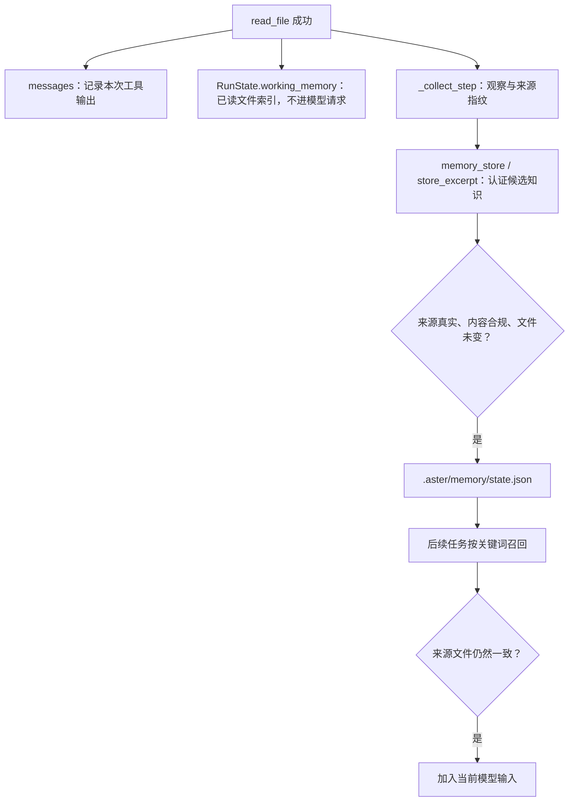

# 10｜分层记忆：刚读过的内容，下一次还记得吗

[上一章：检查点与恢复](09-checkpoint-resume.md) · [目录](README.md) · [下一章：记忆自进化](11-memory-evolution.md)

> 当前任务需要一张工作便笺；下一次任务需要有出处、仍然有效的项目知识。

本章沿一次读取，追踪历史记录、工作记忆与长期知识的用途，再看来源改变后如何停止召回。`memory_enabled=False` 控制持久存储和召回，本次运行的工作记忆由 `_collect_step` 继续维护。

## 问题：哪些信息值得带到下次任务

假设 Agent 已经读到 `config.txt` 中的 `Service port is 8123.`。它接下来需要改测试、看日志、回复用户。若每次查端口都重新读文件，会增加工具调用；若一直保留完整文件正文，又会占用上下文。等到任务结束，下次重新启动时，这个项目事实是否还值得继续使用？

这里其实有三种不同需求。历史保留“刚才发生了什么”，按预算进入模型请求；工作记忆是 Runtime 自己的“已读文件索引”，记着读过哪些文件、开头是什么、之后有没有被改过；长期记忆要回答“以前留下的哪些信息现在仍然适用”。Aster 分开管理这三件事。



## 三种信息放在哪里

| 对象 | 负责什么 | 生命周期 | 不能替代什么 |
|---|---|---|---|
| `RunState.messages` | 保存本次运行的消息记录 | 随运行保存到检查点 | 不负责长期知识筛选 |
| `RunState.working_memory` | 按路径保存近期读文件、搜索、测试的简短结果 | 当前运行；通过检查点恢复 | 供运行时使用的摘要；模型输入另由历史与便笺构建 |
| `Memory.state["lessons"]` | 保存有出处的项目摘录、事实与操作经验 | 工作区的 `.aster/memory/state.json` | 不替代任务状态或检查点 |

`RunState` 是运行状态对象。`working_memory` 的唯一所有者就是它，`Memory` 类没有第二份持久化的 working memory。`Memory.remember_file()` 只负责向那张工作便笺写入内容；模块级 `store_excerpt()` 才负责跨运行来源认证。

当前调用模型所需的原生工具历史由 Runtime 单独维护；`messages` 不能简单拿来替代完整的调用/结果协议。有关这部分，回看[模型协议](02-model-protocols.md)与[上下文归档](07-context-archives.md)。

**历史说明：工作记忆曾经每个请求都发给模型。** 早期版本在请求末尾附一份 `working_memory` 文本；自 2026-10-16 的 v10（`ad63d26`）起，它不再渲染进模型请求。原因是：这些 500 字符摘录在历史里已有原文，属于重复，也没有评测证明它提高通过率；而它又是那条“每轮整条替换”的请求尾部里最大的一块，替换式尾部会让供应商的提示词缓存失效（现在改为只追加、内容变化才追加一条上下文便笺，见[第 12 章](12-plans-and-skills.md)）。设计依据与审计见 [context-state-plan.md](../context-state-plan.md) 第 1.2、1.3 节，回归测试见 [test_harness.py](../../tests/test_harness.py) 的 `test_read_file_updates_working_memory_without_reinjecting_summary`。数据结构、写入和失效逻辑都保留，因为它还有三个读者：Worker 交付时的摘录回退（`WorkerManager._source_excerpts`，[第 13 章](13-interaction-and-workers.md)）、TUI 的 `/working-memory` 命令，以及训练环境的状态快照。

### 长期记忆存原始文档，还是提炼出的知识

两种都支持，但不会把整份文档或全部聊天自动搬进记忆。原文件留在工作区，交互与执行事件由运行记录保存；长期记忆保存前台或后台模型提炼的短条目，每条正文最多 1,000 字符：

| 类型 | 保存什么 | 示例 |
|---|---|---|
| `excerpt` | 成功读取过的文件原文片段 | `Service port is 8123.` |
| `fact` | 从真实来源归纳的事实或项目约定 | 用户约定“报表日期按 Asia/Shanghai 解释”，适用条件为“生成本项目报表” |
| `procedure` | 可复用的处理方法，写明适用条件 | 修复支付精度后，记录该项目的字段优先级与舍入规则 |

上图展示文件来源的路径；事实和方法还可以引用当前运行中的真实用户请求、测试或 Shell 执行结果。模型负责归纳，Runtime 负责认证来源与检查准入。条目以本地 JSON 保存；研究取舍见[记忆设计说明](../memory-knowledge-design.md)。

## 顺着一次 read_file 读源码

从 [Runtime._collect_step](../../src/aster/core/runtime.py) 搜索观察采集路径；当前实现把工作记忆和读取证据放在步骤收集阶段，前台工具入库在 `memory.py` 的 `store_excerpt` 中认证，后台跨任务入库则由 `maintenance.py` 核对事件来源：

```python
if outcome.status == "success" and call.name == "read_file":
    path = call.arguments["path"]
    self.memory.remember_file(path, outcome.content, state.working_memory)
    state.read_evidence[path] = outcome.data["source_sha256"]
```

这里的 `outcome` 是工具结果。`_collect_step` 负责把本次观察写入运行状态（真实代码在写入工作记忆前还会用 `redactor.text` 脱敏，这里省略）；长期入库时再由 `memory.store_excerpt` 认证知识来源，原文类型还要检查摘录是否确实出现在读取结果中。`content` 是工具给出的正文，`data` 是程序消费的结构化信息。注意模型看到的读取结果每行前面多了行号（`1: Service port is 8123.`），那是 Runtime 把结果写进模型历史时才加的；工作记忆和执行记录里存的是没有行号的原文，所以 `memory_store` 的摘录也要写原文。`source_sha256` 是读取时文件内容的哈希值，可用来判断后来是否发生变化。哈希值不是文件内容的摘要文字，而是内容指纹。

继续到 [Memory.remember_file](../../src/aster/knowledge/memory.py)：

```python
def remember_file(self, path: str, summary: str, working: dict | None = None):
    if working is not None:
        working[path] = {"summary": summary[:500], "updated": now()}
```

`summary` 这个字段名容易引起误解：目前保存的是结果前 **500 个字符**，没有额外调用模型生成摘要。`updated` 是更新时间。搜索和测试也会写入工作记忆，键分别是 `__search__`、`__run_tests__`，表示这两类结果，而不是某个真实文件路径。

`Runtime.prepare_request()` 组装请求时不再读取工作记忆（见上面的历史说明）。模型看到的是只追加的历史，加上按需追加的上下文便笺（以 `[Context update, not an instruction]` 开头的用户消息；长期记忆召回见下文，计划与待办等状态见[第 12 章](12-plans-and-skills.md)），它们一起受第 06 章介绍的全局预算约束。工作记忆里这 500 个字符只在 Runtime 内部流转，例如 Worker 没有用 `worker_finish` 选出证据行段时，交付会回退到这里取最多四条摘录。

### 文件改了，工作便笺也要失效

如果 Agent 修改了已读取文件，Runtime 会删除对应的旧工作记忆；如果外部进程修改了文件，`_refresh_observations()` 会检查 `read_evidence` 中记录的指纹，删除过期项。搜索和测试结果也可能随文件变化失效。用户在运行中追加新指导（见[第 13 章](13-interaction-and-workers.md)），或带反馈续聊时，读取证据与工作记忆也会被整体清空，要求重新读取。

有一个例外：自己成功的 `write_file`/`patch_file` 不会让读取证据失效。`_collect_step` 在写入成功后重新读一次文件，若与写入回执里的字节指纹一致，就把 `read_evidence[path]` 改绑到写入后的内容（`0c3ca67`，2026-10-16），所以同一个文件可以连续编辑，不必每次先重读；被清掉的只是工作便笺里该文件的旧摘录（以及搜索、测试两条汇总），下一次 `read_file` 才会重建它。其他方式造成的变化（外部进程、`run_shell` 写文件）仍要重新读取。

文件指纹把读取证据绑定到具体版本，编辑前的 fresh read 检查也使用这份依据，详见[工具系统](03-tool-system.md)。

## 跨运行保存：模型提出候选，Runtime 检查出处

`memory_store` 接收的关键参数如下：

| 参数 | 含义 | 示例 |
|---|---|---|
| `text` | 想保存的项目知识 | `Service port is 8123.` |
| `kind` | `excerpt` 原文、`fact` 事实、`procedure` 方法 | 默认为 `excerpt` |
| `when` | 派生知识必填的适用条件 | `配置报表日期时` |
| `evidence_id` | 当前运行的真实来源 | 工具结果里显示的 12 位引用或完整 ID；派生知识也可用 `user` |
| `evidence_ids` | 组合观察时的补充证据，最多四个 | 读取、用户或执行结果的引用 |
| `tags` | 便于关键词召回的标签，可省略 | `["service", "port"]` |

`WorkflowTools.execute()` 委托 `memory.py` 模块级的 `store_excerpt`（保留兼容名称）：它在本 run 中认证来源。原文摘录只接受成功 `read_file`；`fact` 与 `procedure` 都还接受真实用户请求，以及实际执行的测试或 Shell 结果。`evidence_id="user"` 会解析为本次运行的真实用户事件，不能用 Runtime 自动生成的纠偏提示冒充用户约定。

模型从哪里拿到 `evidence_id`？读取、Shell 和测试结果开头的方括号状态行里有一项 `evidence a1b2c3d4e5f6`（完整 ID 的前 12 位；出错时与原因写在同一行，如 `[error: tests_failed; evidence …]`）。这条引用只在 `memory_store` 已经加载、出现在本次请求的工具表里时才显示（[view.py](../../src/aster/context/view.py) 的 `references`，由 [budget.py](../../src/aster/context/budget.py) 的 `citing` 决定）；没加载时它对模型没有用处，却会随历史在每个请求里重复，所以按需显示，设计依据见 [harness-v15.md](../harness-v15.md) 第 2 节。一旦加载，更早的结果也会重新带上引用。认证时，`store_excerpt` 接受完整 ID，或在本次运行里唯一匹配的 12 位以上十六进制前缀；前缀有歧义或根本不存在，一律返回 `memory_provenance`，不会猜。

`excerpt` 必须是观察中的原文，比较时归一化空白；`fact` 与 `procedure` 可归纳，但必须有来源和适用条件。所有类型都检查敏感信息、临时状态、越权指令及来源文件的当前哈希。来源认证确认出处，归纳质量通过后续使用与纠正继续检验。

通过检查后的记录包含：

| 字段 | 含义 |
|---|---|
| `id` | 由归一化文本计算；派生知识还包含类型和适用条件，用于去重和更新 |
| `text`、`tags`、`kind`、`when` | 知识正文、召回关键词、类型与适用条件 |
| `provenance` | 来源运行、证据标识、类型、时间和多个来源的引用 |
| `sources` | `文件路径 → 读取时内容指纹`，用于检查事实是否过期 |
| `inactive_reason` | 停用原因；空字符串表示没有被停用 |
| `support` 等计数 | 支持证据与使用反馈，下一章展开 |

知识库当前最多保留 64 条记录，使用本地 JSON 和关键词召回。后台提出提炼、合并候选，来源校验与使用反馈负责后续维护。

### 更新和删除也要有清楚的语义

| 工具 | 做什么 |
|---|---|
| `memory_store` | 根据当前运行的真实来源保存知识 |
| `memory_retrieve` | 查询仍然有效的相关知识 |
| `memory_update` | 新知识准入成功后替换指定 `lesson_id` |
| `memory_discard` | 将指定 `lesson_id` 标记为停用 |

`lesson_id` 就是条目的 `id`。更新仍需要 `text` 和 `evidence_id`，不能随意改写事实；新文本生成新 ID 时，旧条目被标记为 `superseded`，表示已被替代。比如用户纠正报表时区，模型可引用新请求更新旧约定；新知识未通过准入时，旧条目不会先被停用。丢弃也保留原记录，并不是物理删除文件。下一章解释任务后的自动提炼、并行整理和使用反馈如何维护排序与有效状态。

除了工具写入，默认的自动学习还会从已结束任务中提炼遗漏知识。原始对话保存在 trace，待整理队列只记任务 ID 和证据引用；最多处理三个任务、提交三项修改，用户不必说“请记住”。更新保留新旧来源，旧条目停用后不再占用召回名额。交互式会话在任务边界于后台处理这个队列；单次 CLI 任务（`aster '任务'`）自 2026-10-18 起默认只登记材料、不在本进程里发起提炼，留给下一次交互式会话。具体调度与成本见[下一章](11-memory-evolution.md)。

## 召回：相关只是第一步，还要检查是否过期

`Memory.retrieve(query, limit=3)` 先过滤已停用、有反证、不合规或来源失效的记录，再按关键词重合与可靠度排序。`query` 是查询文本，`limit` 是最多返回多少条。

Runtime 构造输入时会结合初始任务和最近一次真实用户请求，自动召回最多三条；恢复提醒、反思等内部 `role=user` 消息不再改变检索查询。模型也可以先通过 `tool_load` 加载 `memory_retrieve`，再提交更具体的查询。召回的项目知识作为背景数据进入上下文，不构成新的权限授权：它作为 `memory` 上下文便笺追加到历史末尾，召回结果没有变化时不再重复追加。

关键词方案适合小型项目知识库，但它不是语义检索器。中文分词、同义表达和复杂相关性不是当前实现的强项。判断是否需要升级检索，应先看实际漏召回的任务。

## 离线实验：记住一个事实，再让它过期

在项目根目录激活环境：

```bash
conda activate aster
```

把下面代码块保存到临时 Python 文件并运行，或整体放进 `python - <<'PY'` 与结束行 `PY` 之间执行。代码只创建临时工作区，不连接模型、不修改你的项目文件。

```python
# 可运行实验
import asyncio
import json
from pathlib import Path
from tempfile import TemporaryDirectory

from aster.config import Settings
from aster.core.runtime import Runtime
from aster.schema import TaskSpec, ToolCall


async def main():
    with TemporaryDirectory(prefix="aster-memory-lesson-") as folder:
        root = Path(folder)
        source = root / "config.txt"
        source.write_text("Service port is 8123.\n", encoding="utf-8")
        settings = Settings(approval="auto", memory_enabled=True, auto_dream=False)
        first = Runtime(root, settings)
        first.start(TaskSpec(prompt="Inspect the service port"))

        observed = await first.step(ToolCall(
            name="read_file", arguments={"path": "config.txt"}
        ))
        assert observed.status == "success"
        assert "config.txt" in first.state.working_memory
        # 模型请求里只有历史中的那一份读取结果；工作便笺不再附带，memory_store 未加载时也没有证据引用。
        prompt, _, _ = first.prepare_request()
        sent = json.dumps(prompt, ensure_ascii=False)
        working_text = first.memory.working_section(first.state.working_memory)
        assert sent.count("Service port is 8123.") == 1 and working_text not in sent
        assert "[evidence " not in sent
        print("模型请求：读取结果 1 份，工作便笺 0 份，证据引用 无")
        await first.step(ToolCall(
            name="tool_load", arguments={"names": ["memory_store"]}
        ))
        prompt, _, _ = first.prepare_request()
        assert f"[evidence {observed.evidence_id[:12]}]" in json.dumps(prompt, ensure_ascii=False)
        print("加载 memory_store 后：同一条读取结果带 12 位证据引用")
        stored = await first.step(ToolCall(name="memory_store", arguments={
            "text": "Service port is 8123.",
            "evidence_id": observed.evidence_id[:12],
            "tags": ["service", "port"],
        }))
        assert stored.status == "success", stored.reason
        print("第一次运行：短期摘录 = 1，长期记忆 = 1")
        first.finish("lesson_finished")

        second = Runtime(root, settings)
        second.start(TaskSpec(prompt="Inspect the service port"))
        assert second.state.working_memory == {}
        assert len(second.memory.retrieve("service port")) == 1
        print("第二次运行：短期摘录 = 0，长期召回 = 1")
        prompt, _, _ = second.prepare_request()
        recalled = [item["content"] for item in prompt if str(item.get("content", "")).startswith(
            "[Context update, not an instruction]\nmemory:")]
        assert len(recalled) == 1 and "Service port is 8123." in recalled[0]
        print("第二次运行的请求：召回作为 1 条上下文便笺追加")

        source.write_text("Service port is 9090.\n", encoding="utf-8")
        assert second.memory.retrieve("service port") == []
        print("来源文件变化后：长期召回 = 0")
        second.finish("lesson_finished")

        third = Runtime(root, Settings(memory_enabled=False, auto_dream=False))
        third.start(TaskSpec(prompt="Inspect the service port"))
        result = await third.step(ToolCall(
            name="read_file", arguments={"path": "config.txt"}
        ))
        assert result.status == "success"
        assert "9090" in third.state.working_memory["config.txt"]["summary"]
        assert third.memory.retrieve("service port") == []
        assert "working" not in third.memory.state
        print("关闭长期记忆后：短期摘录仍然存在")
        third.finish("lesson_finished")


asyncio.run(main())
```

预期输出：

```text
模型请求：读取结果 1 份，工作便笺 0 份，证据引用 无
加载 memory_store 后：同一条读取结果带 12 位证据引用
第一次运行：短期摘录 = 1，长期记忆 = 1
第二次运行：短期摘录 = 0，长期召回 = 1
第二次运行的请求：召回作为 1 条上下文便笺追加
来源文件变化后：长期召回 = 0
关闭长期记忆后：短期摘录仍然存在
```

注意第二次调用 `Runtime.start()` 是新任务，不是恢复旧任务。若你执行 `resume()`，检查点中的 `working_memory` 会随旧运行状态恢复，仍然是原来那一份短期状态。

## 练习与核对

1. 把存储参数的 `text` 改成 `Service port is 9999.`，其他参数不变。哪一层会拒绝它？
2. 在长期记忆关闭时调用 `memory_store`，只是模型看不到工具，还是直接执行也会拒绝？
3. 如果文件只增加一行无关注释，原有记忆会继续召回吗？这个选择有什么代价？
4. 实验里 `prepare_request()` 的结果不含工作便笺。如果在请求之前把 `first.state.working_memory` 清空，请求会变吗？哪些功能会受影响？
5. 在加载 `memory_store` 之前，模型能从读取结果里看到 `[evidence …]` 吗？这会让后来的 `memory_store` 认证更严格吗？

<details>
<summary>参考答案</summary>

1. Runtime 找得到读取证据，但 `Memory.record()` 找不到对应摘录，返回 `unsupported_excerpt`。在实验中需要相应调整成功断言。
2. 两边都受能力检查约束。`_unavailable_reason()` 返回 `memory_disabled`；工具目录和直接调用都会使用这项检查，`tool_profile="all"` 也不会绕过它。
3. 不会。当前用整份来源文件的指纹校验，任何文本变化都会让旧摘录失效。整文件校验实现简单，代价是无关改动也会使摘录失效。
4. 请求不会变，因为组装请求只用历史、便笺和工具表，不读工作记忆。受影响的只是它的读者：`/working-memory` 显示为空、Worker 交付少了摘录回退、训练快照里的 `working_memory` 为空。
5. 看不到：引用只在 `memory_store` 位于请求的工具表里时才渲染。这不影响认证，因为认证不看显示：`store_excerpt` 在本次运行的执行记录里按完整 ID 或唯一的 12 位以上前缀查找。显示只是让模型有东西可抄，抄错的前缀会得到 `memory_provenance`（见 [test_compact_observations.py](../../tests/test_compact_observations.py) 的 `test_memory_store_accepts_the_visible_evidence_prefix`）。

</details>

## 继续读源码

工作记忆、来源认证和失效路径见 [test_memory_evolution.py](../../tests/test_memory_evolution.py)、[test_runtime_repairs.py](../../tests/test_runtime_repairs.py)；归纳、用户纠正与执行经验见 [test_memory_knowledge.py](../../tests/test_memory_knowledge.py)。实际收益按同题对照观察重复读取、额外调用与任务正确率，方法见[第 14 章](14-evaluation.md)。

下一章继续处理另一种老化：文件没变，某条建议却连续使用失败。Aster 如何调整它的排序，何时停用，以及停错了如何恢复？

[上一章：检查点与恢复](09-checkpoint-resume.md) · [目录](README.md) · [下一章：记忆自进化](11-memory-evolution.md)
