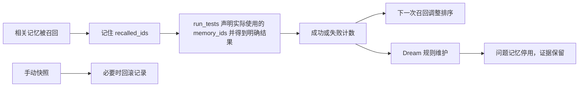

# 11｜记忆自进化：让使用结果影响下一次选择

[上一章：分层记忆](10-layered-memory.md) · [目录](README.md) · [下一章：计划与技能](12-plans-and-skills.md)

> 保存下来不代表永远可靠；一次失败也不应该抹掉全部证据。

本章把“自进化”拆成可以在代码中指出来的动作：从验证过的修复中提炼经验、按新证据纠正知识、记录使用反馈、调整召回排序、停用问题记录，以及用快照回滚。这里改变的是项目知识与后续选择，模型权重没有更新。

## 问题：两条建议都相关，先相信哪一条

仓库里留下了两个测试命令：`pytest` 和 `python -m pytest`。它们都包含“project tests”，都来自真实文件，关键词召回无法区分哪个更适用于当前环境。后来第一种方式执行失败，第二种方式成功。下次任务应不应该继续保持原来的召回顺序？

Aster 让记忆保留使用反馈，反馈影响下次排序；持续失败的记录则进入停用状态。排序与维护规则在 [memory.py](../../src/aster/knowledge/memory.py)，自动提炼与批量整理在 [maintenance.py](../../src/aster/knowledge/maintenance.py)。前台能及时写入，后台也能补充遗漏；沿用同一模型配置，不增加模型服务。



## 先分清三个开关

| `Settings` 字段 | 默认值 | 作用 |
|---|---|---|
| `memory_enabled` | `True` | 开启跨运行存储与召回，不控制短期工作记忆 |
| `memory_evolution` | `True` | 开启自动经验提炼、使用反馈、反馈排序和 Dream 维护 |
| `auto_dream` | `True` | 运行结束登记材料；自动规则维护，并在预算允许时后台提炼与整理 |

关闭 `auto_dream` 不会关闭反馈计数，仍可显式调用 `Memory.dream()`；但如果 `auto_dream=True` 而 `memory_enabled` 或 `memory_evolution` 关闭，Dream 会返回 `skipped`，不会进行维护。关闭 `memory_evolution` 后，基础记忆的来源校验、敏感信息过滤和关键词召回仍然有效；长期记忆不能因为停止自进化就变得不可信。

这三个开关默认全部开启，用户直接启动即可使用。保留开关方便模块对照或主动关闭：保持任务和模型相同，只改变目标机制。

## 从一次任务自动提炼知识

过去，Aster 主要依靠主 Agent 主动调用记忆工具；它有时会说“已记住”，实际上却没有存入。本轮新增的 `MemoryMaintenance` 独立检查已结束任务中的材料，用户不必额外要求记忆。主 Agent 仍可立即保存或纠正知识。

流程从 `enqueue()` 开始：选取真实用户消息、最近的失败、验证通过结果及读文件证据，持久化事件引用及输入指纹。`_prepare()` 读取最多三个已结束任务和六条相关旧记忆，构成小请求。原始交互仍在 trace 中，模型只看到有上限的真实证据片段，不再额外携带助手最终答复的摘要。

如果新会话重复了已经成功整理的材料，且工作区、记忆内容版本、日期与提炼契约都没有变化，就记录 `skipped / unchanged_evidence`，不再请求模型。上一批有候选被拒绝、取消或失败时不能走这条路径。检测到“现在”“明天”等中英文相对时间表达时保留完整时间戳，减少错误地当作相同事实的风险；它不是通用时间理解器。新约定、更正、来源变动仍会自动处理。这个检查沿用现有审计表，和用另一个模型先判断“值不值得记”不同，不额外产生分类调用。

`_request()` 使用当前模型与账户，调用一次，提出最多三项结构化操作：新增、替换/合并、停用，也允许空列表。前台可以在这期间处理下一任务。候选没有代码编辑或 Shell 权限；`_commit()` 由 Runtime 在工作区锁内核对并原子提交。

`when` 描述知识适用于什么场景，例如“工单 CSV 导出接口”；不应夹带“本轮确认”或“本轮不写代码”等对话过程。这些词可能触发临时信息过滤，导致有价值的约定未保存。提炼指令明确了这个区别，但自然语言候选仍可能被拒绝；有模型调用不等于知识已经入库。

| 检查 | 实际边界 |
|---|---|
| 来源 | 引用必须能在真实任务事件中找到，文件内容还需与引用时一致 |
| 修复方法 | 必须同时引用实际执行失败和时间更晚的验证通过；模型仍需判断两者是否相关 |
| 用户纠正 | 同一知识再次入库保留已有引用；替换或停用带用户来源的约定需引用时间更晚的用户消息，不能仅凭文件或推断覆盖 |
| 并发更改 | 生成期间记忆正文、适用范围或来源发生变化，则整批候选作废；查询计数变化不影响提交 |
| 保存结果 | 实际提交后才发回执；被拒绝、冲突或空操作都不会显示“已记录” |

例如支付测试发现浮点数舍入错误，并且旧实现忽略 `amount_minor`。在修复且通过测试后，可保存“该项目优先采用整数分字段，否则用 Decimal 和 ROUND_HALF_UP 转换金额”，同时保留失败、验证来源与支付记录这一适用范围。它不是所有项目通用的金额规则。已有支付补查见[历史案例](../../evaluations/memory-knowledge-20261005/REPORT.md)，本轮自动学习验证见[固定协议](../../evaluations/memory-sleep-20261005/PROTOCOL.md)。

如果关闭后台整理或没有可用后台模型，`Runtime._reflect_repair` 保留原有回退：真实非零执行失败后测试通过，向主 Agent 提醒一次，可保存也可跳过。正常后台路径省去这条前台提醒，避免同一经验重复提炼。自动生成 Skill 不在这一流程内。

## Aster 的“睡眠期”不是停工状态

[LightMem](https://arxiv.org/abs/2510.18866)（ICLR 2026）把及时记录与后续批量更新拆开，候选检索可与在线推理并行。Aster 采用同一思想：稳定的旧经历可以后台处理，当前任务继续执行；仅提交时需要与前台协调。它不需要等到夜间，也不是在任何状态都允许任意改写记忆。论文方法、开源源码与具体取舍见[本轮调研与设计](../agent-next-optimization.md)。

任务结束时尝试调度；新的任务边界还会处理遗留材料。生成调用由专用文件锁保证同一工作区同时最多一个，前台不等待这个计算锁；生成结果在请求、工具批次或任务边界发布。简单起见，最多 64 条的记忆使用整库内容版本检查，而没有复杂的局部冲突重放，因此无关正文变化也可能让一批候选作废。

CLI 先输出最终答案，再给整理最多 15 秒；这个时间属于命令总耗时。TUI 可以继续接收任务，退出则取消未完成调用，保留待处理引用，下一次使用再尝试。供应商失败或坏格式不会自动重试，也不会改变已经交付的任务结果。

每批完整请求的本地输入估算不超过 4,096 tokens，输出限制设为 768。后台调用数和已知 usage 纳入任务预算及总量，`memory_usage` 单列其中的维护部分；请求已经发出但没有 usage 的取消或失败保持未知，并保留预算估计。请求尚未启动时发生存储失败，则释放预留，材料留待后续处理。前台预算不足时延期整理，临近最后一次请求时优先交付已完成工作，未满足验收条件仍标记为未完成。并行改善等待体验，不等于免费或必然减少 token。

`/memory` 可查看条目是否生效、类型、适用范围、来源、最近整理和维护用量；CLI/TUI 的学习通知来自真实提交事件。对常见“已记住”却没有写入的答复，Runtime 会补充“尚未写入长期记忆”的状态，不为此再调用模型。自然语言表达很多，这条补救不是通用承诺校验器。

## 反馈来自哪里：被召回不等于被正确使用

在 [Runtime._memory_text](../../src/aster/core/runtime.py) 和 `_collect_step` 对 `memory_retrieve` 的结果归集中，召回条目的 ID 会进入 `state.recalled_ids`。`recalled_ids` 是“待关联后续测试结果的条目集合”，不是“已证明有帮助的条目集合”。

Runtime 的实际反馈条件是：

```python
if (
    state.recalled_ids
    and call.name == "run_tests"
    and (outcome.status == "success" or outcome.reason == "tests_failed")
):
    applied = set(call.arguments.get("memory_ids", [])) & set(state.recalled_ids)
    if applied:
        self.memory.record_use(applied, success=outcome.status == "success")
        state.recalled_ids = sorted(set(state.recalled_ids) - applied)
```

工具名字叫 `run_tests` 还不够，必须得到了明确的成功或 `tests_failed`。工具参数错误、审批失败、测试环境没有配置好等问题，不应该统统算成记忆的责任，因此它们不会触发这里的负反馈。

Agent 要通过 `run_tests.memory_ids` 明确列出实际应用并检验的记忆；省略时不更新任何条目，也不会奖励未召回的伪造 ID。这样可避免把所有召回条目一起奖惩。不过，选择条目仍由模型判断，测试也是代理信号，Runtime 没有证明某条记忆“导致”成功。

## 每个计数字段在数什么

| 字段 | 什么时候变化 | 不代表什么 |
|---|---|---|
| `support` | 合法知识被记录，并且与最近一次记录的证据 ID 不同 | 不保证支持证据在全历史内全局去重 |
| `contradictions` | 记录反证或显式丢弃时增加 | 不是由模型自动判定的自然语言矛盾总数 |
| `retrievals` | 条目被选中召回时增加 | 不是成功使用次数 |
| `successful_uses` | 相关测试成功时增加 | 不证明该条目是成功原因 |
| `failed_uses` | 相关测试确实失败时增加 | 不包含所有运行异常 |
| `inactive_reason` | 显式停用或 Dream 隔离后填写 | 不表示原始记录已经被删除 |

尤其不要把 `retrievals` 当成推荐权重：经常出现的错误知识，不应该仅因为出现频繁就越来越受信任。当前排序使用相关性、支持证据与使用反馈，召回次数只是观测数据。

## 排序公式：先相关，再用反馈打破平局

`Memory.retrieve()` 的核心计算可以直接在源码里找到：

```python
confidence = (item["support"] + 1) / (item["support"] + 2)
reliability = (
    (item["successful_uses"] + 1)
    / (item["successful_uses"] + item["failed_uses"] + 2)
    if self.evolution
    else 1
)
ranked.append((overlap + confidence * reliability, item))
```

`overlap` 是查询关键词在条目正文、标签及适用条件中命中的数量；`confidence` 是支持证据项；`reliability` 是使用可靠度。分子分母中的常数用于平滑，避免新记录没有历史就出现除零或极端分数。

假设两条记录的 `support` 都是 1，关键词命中也相同。各使用一次后，成功记录的可靠度是 `2/3`，失败记录是 `1/3`，因此前者排序更高。两条记录都还存在，失败一次不会立刻停用。

这只是固定规则，不是训练得到的概率模型。关键词命中数仍是主要排序项：可靠度没有把不相关的内容凭空变成相关内容。

## 两种维护：规则检查与模型整理

`Memory.dream()` 会扫描已有记录，按以下情况填写停用原因：

| 原因 | 含义 |
|---|---|
| `sensitive`、`transient`、`unsafe_instruction` | 内容不再满足准入条件 |
| `stale_source` | 原来源文件变化、删除或不再可安全读取 |
| `contradicted` | 有明确反证计数 |
| `repeated_failure` | 累计失败达到保守阈值 |

失败阈值的实际条件是：

```python
item["failed_uses"] >= max(2, item["successful_uses"] + 2)
```

因此零次成功、一次失败不会停用；零次成功、两次失败会停用；三次成功则至少需要五次失败。这些都是累计次数，代码不要求失败连续发生。

这里的 `Memory.dream()` 只是无需模型的规则检查，不改正文；新增 `MemoryMaintenance` 才负责知识提炼和合并。两者都保留审计记录。文件过期等安全过滤在每次召回时就会执行，不需要等 Dream 才生效。

## 快照与回滚：恢复记录，不恢复现实

`snapshot()` 深拷贝当前 `lessons`，用内容哈希作为快照 ID；最多保留八份快照。`rollback(id)` 恢复这份条目列表，并写入回滚审计。深拷贝意味着后续计数变化不会悄悄修改快照。

规则 `Memory.dream()` 本身不创建快照，手工调用时可先 `snapshot()`；后台整理在变更前自动快照，并将通过准入的整批修改一次写入。保存失败会恢复原内存状态，不发布成功回执。快照也不包含工作区文件、运行状态与全部审计历史。

回滚之后仍会执行来源校验。如果磁盘文件已经从端口 8123 改为 9090，恢复旧条目不会让“8123”重新变成事实。恢复权重与恢复世界状态是两件事。

## 离线实验：同一条记忆如何降权、停用和恢复

从项目根目录、在 `aster` 环境中运行下列 Python 代码。此实验通过 Runtime 写入有真实读取证据的条目，然后人工注入反馈标签，只演示确定性规则；它不会真的执行两种测试命令，也不衡量真实模型效果。

```python
# 可运行实验
import asyncio
from pathlib import Path
from tempfile import TemporaryDirectory

from aster.config import Settings
from aster.core.runtime import Runtime
from aster.schema import TaskSpec, ToolCall


async def main():
    with TemporaryDirectory(prefix="aster-evolution-lesson-") as folder:
        root = Path(folder)
        texts = [
            "Run project tests with pytest.",
            "Run project tests with python -m pytest.",
        ]
        source = root / "commands.txt"
        source.write_text("\n".join(texts), encoding="utf-8")
        runtime = Runtime(root, Settings(memory_enabled=True, memory_evolution=True, auto_dream=False))
        runtime.start(TaskSpec(prompt="Inspect project tests"))
        observed = await runtime.step(ToolCall(
            name="read_file", arguments={"path": "commands.txt"}
        ))
        await runtime.step(ToolCall(
            name="tool_load", arguments={"names": ["memory_store"]}
        ))
        ids = []
        for text in texts:
            outcome = await runtime.step(ToolCall(name="memory_store", arguments={
                "text": text, "evidence_id": observed.evidence_id,
            }))
            assert outcome.status == "success", outcome.reason
            ids.append(outcome.data["id"])

        memory = runtime.memory
        assert memory.retrieve("project tests", limit=1)[0]["id"] == ids[0]
        saved = memory.snapshot()
        memory.record_use([ids[0]], success=False)
        memory.record_use([ids[1]], success=True)
        assert memory.retrieve("project tests", limit=1)[0]["id"] == ids[1]
        print("一次反馈后：优先召回 python -m pytest")

        assert memory.dream()["deactivated"] == 0
        memory.record_use([ids[0]], success=False)
        assert memory.dream()["deactivated"] == 1
        old = next(item for item in memory.state["lessons"] if item["id"] == ids[0])
        assert old["inactive_reason"] == "repeated_failure"
        print("第二次失败后：停用 1 条，原记录仍然保留")

        assert memory.rollback(saved)
        assert len(memory.retrieve("project tests")) == 2
        assert all(item["failed_uses"] == 0 for item in memory.state["lessons"])
        print("回滚后：恢复 2 条，失败计数恢复为 0")

        source.write_text("Project commands changed.\n", encoding="utf-8")
        assert memory.rollback(saved)
        assert memory.retrieve("project tests") == []
        print("来源变化后：即使回滚，也不会召回旧事实")
        runtime.finish("lesson_finished")


asyncio.run(main())
```

预期输出：

```text
一次反馈后：优先召回 python -m pytest
第二次失败后：停用 1 条，原记录仍然保留
回滚后：恢复 2 条，失败计数恢复为 0
来源变化后：即使回滚，也不会召回旧事实
```

## 练习：什么时候不应惩罚记忆

1. 将实验中的 `Settings` 改成 `memory_evolution=False`。注入反馈后、期待优先召回 `ids[1]` 的排序断言还会通过吗？
2. `run_tests` 因没有可运行测试而失败，与实际测试断言失败，应不应该给相同负反馈？
3. 两次失败后直接回滚，下一次运行是否还能从 audit 中看到发生过 Dream？

<details>
<summary>参考答案</summary>

1. 不会。`record_use()` 不再更新计数，排序也不使用可靠度；关键词与支持证据相同时保持已有顺序。需要相应修改实验预期。
2. 不应该。前者可能是运行条件问题，不能据此判断知识错误；Runtime 只对 `success` 或 `tests_failed` 更新反馈。具体边界由 [test_memory_feedback_contract.py](../../tests/test_memory_feedback_contract.py) 检查。
3. 可以。回滚替换 `lessons`，不会删除已有审计，并且会增加 `rollback` 事件；不过审计只保留最近 256 条，不是无限历史仓库。

</details>

## 如何评测，不把规则收益冒充模型收益

[memory_evolution_cases.json](../../datasets/memory_evolution_cases.json) 把准入、来源变化、反馈排序和回滚组织成可读数据；[test_memory_evolution.py](../../tests/test_memory_evolution.py) 对照开关运行它们。它们能证明固定输入下的机制符合预期，不能单独证明模型因记忆而解决了更多任务。

要论证实际收益，应固定任务和模型，记录错误是否复发、重复调用是否减少、任务是否完成。测试通过也不能证明反馈归因已经精确；模型若主动填入无关 ID，仍可能产生错误归因。知识提炼、用户纠正与十题对比的设计见[记忆改进说明](../memory-knowledge-design.md)，自动提炼、并发和恢复的源码及检查见 [MemoryMaintenance](../../src/aster/knowledge/maintenance.py) 与 [test_memory_maintenance.py](../../tests/test_memory_maintenance.py)，实际成绩及指标口径见[第 14 章](14-evaluation.md)。

下一章转向人明确编写的工作方法：计划记录进度，Skill 提供可按需加载的操作说明。它们与机器积累的记忆各有职责。

[上一章：分层记忆](10-layered-memory.md) · [目录](README.md) · [下一章：计划与技能](12-plans-and-skills.md)
