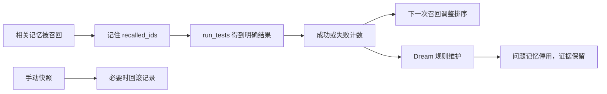

# 11｜记忆自进化：让使用结果影响下一次选择

[上一章：分层记忆](10-layered-memory.md) · [目录](README.md) · [下一章：计划与技能](12-plans-and-skills.md)

> 保存下来不代表永远可靠；一次失败也不应该抹掉全部证据。

本章把“自进化”拆成可以在代码中指出来的动作：记录反馈、调整召回排序、停用问题记录、用快照回滚。它没有训练模型，也没有自动学习上下文压缩策略。

## 问题：两条建议都相关，先相信哪一条

仓库里留下了两个测试命令：`pytest` 和 `python -m pytest`。它们都包含“project tests”，都来自真实文件，关键词召回无法区分哪个更适用于当前环境。后来第一种方式执行失败，第二种方式成功。下次任务应不应该继续保持原来的召回顺序？

Aster 让记忆保留使用反馈，反馈影响下次排序；持续失败的记录则进入停用状态。所有规则都在 [memory.py](../../src/aster/memory.py) 里，没有额外的反思模型。



## 先分清三个开关

| `Settings` 字段 | 默认值 | 作用 |
|---|---|---|
| `memory_enabled` | `False` | 开启跨运行存储与召回，不控制短期工作记忆 |
| `memory_evolution` | `False` | 开启使用反馈更新、反馈排序和 Dream 维护 |
| `auto_dream` | `False` | 运行完成或停止时，自动尝试一次 Dream |

关闭 `auto_dream` 不会关闭反馈计数，仍可显式调用 `Memory.dream()`。关闭 `memory_evolution` 后，基础记忆的来源校验、敏感信息过滤和关键词召回仍然有效；长期记忆不能因为停止自进化就变得不可信。

这些开关适合做模块对照：保持任务和模型相同，只改变目标机制。它们不意味着每个用户都需要在运行前手工配置。

## 反馈来自哪里：被召回不等于被正确使用

在 [Runtime._memory_text](../../src/aster/runtime.py) 和 `memory_retrieve` 分支中，召回条目的 ID 会进入 `state.recalled_ids`。`recalled_ids` 是“待关联后续测试结果的条目集合”，不是“已证明有帮助的条目集合”。

Runtime 的实际反馈条件是：

```python
if (
    state.recalled_ids
    and call.name == "run_tests"
    and (outcome.status == "success" or outcome.reason == "tests_failed")
):
    self.memory.record_use(state.recalled_ids, success=outcome.status == "success")
    state.recalled_ids = []
```

工具名字叫 `run_tests` 还不够，必须得到了明确的成功或 `tests_failed`。工具参数错误、审批失败、测试环境没有配置好等问题，不应该统统算成记忆的责任，因此它们不会触发这里的负反馈。

成功条件仍然是仓库测试这个代理信号。Runtime 没有证明某条记忆“导致”成功；如果一次召回三条记录，三条都会接收这次测试反馈。它是可解释的粗粒度归因，不能包装成精确的因果信用分配。

## 每个计数字段在数什么

| 字段 | 什么时候变化 | 不代表什么 |
|---|---|---|
| `support` | 合法摘录被记录，并且与最近一次记录的证据 ID 不同 | 不保证支持证据在全历史内全局去重 |
| `contradictions` | 记录反证或显式丢弃时增加 | 不是由模型自动判定的自然语言矛盾总数 |
| `retrievals` | 条目被选中召回时增加 | 不是成功使用次数 |
| `successful_uses` | 相关测试成功时增加 | 不证明该条目是成功原因 |
| `failed_uses` | 相关测试确实失败时增加 | 不包含所有运行异常 |
| `inactive_reason` | 显式停用或 Dream 隔离后填写 | 不表示原始记录已经被删除 |

尤其不要把 `retrievals` 当成推荐权重：经常出现的错误知识，不应该仅因为出现频繁就越来越受信任。当前排序使用相关性、支持证据与使用反馈，召回次数只是观测数据。

## 排序公式：先相关，再用反馈打破平局

`Memory.retrieve()` 的核心计算可以直接在源码里找到：

```python
confidence = (item["support"] + 1) / (item["support"] + 2)
reliability = (
    (item["successful_uses"] + 1)
    / (item["successful_uses"] + item["failed_uses"] + 2)
    if self.evolution
    else 1
)
ranked.append((overlap + confidence * reliability, item))
```

`overlap` 是查询关键词在条目正文与标签中命中的数量；`confidence` 是支持证据项；`reliability` 是使用可靠度。分子分母中的常数用于平滑，避免新记录没有历史就出现除零或极端分数。

假设两条记录的 `support` 都是 1，关键词命中也相同。各使用一次后，成功记录的可靠度是 `2/3`，失败记录是 `1/3`，因此前者排序更高。两条记录都还存在，失败一次不会立刻停用。

这只是固定规则，不是训练得到的概率模型。关键词命中数仍是主要排序项：可靠度没有把不相关的内容凭空变成相关内容。

## Dream 做的事：维护，不是睡一觉长出知识

`Memory.dream()` 会扫描已有记录，按以下情况填写停用原因：

| 原因 | 含义 |
|---|---|
| `sensitive`、`transient`、`unsafe_instruction` | 内容不再满足准入条件 |
| `stale_source` | 原来源文件变化、删除或不再可安全读取 |
| `contradicted` | 有明确反证计数 |
| `repeated_failure` | 累计失败达到保守阈值 |

失败阈值的实际条件是：

```python
item["failed_uses"] >= max(2, item["successful_uses"] + 2)
```

因此零次成功、一次失败不会停用；零次成功、两次失败会停用；三次成功则至少需要五次失败。这些都是累计次数，代码不要求失败连续发生。

Dream 不改写正文、不合并语义、不产生新知识，也不改变上下文组织策略。它会保留原记录并追加审计事件。文件过期等安全过滤在每次召回时就会执行，不需要等 Dream 才生效。

## 快照与回滚：恢复记录，不恢复现实

`snapshot()` 深拷贝当前 `lessons`，用内容哈希作为快照 ID；最多保留八份快照。`rollback(id)` 恢复这份条目列表，并写入回滚审计。深拷贝意味着后续计数变化不会悄悄修改快照。

当前自动 Dream **不会自动创建快照**。如果你想比较维护前后、或需要回滚保障，应先显式调用 `snapshot()`。快照也不包含工作区文件、运行状态与全部审计历史。

回滚之后仍会执行来源校验。如果磁盘文件已经从端口 8123 改为 9090，恢复旧条目不会让“8123”重新变成事实。恢复权重与恢复世界状态是两件事。

## 离线实验：同一条记忆如何降权、停用和恢复

从项目根目录、在 `aster` 环境中运行下列 Python 代码。此实验通过 Runtime 写入有真实读取证据的条目，然后人工注入反馈标签，只演示确定性规则；它不会真的执行两种测试命令，也不衡量真实模型效果。

```python
# 可运行实验
import asyncio
from pathlib import Path
from tempfile import TemporaryDirectory

from aster.config import Settings
from aster.runtime import Runtime
from aster.schema import TaskSpec, ToolCall


async def main():
    with TemporaryDirectory(prefix="aster-evolution-lesson-") as folder:
        root = Path(folder)
        texts = [
            "Run project tests with pytest.",
            "Run project tests with python -m pytest.",
        ]
        source = root / "commands.txt"
        source.write_text("\n".join(texts), encoding="utf-8")
        runtime = Runtime(root, Settings(memory_enabled=True, memory_evolution=True, auto_dream=False))
        runtime.start(TaskSpec(prompt="Inspect project tests"))
        observed = await runtime.step(ToolCall(
            name="read_file", arguments={"path": "commands.txt"}
        ))
        await runtime.step(ToolCall(
            name="tool_load", arguments={"names": ["memory_store"]}
        ))
        ids = []
        for text in texts:
            outcome = await runtime.step(ToolCall(name="memory_store", arguments={
                "text": text, "evidence_id": observed.evidence_id,
            }))
            assert outcome.status == "success", outcome.reason
            ids.append(outcome.data["id"])

        memory = runtime.memory
        assert memory.retrieve("project tests", limit=1)[0]["id"] == ids[0]
        saved = memory.snapshot()
        memory.record_use([ids[0]], success=False)
        memory.record_use([ids[1]], success=True)
        assert memory.retrieve("project tests", limit=1)[0]["id"] == ids[1]
        print("一次反馈后：优先召回 python -m pytest")

        assert memory.dream()["deactivated"] == 0
        memory.record_use([ids[0]], success=False)
        assert memory.dream()["deactivated"] == 1
        old = next(item for item in memory.state["lessons"] if item["id"] == ids[0])
        assert old["inactive_reason"] == "repeated_failure"
        print("第二次失败后：停用 1 条，原记录仍然保留")

        assert memory.rollback(saved)
        assert len(memory.retrieve("project tests")) == 2
        assert all(item["failed_uses"] == 0 for item in memory.state["lessons"])
        print("回滚后：恢复 2 条，失败计数恢复为 0")

        source.write_text("Project commands changed.\n", encoding="utf-8")
        assert memory.rollback(saved)
        assert memory.retrieve("project tests") == []
        print("来源变化后：即使回滚，也不会召回旧事实")
        runtime.finish("lesson_finished")


asyncio.run(main())
```

预期输出：

```text
一次反馈后：优先召回 python -m pytest
第二次失败后：停用 1 条，原记录仍然保留
回滚后：恢复 2 条，失败计数恢复为 0
来源变化后：即使回滚，也不会召回旧事实
```

## 练习：什么时候不应惩罚记忆

1. 将实验中的 `Settings` 改成 `memory_evolution=False`。注入反馈后、期待优先召回 `ids[1]` 的排序断言还会通过吗？
2. `run_tests` 因没有可运行测试而失败，与实际测试断言失败，应不应该给相同负反馈？
3. 两次失败后直接回滚，下一次运行是否还能从 audit 中看到发生过 Dream？

<details>
<summary>参考答案</summary>

1. 不会。`record_use()` 不再更新计数，排序也不使用可靠度；关键词与支持证据相同时保持已有顺序。需要相应修改实验预期。
2. 不应该。前者可能是运行条件问题，不能据此判断知识错误；Runtime 只对 `success` 或 `tests_failed` 更新反馈。具体边界由 [test_memory_feedback_contract.py](../../tests/test_memory_feedback_contract.py) 检查。
3. 可以。回滚替换 `lessons`，不会删除已有审计，并且会增加 `rollback` 事件；不过审计只保留最近 256 条，不是无限历史仓库。

</details>

## 如何评测，不把规则收益冒充模型收益

[memory_evolution_cases.json](../../datasets/memory_evolution_cases.json) 把准入、来源变化、反馈排序和回滚组织成可读数据；[test_memory_evolution.py](../../tests/test_memory_evolution.py) 对照开关运行它们。它们能证明固定输入下的机制符合预期，不能单独证明模型因记忆而解决了更多任务。

要论证实际收益，应再固定任务和模型，对照关闭/开启自进化，记录错误建议是否减少、重复调用是否减少、任务是否完成。测试通过也不能证明反馈归因已经精确；被一起召回的无关记录仍可能受到连带影响。

下一章转向人明确编写的工作方法：计划记录进度，Skill 提供可按需加载的操作说明。它们与机器积累的记忆各有职责。

[上一章：分层记忆](10-layered-memory.md) · [目录](README.md) · [下一章：计划与技能](12-plans-and-skills.md)
