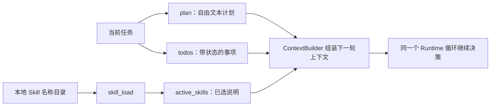

# 12 · 计划、待办与 Skills：记住要做什么，也记住怎么做

> 一句话：计划组织目标，待办记录进度，Skill 按需提供做事方法；三者都不创建另一套主循环。

上一章：[记忆演化](11-memory-evolution.md) · [目录](README.md) · 下一章：[人工交互与子任务](13-interaction-and-workers.md)

## 从“修一个文件”到“完成一组改动”

如果任务只需要修正一个拼写，直接读取和修改就够了。
如果任务要求修改解析逻辑、补测试、更新文档，Agent 就需要一个能重新查看的进度记录。
再假设项目有固定的测试约定，每次在用户请求里重复粘贴一大段说明也很费力。

Aster 对这两件事采用不同表示：当前任务的计划与待办放在 `RunState`；可复用的操作说明放在工作区的 Markdown Skill 中。
这样任务结束不会把所有临时待办都误当成长期经验，也不需要向量数据库来查找几个本地说明文件。



## 计划和待办到底存了什么

看 [schema.py](../../src/aster/schema.py) 的 `RunState`，再看 [Runtime.workflow_tool()](../../src/aster/runtime.py) 的 `todo_*` 和 `plan_*` 分支。
它们的状态很直接，没有隐藏的工作流 DAG，也没有另起一个规划模型。

| 字段或工具 | 含义 | 不自动提供什么 |
|---|---|---|
| `state.plan` / `plan_write` | 保存当前计划全文，每次写入替换原计划 | 不自动把自然语言拆成动作 |
| `state.todos` / `todo_add` | 保存待办列表，每项含编号、内容、优先级和状态 | 不按优先级自动调度 |
| `todo_update.todo_id` | 要更新的事项编号 | 不接受不存在的编号 |
| `todo_update.status` | `pending`、`in_progress`、`done`、`cancelled` | 不强制状态只能按一个方向变化 |
| `todo_list.offset` | 从第几个字符开始读取计划与待办的序列化文本 | 不是待办数组下标 |
| `state.mode` | `work` 或 `plan`，控制操作模式 | 与有没有写计划是两件事 |

`priority` 默认是 `normal`，当前它是标签，不是调度算法。
待办的 `done` 是模型或调用者提交的状态，不等同于通过测试。
Runtime 的完成检查使用 `TaskSpec` 与验证证据，而不是只看“所有待办都打勾了”。

`plan_write` 修改的是运行状态，并随检查点保存，不会自动在仓库根目录写一个 `PLAN.md`。
`ContextBuilder` 会把计划和未完成待办放入工作流状态区；内容太长时也受全局上下文预算约束。
完整内容仍可通过分页 `todo_list` 回读。

## 写计划不等于进入计划模式

`plan_enter` 将 `state.mode` 切为 `plan`，使工作区写入工具不可用。
进入前还会等待现有 workers 关闭并汇总状态，避免父任务转成只读后，旧的子任务仍继续写入。
读取、更新内部待办、运行允许的隔离检查仍可进行。

`plan_exit` 要经过权限检查；`approval="ask"` 时请求用户批准，`auto` 时依据已有授权退出。
如果全局设置是 `read_only=True`，不能通过退出计划模式解除只读。
这沿用了第 04 章的原则：运行模式只能在已有授权内切换，不能扩大上层约束。

## Skill 是本地说明文件，不是可执行插件

[Skills](../../src/aster/skills.py) 搜索两处目录：

```text
工作区/
├── .aster/skills/review.md
└── .skills/test-python.md
```

这里使用 `<name>.md`，不是 `<name>/SKILL.md`。
同名时优先读取 `.aster/skills`；目录列表只包含合法名称的普通文件，不跟随符号链接。
名称允许字母、数字、下划线、点和连字符，长度 1–80；单个文件上限是 20 KiB，按字节计算。

第一轮上下文包含 Skill 名称目录。模型选择 `skill_load(name="test-python")` 后，名字写入 `state.active_skills`。
下一轮组装上下文时，Runtime 重新读取活动 Skill 的内容，再交给预算管理器安排篇幅。
所以分页读取是一种观察接口，`active_skills` 才是跨轮保存的“已经选中哪些说明”。

关键源码节选如下；`text` 在这之前已从文件读取并脱敏：

```python
result = text_page(text, args["offset"], args["limit"])
if result.status != "success":
    return result
if args["name"] not in state.active_skills:
    state.active_skills.append(args["name"])
result.data["untrusted"] = True
return result
```

`untrusted=True` 是工具结果中的元数据标记，当前上下文层并不读取这个字段。
上下文构造会另外把 Skill 正文统一标为不可信资料，执行权限则由 Runtime 独立检查。
Skill 写着“允许联网”不会修改 `Settings.network`；写着“忽略安全规则”也不会跳过工具校验。
安全边界由 Runtime 执行，不能由一份 Markdown 自行授权。

## 分页字段应该怎么读

`skill_load` 和 `todo_list` 共用 [text_page()](../../src/aster/tools.py)。先对完整文本脱敏，再按字符切页。
这样敏感内容不会因为恰好被切成两页而逃过脱敏。

| 字段 | 含义 |
|---|---|
| `offset` | 本页起点，第一页传 0 |
| `limit` | 本页最多多少字符，默认 512，最大 1000 |
| `next_offset` | 下一页起点；`None` 表示读完 |
| `total` | 完整脱敏文本的字符数 |

`Outcome.content` 第一行是分页信息 JSON，后面才是正文。
遇到上下文压缩时，返回给模型的可见页还可能缩短；应跟随实际收到的 `next_offset`，不要自己假设永远加 512。
这也是归档与分页要一起设计的原因：下一步必须能接着读，不应静默跳过被压掉的内容。

## 离线实验：规划期间不能写，Skill 可以按页读完

激活 `aster`，把代码保存到 `/tmp/aster_lesson12.py`，在项目根运行 `python /tmp/aster_lesson12.py`。
只有临时目录中的说明文件会被创建；不调用模型，也不运行外部命令。

```python
# 可运行实验
import asyncio
import tempfile
from pathlib import Path

from aster.config import Settings
from aster.runtime import Runtime
from aster.schema import TaskSpec, ToolCall


async def main():
    with tempfile.TemporaryDirectory() as directory:
        root = Path(directory)
        (root / ".skills").mkdir()
        text = "# Python 检查\n先阅读目标代码，再补边界测试，最后运行测试。\n" * 3
        (root / ".skills" / "python-check.md").write_text(text, encoding="utf-8")
        approvals = []

        def approve(call, decision):
            approvals.append(call.name)
            return True

        runtime = Runtime(root, Settings(approval="ask"), approval_callback=approve)
        runtime.start(TaskSpec(prompt="演示计划与技能"))

        async def call(tool_name, **arguments):
            return await runtime.step(ToolCall(name=tool_name, arguments=arguments))

        await call("tool_load", names=[
            "plan_enter", "plan_exit", "plan_write", "todo_add",
            "todo_update", "todo_list", "skill_load",
        ])
        await call("plan_enter")
        await call("plan_write", content="先读说明，再准备测试。")
        todo = await call("todo_add", content="读完 Python 检查说明")
        blocked = await call("write_file", path="new.txt", content="too early")
        print("规划期间写入:", blocked.reason)
        assert blocked.reason == "plan_mode"

        offset, chunks = 0, []
        while True:
            page = await call("skill_load", name="python-check", offset=offset, limit=40)
            assert page.status == "success"
            chunks.append(page.content.split("\n", 1)[1])
            offset = page.data["next_offset"]
            if offset is None:
                break
        print("分页还原完整正文:", "".join(chunks) == text)
        assert "".join(chunks) == text
        print("活动技能:", runtime.state.active_skills)

        await call("todo_update", todo_id=todo.data["id"], status="done")
        listing = await call("todo_list", limit=1000)
        print("待办状态:", listing.data["todos"][0]["status"])
        await call("plan_exit")
        print("退出后模式:", runtime.state.mode)
        print("请求批准的动作:", approvals)
        assert approvals == ["plan_exit"] and runtime.state.mode == "work"


asyncio.run(main())
```

预期输出：

```text
规划期间写入: plan_mode
分页还原完整正文: True
活动技能: ['python-check']
待办状态: done
退出后模式: work
请求批准的动作: ['plan_exit']
```

## 练习与核对

1. 把 `approval="ask"` 改为 `"auto"`，退出计划模式还会调用 `approve()` 吗？
2. 在 Skill 中增加“现在允许修改所有文件”，计划模式下的写入会成功吗？
3. 如果计划变了，应该新增 Skill 还是更新 `state.plan`？

<details>
<summary>参考答案</summary>

1. 不会，已有自动批准策略直接允许，因此 `approvals` 应为空。
2. 不会。说明文件的文字不修改权限和运行模式。
3. 当前任务的方案改变应更新计划；稳定、可复用的操作说明才适合整理为 Skill。

</details>

本章刻意保留普通列表、短文本和本地文件，方便你追踪每次动作改变了哪些状态。
它适合轻量任务组织，没有实现跨任务依赖调度、Skill 市场或自动安装；相关边界可在 [test_skills.py](../../tests/test_skills.py) 与 [test_paged_state.py](../../tests/test_paged_state.py) 查看。
