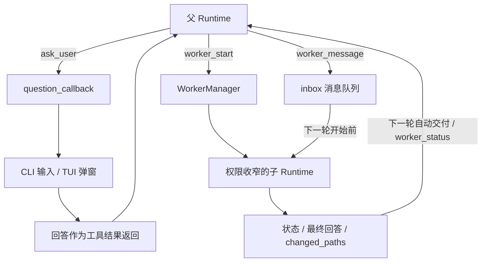

# 13 · 人工交互与子任务：同一个 Runtime，多种参与方式

> 一句话：界面负责与人交流，worker 负责一个受限子任务；它们都复用同一套执行规则。

上一章：[计划与 Skills](12-plans-and-skills.md) · [目录](README.md) · 下一章：[评测](14-evaluation.md)

## 两类“等别人回答”

Agent 要修改导出格式，但用户还没决定用 CSV 还是 JSON：这需要向人提问。
Agent 需要同时调查测试入口与模块结构：这可以交给一个只读子任务。
两者都会暂停部分工作，但权限和返回结果很不一样，不能都塞进一个没有明确语义的“消息工具”。

Aster 将人工问题接到回调，将子任务接到 `WorkerManager`。
CLI、TUI、父运行与子运行共享 Runtime 的工具、预算、检查点和权限逻辑。公开 CLI 支持 `--model`/profile 配置；TUI 命令的实际形式是 `/model [alias]`、`/new`、`/continue [--adopt-workspace]`、`/resume RUN_ID [--allow-model-change] [--adopt-workspace]`，恢复时的标志必须显式确认。模型切换不是任意输入型号即可接通：它要经过 profile 配置、空闲边界、历史转换和预算检查。



## `ask_user` 是真正的等待，不是占位返回

在 [WorkflowTools.execute()](../../src/aster/tools/workflow.py) 中，人工提问的执行路径如下：

```python
answer = self.question_callback(args["question"])
if inspect.isawaitable(answer):
    answer = await answer
if answer is None:
    return Outcome(status="blocked", reason="user_input_cancelled")
return Outcome(status="success", content=str(answer))
```

`question_callback` 可以同步返回字符串，也可以异步等待输入。
`None` 表示取消，不是空白批准。问题回答是工具结果，会进入后续模型请求。
没有回调时，能力目录和完整工具列表都隐藏 `ask_user`；即便直接调用也返回 `user_input_unavailable`。

批准动作使用另一个回调 `approval_callback(call, decision)`，返回布尔值。
回答“用 JSON”不会变成批准删除文件；批准一个写入动作也不等于回答需求问题。
它们在 TUI 可以长得相似，运行语义却始终分开。

## TUI 改变的是交互方式

[AsterTui](../../src/aster/ui/app.py) 使用 Textual，包含输入框、执行日志、轮次/工具次数和验证状态。[ui/widgets.py](../../src/aster/ui/widgets.py) 定义输入和批准框；[ui/commands.py](../../src/aster/ui/commands.py) 管理命令目录、解析和执行，App 持有界面状态并通过明确回调响应命令。
提交任务后由异步 worker 驱动 Runtime，输入框暂时禁用，避免两个前台任务争用同一个运行状态。
日志订阅 `EvidenceStore` 的事件，因此界面显示与执行记录来自同一条事件流。

人工弹窗使用一个异步锁：父运行和子运行如果同时提问，问题会排队，而不是叠放两个互相遮挡的批准框。
批准框默认聚焦“拒绝”；Escape 取消当前问题，Ctrl+C 取消任务，Ctrl+Q 退出界面。
取消会传播到正在运行的协程和工具清理路径，不只是把屏幕上的状态改成“取消”。

想手动体验时，在已激活的 `aster` 环境和交互终端中直接运行 `aster` 即可。它默认以当前目录为工作区，并自动读取当前目录的 `.env`。也可以从项目根目录指定练习工作区：

```bash
aster --cwd /tmp/aster-tui-practice
```

目录不存在时会创建，`.env` 仍从启动命令所在目录读取。大多数参数可以省略，默认审批策略为 `ask`。启动界面本身不请求模型，提交任务后使用 `.env` 配置的真实 API 并产生费用。
可以输入“列出当前目录，不要修改文件”，观察日志和状态；再尝试创建一个文件，查看批准框。
`aster '任务内容'` 则只执行一次任务；`aster --tui`、`aster-tui` 保留显式 TUI 入口。非交互输入下无任务会报错，`--resume` 与 `--rl-smoke` 继续使用专用执行路径。
本节后面的自动实验完全离线，不依赖人工操作这个界面。

## worker 复制运行边界，不复制一个独立仓库

查看 [WorkerManager.start()](../../src/aster/core/workers.py)。它创建新的 Runtime、新的 `RunState` 和检查点，并记录 `parent_run_id`。
子运行与父运行共享工作区；这是有写入范围检查的协作，不是每个 worker 都有 Git worktree。

| 字段或配置 | 具体含义 |
|---|---|
| `mode="explore"` | 只读调查；不能向工作区发布改动 |
| `mode="worker"` | 可写子任务，但只在指定 `write_scope` 内写回 |
| `write_scope` | 相对工作区路径列表；与父范围取交集，不扩大权限 |
| `max_workers` | 同时活跃的子任务上限，默认 0（按需显式开启）；结束后名额可复用 |
| `worker_id` | 父运行管理子任务的编号，不是子运行的 `run_id` |
| `future` | Python 的异步任务句柄，供调度器等待和取消 |
| `inbox` | 尚未投递给子运行的补充要求 |

Worker 默认关闭；启用后每个 worker 保留独立上下文，但父子共同消耗根任务的 `TaskSpec.max_steps`、`max_turns`，以及可选的 `max_tokens` 总额度。启动时从剩余额度分配局部上限，最多 24 次工具调用、12 次模型调用；为父任务保留步骤与调用总额度的约 20%（至少各 2 次），token 上限也保留约 20%。子运行 `max_workers=0` 禁止继续派生；持久 Memory 召回与演化也关闭。流式预览只表示暂时收到的 delta，不表示动作已经执行。
它保留自己的短期工作记忆，但关闭跨运行记忆写入与演化，由父任务负责长期经验维护。
共享工作区同一时间只允许一个写入者。只要已有写 worker 活跃，另一个写 worker 就会返回 `worker_scope_busy`，即使范围不重叠；父任务的写入和进程工具返回 `worker_writer_active`，但仍可读取文件。写 worker 结束或取消后释放写入资格，父任务才能修改文件或运行测试。
这并不禁止用户的编辑器或另一个 Aster 进程修改文件，所以第 04 章的并发变更检查仍然必要。

每次模型调用发出前，团队账本先预留估算输入与最大输出 token；请求结束后用供应商报告的 usage 结算。缺失 usage 时保留预估收费量，不把失败或取消当作免费请求。`RunState.team_usage` 随父检查点保存，恢复仍保留已消耗额度；它记录调用、工具和 token，不换算为精确的美元费用。

### 交付范围与测试责任

子任务自动收到初始 `TaskSpec.prompt` 及当前分支祖先链中最近的用户请求，后者优先，保留复现和验收条件，不继承整段对话或工具观察。`worker_start.task` 仍应写清局部目标、接口、已知事实和测试分工；可选 `parent_work` 注明父任务负责的另一模块或检查，没有独立工作就等待后整合。双方收到同一分工，父检查点和启动事件保留记录；这些提示不强制保证没有重复调查。完成约束只从局部分工推断，原请求不会让只读调查承担编辑或测试门槛。没有会话树的旧版独立检查点只能回退初始请求；其余必要历史事实仍需放入局部分工。子任务使用专门的交付提示，优先检查给定目标、遵守范围，结束时简要说明改动、实际检查和未验证项。

启用 Worker 时，父任务首轮系统提示就会说明如何加载委派工具，以及先做足以分工的发现、再分派独立调查的顺序；这段宿主能力说明参与正常预算和会话预检。没有启用 Worker 的运行与子任务不会携带它。工具与文件内容仍保持原有信任边界，主任务应检查子结论的证据和缺口，避免通读完所有材料后再重复委派。

父任务分派时应包含具体问题和输出字段；没有独立工作时直接等待整组结果，再核查缺口或矛盾，不在等待期间重新调查已分派的所有区域。子任务在自己的动态额度内及时交付，已读路径与符号即可作为来源，无需为行号重复读取。执行受限时说明静态结论与待核查项，由父任务补做必要检查。引用子结论应说明来源于委派调查，不能声称父任务亲自读过所有源码。

局部额度耗尽时，worker 尝试最后一次无工具请求，只整理已知事实；即使模型仍返回工具调用也不会执行。这个收尾仍占团队预算，额度不足、服务故障或取消时，程序把已读路径、实际改动、验证状态与停止原因写入 `handoff.json`。正常完成与部分交付用 `delivery="complete"` / `"partial"` 区分；部分交付的运行状态仍然是停止、失败或取消，不伪装成成功。

Explore 和继承只读权限的子任务按调查交付：即使要求“找出修复方法、建议测试”，也不会因关键词而被要求实际编辑或通过正式测试。原有的观察要求仍然有效；只读工具权限没有放宽。

当父任务 `completion="strict"` 且 `TaskSpec.require_verification=True` 时，系统自动由父任务承担最终验证：子任务读完目标后交付实现，不必等待父任务尚未写好的测试，也不能到范围外自建替代测试。这个规则只解除子任务自己的验证完成门槛，不改变观察、编辑要求，也不把未测试的交付标成验证通过；父任务没有严格验证门槛时，子任务保留原有的任务推断规则。分工记录在 `worker_started.verification_owner`，无需模型选择额外参数。

只读子任务运行时，父任务可处理独立工作；写子任务运行时，父任务只能做只读调查。写入结束后再检查改动并验证最终工作区。子任务的验证证据不是父任务的验证证据；共享文件仍在变化时执行的测试也不能证明最终状态正确。小任务的交接与模型调用开销可能超过并行收益，无需为了使用 Worker 而拆分。

## 消息要在明确边界生效

`worker_message` 成功时返回 `queued`，只意味着消息进入队列。
worker 在下一轮模型请求前把队列内容写入自己的消息状态，然后清空队列；不会修改已经发出的 HTTP 请求。
正在执行最后一轮的 worker 如果直接完成，刚排队的消息可能来不及送达；需要区分入队记录与 `worker_message_delivered` 事件。

每个队列最多 8 条待投递消息，单条最长 8192 字符。
worker 已结束后，默认发送仍返回 `worker_finished`；显式 `resume=true` 可在同一子任务上下文中补问一次，最多追加 8 步/4 轮，且继续占用团队预算。续问也检查父权限、并发名额和单写入者限制；父任务切到计划模式等权限变化后不会沿用旧权限继续执行。未知编号返回 `worker_missing`。
这些是明确的生命周期结果，不是“这个工具永远不支持”的占位实现。

完成的子任务在父任务下一轮构建模型请求时自动投递一次。显式 `worker_status` 工具已经返回的交付不会再重复通知；界面轮询仅查看状态，不表示父模型已收到结果。`pending_handoffs` 随父检查点保存，进程恢复后补发已落盘交付；没有交付文件时报告中断，不会自动重启后台子任务，恢复后也不能对已不存在的子 Runtime 续问。

`worker_status` 返回状态、完整交付、改动路径和子任务记录的 `verification`，并让父运行吸收新增改动信息。`worker_id` 兼容单个编号，也可传最多四个编号的列表，一次等待全部交付。`wait_seconds`（0–300）是本次查询的共同期限，不按子任务数累加；默认 0 立即查询，整合前可用 300 等待。列表按请求顺序去重，外层 `finished` 只表示没有选中的子任务仍在运行，须逐项检查成功、失败、取消或 `missing`。等待超时只返回当前状态，不会取消子任务。等待期间子任务发生异常或被取消，会分别返回 `failed` / `cancelled`，不因此中断父任务。取消查询本身也不会取消子任务；退出父任务时仍按原有规则清理子任务。
`worker_stop` 取消仍在运行的任务并等待清理；不能用“子任务已结束”推断它一定成功完成了目标。

## 离线实验：回答问题，并在子任务两轮之间补充要求

激活 `aster`，保存为 `/tmp/aster_lesson13.py`，运行 `python /tmp/aster_lesson13.py`。
`PausedModel` 是确定性的教学替身：第一轮请求列文件，第二轮回答。它不调用 API，不代表真实模型的规划能力。
事件 `entered` 与 `release` 控制暂停点，避免用猜测的睡眠时间制造并发效果。

```python
# 可运行实验
import asyncio
import json
import tempfile
from pathlib import Path

from aster.config import Settings
from aster.core.runtime import Runtime
from aster.schema import ModelReply, TaskSpec, ToolCall


class PausedModel:
    def __init__(self):
        self.entered = asyncio.Event()
        self.release = asyncio.Event()
        self.requests = []
        self.saw_guidance = False

    async def complete(self, messages, tools):
        self.requests.append(messages)
        if len(self.requests) == 1:
            self.entered.set()
            await self.release.wait()
            call = ToolCall(name="list_files")
            return ModelReply(calls=[call], raw=[{
                "type": "function_call", "name": call.name,
                "call_id": call.call_id, "arguments": "{}",
            }])
        self.saw_guidance = "还要检查许可证" in json.dumps(messages, ensure_ascii=False)
        return ModelReply(text="目录已查看，补充要求已收到。")


async def main():
    with tempfile.TemporaryDirectory() as directory:
        model = PausedModel()
        runtime = Runtime(
            Path(directory), Settings(approval="auto", max_workers=1),
            model=model, question_callback=lambda question: "JSON",
        )
        runtime.start(TaskSpec(prompt="演示人机交互和子任务"))

        async def call(name, **arguments):
            return await runtime.step(ToolCall(name=name, arguments=arguments))

        await call("tool_load", names=[
            "ask_user", "worker_start", "worker_message", "worker_status",
        ])
        answer = await call("ask_user", question="导出用 CSV 还是 JSON？")
        print("人工回答:", answer.status, answer.content)

        started = await call("worker_start", task="查看目录", mode="explore")
        worker_id = started.data["worker_id"]
        worker = runtime.workers.workers[worker_id]
        await asyncio.wait_for(model.entered.wait(), timeout=5)
        queued = await call("worker_message", worker_id=worker_id, message="还要检查许可证")
        print("首轮进行中:", queued.data["status"], "已看见补充:", model.saw_guidance)
        print("子运行只读 / 可派生数:", worker.runtime.settings.read_only, worker.runtime.settings.max_workers)

        model.release.set()
        await asyncio.wait_for(worker.future, timeout=5)
        status = await call("worker_status", worker_id=worker_id)
        print("第二轮看见补充:", model.saw_guidance)
        print("子任务状态:", status.data["status"])
        assert model.saw_guidance and status.data["status"] == "completed"
        late = await call("worker_message", worker_id=worker_id, message="来晚的补充")
        print("结束后发消息:", late.reason)
        assert late.reason == "worker_finished"
        again = await call("worker_message", worker_id=worker_id, message="只解释许可证结论", resume=True)
        assert again.data["continued"]
        await asyncio.wait_for(worker.future, timeout=5)
        runtime.prepare_request()
        runtime.prepare_request()
        deliveries = [row for row in runtime.evidence.events(runtime.state.run_id)
                      if row["event"] == "worker_handoff_delivered"]
        print("补问自动交付次数:", len(deliveries))
        assert len(deliveries) == 1
        await runtime.workers.close()


asyncio.run(main())
```

预期输出：

```text
人工回答: success JSON
首轮进行中: queued 已看见补充: False
子运行只读 / 可派生数: True 0
第二轮看见补充: True
子任务状态: completed
结束后发消息: worker_finished
补问自动交付次数: 1
```

## 练习与核对

1. 删掉 `question_callback` 后，`ask_user` 应该出现在工具目录里吗？
2. 父运行只允许写 `src/allowed`，子任务申请 `src`，最终范围是什么？
3. 在第一轮阻塞期间把 `model.release.set()` 换成停止 worker，为什么还要等待异步清理？

<details>
<summary>参考答案</summary>

1. 不应出现，直接调用也要拒绝。本实验整组 `tool_load` 会因此失败，可改成只加载 worker 工具后单独探测。
2. 交集是 `src/allowed`；子任务不能通过更宽的路径扩大父权限。
3. 取消请求与清理完成不同。需要等待正在运行的协程、工具进程和检查点收尾，避免退出后仍有后台副作用。

</details>

[test_interaction_workers.py](../../tests/test_interaction_workers.py) 还用 Textual 的无头界面测试验证了真实弹窗、拒绝、回答与取消。
这个设计没有跨机器消息队列、持久化团队调度或自动合并分支；先把有界协作做完整，再由评测判断是否值得继续扩展。

真实代码复验的结果也需要和机制可用性分开看：[2026-09-29 聚焦复验](../../evaluations/worker-focused-20260929/REPORT.md)共运行 24 个 episode。Worker 的冻结评分为 5/12，Solo 为 2/12，但全队报告 token 多 21.6%、时间多 30.2%；只有 CDF 的一次 repeat 能确认子任务实际写入六个方法并被父任务保留。三轮公开样例合计 Worker 31/36、Solo 30/36，不能据此声称委派稳定提升任务能力或降低成本。使用 Worker 时应把独立工作的范围、父任务的验证责任和额外协调成本一起记录。

## 多个独立会话

[`SessionViews`](../../src/aster/ui/sessions.py) 给每个打开的会话保留自己的 Runtime、任务 worker、草稿和输出。异步运行捕获自身 Runtime，事件只发给所属会话；后台回复暂存，切回时展示。`/new [目录]` 打开独立会话，`/sessions` 查找切换，`/switch 序号` 快速切换。取消只作用于当前会话，退出则结算全部打开任务。

鼠标入口复用同一套导航：顶部「新建」填写工作目录，「会话」选择任务，「历史」选择恢复点；每次对话后的「从此分支」「带入摘录」绑定该次对话的确定位置，不会把当前最新位置误当成用户点击的旧位置。宽终端显示可点击的会话侧栏，小终端通过弹窗查看。文件变化时必须点击「保留文件并继续」才能采用当前文件。

[`session_widgets.py`](../../src/aster/ui/session_widgets.py) 使用 Textual 原生按钮、列表与 Rich 点击动作，不增加界面依赖。侧栏按真实 worker 和该会话的交互等待状态显示工作中、等待回答、已完成、取消或失败；磁盘里 running 的旧存档显示「待恢复」。弹窗定时更新状态但保留筛选与选中条目，后台审批也不会把前台会话误标为等待。恢复历史时沿父指针重建可见对话，模型上下文仍由原有恢复和压缩规则决定。

独立会话与模型启动的 Worker 不同。不同工作目录的会话可并行执行；相同目录以操作级文件锁防止多个独立执行者同时写入，父子 Worker 则遵循写入范围和单写入者规则。工具审批和追问显示所属会话与工作目录，不因切换前台而改变授权对象。不同目录的长期记忆不会自动共享。
