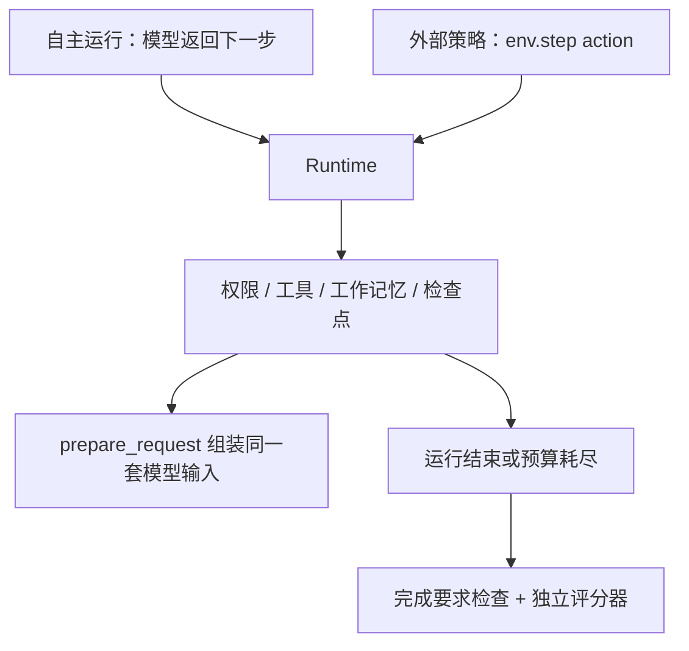

# 15｜选读：把同一个 Harness 接到外部策略

[上一章：评测](14-evaluation.md) · [目录](README.md)

> 模型自己决定下一步，或外部程序传入下一步，都应该经过同一套工具与安全规则。

本章只介绍已经实现的环境接口 `AsterEnv`，以及已经实现的数据契约。项目没有实现 tokenizer 对齐、采样训练器、优化器、权重更新或训练效果验证；读懂这章，不代表已经完成 Agent 后训练。

## 问题：评测动作为什么要经过真实运行时

自主运行时，Runtime 调用模型，解析工具调用，再执行动作。如果后续为了训练另写一个简化执行器，很容易遗漏权限、工具加载、上下文压缩或完成校验。训练中的策略因此可能学会部署后无法执行的动作。

Aster 的做法是保留同一个 Runtime，只把“谁产生下一步动作”交给外部调用者。`AsterEnv.step()` 接收动作，交回观察、奖励和终止状态；此接口现在就能用于离线动作回放。



代码入口是 [rl.py](../../src/aster/rl.py)，公开动作和任务类型在 [schema.py](../../src/aster/schema.py)。它采用常见环境接口的五元组形式，但没有依赖 Gym，也不是训练框架本身。

## 已实现的后训练数据契约

[`training.py`](../../src/aster/training.py) 已实现 `TaskRecord` 的任务来源、许可证、revision、fixture/verifier 哈希和 train/dev/test/audit 划分校验；`prepare_sft()` 会把真实保存的 request artifact 与匹配的 `model_reply` 事件连接起来，导出 assistant target，并记录省略的 prompt reasoning 数量，不导出被省略的推理内容。`TokenizedDecision` 只规定 token、prompt 长度和 assistant mask 的一致性，未提供 tokenizer。`GRPORollout`/`validate_group()` 还校验版本、采样参数、预算、分组数量和 reward 可用性。

这些是数据质量合同，不是训练器：没有真实 tokenizer 对齐、采样循环、反向传播或优化器，也没有因此产生权重或证明模型变强。`AsterEnv` 的教学奖励和 `GRPORollout` 的训练合同也要分开：环境演示可以返回奖励，但 rollout 的 `cancelled`、`infrastructure_error`、`verifier_error` 必须保持 `reward=None`，不能直接当成模型负例训练。

## reset：一轮试验一个临时工作区

```python
observation, info = env.reset(task, seed=7)
```

`task` 可以是字符串，也可以是 `TaskSpec`。字符串会被包装成任务规格。`reset()` 关闭上一轮，按 `Workspace.files()` 的工作区规则把种子仓库复制到新临时目录，并调用 `Runtime.start(task)`。

这不是复制整个目录的所有内部文件；`.aster` 等内部路径受工作区枚举规则控制。每轮修改发生在临时副本中，避免把上一轮产物当成下一轮的起点。

`seed` 当前只是返回在 `info` 中的记录值，不会自动设置模型或所有依赖库的随机种子。实验复现仍需调用者控制任务版本、策略采样和模型参数。

## step：一个动作，一次状态转换

```python
observation, reward, terminated, truncated, info = await env.step(action)
```

| 返回值 | 含义 |
|---|---|
| `observation` | 给外部策略的当前观察，包括模型输入、工具定义和任务状态 |
| `reward` | 本次转换的奖励或代价，浮点数 |
| `terminated` | `phase` 为 `completed` / `failed`，或因完成要求不满足、停滞恢复耗尽而结束 |
| `truncated` | 已进入终态但不属于上述情况，如步数/轮数耗尽、用户停止、Hook 停止或上下文超预算 |
| `info` | 结果解释、验证详情、停止原因与 trace 路径 |

动作有两种：`ToolCall` 请求执行工具，`Final` 请求交付最终回答；也可传入带 `kind` 字段的字典，由 Pydantic 检查。每次外部决策都会消耗一个 `turn`，包括被拒绝的 `Final`；工具执行还会消耗 `step`。

因此 `max_turns` 限制外部决策次数，`max_steps` 限制工具动作次数。策略不能通过不断提交无效的 Final 无限续跑。

## 外部策略实际看到什么

`AsterEnv._observation()` 会调用 `Runtime.prepare_request()`，与自主运行共享上下文策略。最应该关注的字段是：

| 字段 | 用途 |
|---|---|
| `model_input` | 已经经过当前上下文策略构建的模型输入 |
| `tools` | 当前可见且可用的工具定义 |
| `context_tokens` | 本地估算的模型输入 token 数 |
| `context_policy` | 上下文策略版本，例如 `deterministic-v7` |
| `phase`、`turn`、`step` | 当前运行阶段和已消耗预算 |
| `working_memory`、`plan`、`todos` | 短期信息、计划和任务清单 |
| `feedback`、`verification` | Runtime 的纠偏提示与内部验证状态 |

`messages` 也会暴露用于观测，但策略不能把它直接当成 `model_input` 的等价替代品：前者不是完整的原生协议历史，后者才经过实际预算、工具协议与证据组织流程。

观察中的可变容器使用副本，修改 `observation["todos"]` 不会直接改写 Runtime 状态。要执行动作，应走 `step()`，让变化留下证据。

## 两种验证，各自回答不同问题

内部完成检查回答“任务要求是否满足”：要求读过代码、发生编辑、运行验证、交付指定文件时，不能只回复一句“完成了”。外部 `verifier(root, state)` 回答“这个候选结果是否真的正确”，返回 `VerifierResult(passed, reason, details)`。

外部评分器应由可信的评测端持有，不能简单把 Agent 能修改的仓库测试当作唯一奖励来源。Aster 接受这个回调，但训练/评测划分、隐藏测试保护和评分器自身隔离，仍由调用方负责。

终局评分的实际逻辑节选如下：

```python
eligible = state.phase == "completed" or state.stop_reason in {"step_limit", "turn_limit"}
if not eligible or not completion.passed:
    return -1.0, result, completion
if result is not None:
    return (1.0 if result.passed else -1.0), result, completion
return (0.0 if state.phase == "completed" else -1.0), None, completion
```

`eligible` 表示当前停止方式是否允许把产物作为候选提交评分。达到步数/轮数上限时也检查最后的产物，避免策略用“耗尽预算”逃避失败处罚。它也意味着 `truncated=True` 不一定奖励为负：预算到点前已经写对答案，可以得到正奖励。

未结束的成功工具动作代价是 `-0.05 / max_turns`；失败工具动作或被要求修订的 Final 是 `-0.5 / max_turns`。终局使用上面的 `+1/0/-1` 替换本次动作代价。当前解释基于不折扣的整轮奖励总和，不声称这套数值已经是训练最优解。

## 离线实验：正确完成、无评分器、预算截断

在项目根目录、`aster` 环境中运行。动作由脚本明确提供，不调用模型；写文件使用项目本身的工具执行链路。

```python
# 可运行实验
import asyncio
from pathlib import Path
from tempfile import TemporaryDirectory

from aster.config import Settings
from aster.rl import AsterEnv
from aster.schema import Final, TaskSpec, ToolCall, VerifierResult


def grade(root, state):
    answer = root / "answer.txt"
    passed = answer.exists() and answer.read_text() == "42\n"
    return VerifierResult(passed=passed, reason="exact_answer")


async def main():
    with TemporaryDirectory(prefix="aster-env-lesson-") as folder:
        seed_root = Path(folder)
        settings = Settings(approval="auto", auto_dream=False)
        env = AsterEnv(seed_root, settings, verifier=grade)
        write_answer = ToolCall(name="write_file", arguments={
            "path": "answer.txt", "content": "42\n",
        })
        try:
            observation, info = env.reset(TaskSpec(
                prompt="Produce answer.txt", require_edit=True, max_turns=4,
            ))
            assert Path(info["workspace"]) != seed_root
            _, cost, ended, cut, _ = await env.step(write_answer)
            assert not ended and not cut and cost == -0.0125
            _, reward, ended, cut, info = await env.step(Final(answer="Written."))
            assert (reward, ended, cut) == (1.0, True, False)
            assert info["reward_verification"]["passed"]
            assert not (seed_root / "answer.txt").exists()
            print("正确交付：reward=1，terminated=True，种子仓库未修改")

            env.reset(TaskSpec(
                prompt="Produce answer.txt", require_edit=True, max_turns=1,
            ))
            assert not (env.runtime.workspace.root / "answer.txt").exists()
            _, reward, ended, cut, info = await env.step(write_answer)
            assert (reward, ended, cut) == (1.0, False, True)
            assert info["stop_reason"] == "turn_limit"
            print("预算截断：reward=1，truncated=True，最后产物仍被评分")
        finally:
            env.close()

        ungraded = AsterEnv(seed_root, settings)
        try:
            ungraded.reset(TaskSpec(prompt="Answer the question"))
            _, reward, ended, cut, info = await ungraded.step(Final(answer="42"))
            assert (reward, ended, cut) == (0.0, True, False)
            assert info["reward_verification"] is None
            print("没有独立评分器：正常结束，但不给成功奖励")
        finally:
            ungraded.close()


asyncio.run(main())
```

预期输出：

```text
正确交付：reward=1，terminated=True，种子仓库未修改
预算截断：reward=1，truncated=True，最后产物仍被评分
没有独立评分器：正常结束，但不给成功奖励
```

`close()` 会清理临时目录。若你启用了后台 Worker，应先 `await env.runtime.workers.close()` 等待它们收敛，再关闭或重置环境；正在执行的 step 也不能并发 reset。

## 练习与参考答案

1. 把写入的 `42` 改成 `41`，Runtime 完成检查可能通过吗？奖励如何变化？
2. `verifier` 错误地返回布尔值 `True`，会直接变成成功奖励吗？
3. 获得终局奖励后再执行一次 `step()`，能否重复领到奖励？

<details>
<summary>参考答案</summary>

1. 可能通过，因为“产生了要求的编辑”与“编辑内容正确”不同。但独立评分器会失败，终局奖励为 `-1`。实验中的正奖励断言需要相应修改。
2. 不会。回调必须返回 `VerifierResult`；错误类型会被报告为 `verifier_error:TypeError`，不会得到成功奖励。
3. 不能。已经终止的轮次会拒绝 step，报 `episode_finished`，必须先 reset。

</details>

相关契约测试见 [test_rl_contract.py](../../tests/test_rl_contract.py)。它们检查接口语义、奖励边界与并发限制，不证明策略经过训练后会变强。

到这里，你应能把 Aster 画成一个共享运行时：不同入口提供动作，相同工具、安全、上下文、记忆与恢复机制负责执行；评测单独判断执行结果。SFT/GRPO 的数据组织与校验合同已经在 [`docs/post-training-design.md`](../post-training-design.md) 和本章接口中说明；训练目标、采样训练器和优化器仍未实现。

[上一章：评测](14-evaluation.md) · [目录](README.md)
