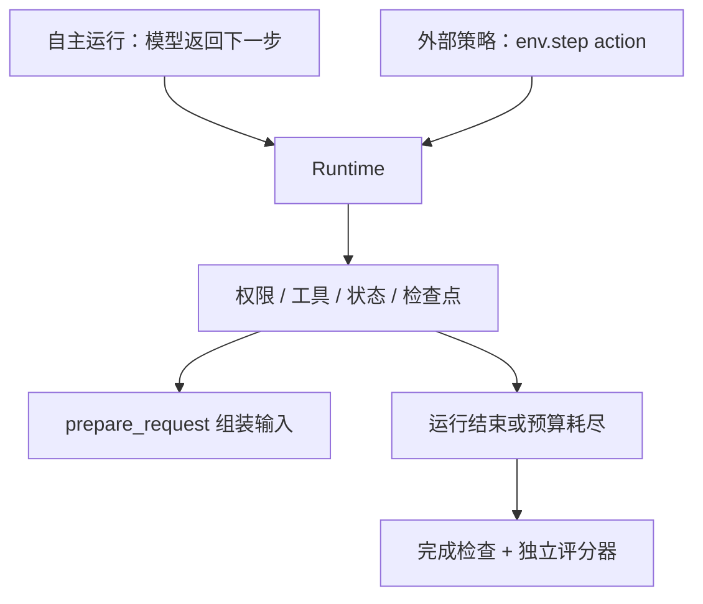

# 15｜选读：把同一个 Harness 接到外部策略

[上一章：评测](14-evaluation.md) · [目录](README.md)

> 外部策略复用 Runtime 执行动作；采样轨迹保留策略真正看到和生成的 token。

本章介绍动作级环境 `AsterEnv` 和 2026-10-18 加入的 token 级 rollout。前者适合离线回放，后者为训练提供原始采样记录；当前已通过离线契约检查，GPU 冒烟与训练循环仍待实施。

## 一套执行规则，两个动作入口

训练若另写简化执行器，容易漏掉部署时的权限、工具加载或上下文策略。Aster 将动作来源外置，执行仍交给同一个 Runtime：



[env.py](../../src/aster/training/env.py) 的 `reset(task, seed=7)` 按 `Workspace.files()` 复制种子仓库，建立新的临时工作区。每轮从相同文件起步；`seed` 在此作为记录值，策略采样种子由调用者设置。

| 接口 | 动作与计数 |
|---|---|
| `step(ToolCall / Final)` | 一次外部决策增加一轮 `turn`，工具执行另计 `step` |
| `step_turn(text, calls)` | 一轮执行文本与多个工具调用 |
| `step_invalid(raw, error)` | 保存无法解析的原文并反馈错误，允许策略下一轮修正 |

返回五元组为 `observation, reward, terminated, truncated, info`。观察中的 `model_input`、`tools` 来自 `prepare_request()`；计划、待办、工作记忆作为副本用于分析。模型输入仍由实际上下文策略决定。

`terminated` 表示正常完成、失败或完成条件/停滞终止；`truncated` 表示其他停止，例如步数、轮数或上下文预算耗尽。终局由独立 `verifier(root, state)` 检查候选：符合完成条件且独立通过得 +1，失败得 −1，正常完成但未配置独立评分器得 0。预算耗尽时也检查最后产物，因此正确候选可同时得到正奖励与 `truncated=True`。

## 数据契约保存什么

[contracts.py](../../src/aster/training/contracts.py) 的 `TaskRecord` 校验来源、许可证、revision、fixture/verifier 哈希与 train/dev/test/audit 划分；`prepare_sft()` 对齐真实 request artifact 和 `model_reply` 事件。`TokenizedDecision` 检查 token、prompt 长度与 assistant mask，`GRPORollout` 检查策略版本、采样参数、预算、分组和奖励。

这些契约描述数据准入。下面的 `Trajectory` 描述采样过程，两者之间的转换、优化器与权重更新属于后续训练实现。

## 为什么必须“token 进、token 出”

训练需要采样时的 prompt ID、completion ID 和 logprob。若先解码成文本再重新分词，同一段文字可能得到不同 token 切分，概率就不再对应当时的动作。工具调用 JSON 重排、思考标签处理也会带来这种变化。

[rollout.py](../../src/aster/training/rollout.py) 因此按如下路径执行：

1. `training_settings()` 选用非流式 Chat，关闭记忆、Worker、工作流便笺和完成补做，奖励交给独立评分器。
2. 使用策略自己的 chat template，把 `model_input` 和工具定义转为 prompt token ID。
3. `VLLMCompletions` 向 `/completions` 发送 ID，并从 `token_id:N` 响应读回原始生成 ID 与 logprob。
4. [qwen.py](../../src/aster/training/qwen.py) 解析解码文本，支持 Hermes JSON 与 XML 参数写法；动作交给 `step_turn`，格式错误交给 `step_invalid`。
5. 每轮保存 prompt/completion ID、logprob、结束原因、解析错误和段号；`loss_mask` 在 prompt 为 False、completion 为 True。

### 前缀变化时切段

只有新 prompt 的前缀精确等于上一轮 `prompt + completion`，两轮才属于同一段。上下文压缩、模板删除旧思考内容、调用重新序列化都可能改变前缀，`segment` 随之增加。每轮记录仍保留实际采样的 token；训练侧按段构造样本并关联终局奖励，分段规则直接比较 ID。

### 终止标签决定哪些样本可用于训练

| 标签 | 含义 | `trainable` |
|---|---|---|
| `success` | 独立判分通过，包括预算到点时的正确产物 | True |
| `candidate_failure` | 已终止，候选未通过 | True |
| `parse_error` | 最后输出解析失败，且候选未通过 | True |
| `budget_exhausted` | 截断结束且候选未通过 | False |
| `infrastructure_error` | 生成等环节抛异常，奖励为 `None` | False |

基础设施失败没有可归因的策略表现，排除它可避免错误负反馈；预算耗尽目前也过滤，格式错误则保留为策略学习信号。接训练器前有一处待对齐：`AsterEnv` 捕获 verifier 异常后返回 −1，当前 rollout 会标为 `candidate_failure`，而数据契约要求 `verifier_error` 的奖励为 `None`。

实施顺序见 [agent-rl-harness.md](../agent-rl-harness.md) 与 [v14 方案](../v14-and-agent-rl-plan.md)：R1–R3 已有离线实现；R0 要在 GPU 核对 token 往返及 logprob，R4–R7 再接容器环境、教师轨迹、SFT 和 RL。

## 实验一：完成与预算截断都检查最终产物

需要支持 Landlock/seccomp 的 Linux 环境。两次运行使用同一份空种子仓库和独立评分器。

```python
# 可运行实验
import asyncio
from pathlib import Path
from tempfile import TemporaryDirectory
from aster.config import Settings
from aster.schema import Final, TaskSpec, ToolCall, VerifierResult
from aster.training.env import AsterEnv


def grade(root, state):
    path = root / "answer.txt"
    return VerifierResult(passed=path.exists() and path.read_text() == "42\n", reason="exact_answer")


async def main():
    with TemporaryDirectory(prefix="aster-env-lesson-") as directory:
        seed = Path(directory)
        for limit in (3, 1):
            env = AsterEnv(seed, Settings(approval="auto", auto_dream=False), verifier=grade)
            try:
                env.reset(TaskSpec(prompt="Produce answer.txt", require_edit=True, max_turns=limit))
                result = await env.step(ToolCall(name="write_file", arguments={
                    "path": "answer.txt", "content": "42\n"}))
                if not result[2] and not result[3]:
                    result = await env.step(Final(answer="Written."))
                _, reward, ended, cut, _ = result
                assert (reward, ended, cut) == (1.0, limit > 1, limit == 1)
                assert not (seed / "answer.txt").exists()
                print(f"max_turns={limit}: reward={reward}, terminated={ended}, truncated={cut}")
            finally:
                env.close()


asyncio.run(main())
```

预期输出：

```text
max_turns=3: reward=1.0, terminated=True, truncated=False
max_turns=1: reward=1.0, terminated=False, truncated=True
```

## 实验二：用逐字符的假分词器观察分段

下面沿用 [test_token_rollout.py](../../tests/test_token_rollout.py) 的脚本化采样方式。工具表放在模板前方，后面依次追加消息；五轮分别读取、用 XML 列目录、生成残缺调用、修复、交付。假生成器为每个字符返回一个 ID 和对应 logprob，全程离线。

```python
# 可运行实验
import asyncio
import json
from pathlib import Path
from tempfile import TemporaryDirectory

from aster.schema import TaskSpec, VerifierResult
from aster.training.env import AsterEnv
from aster.training.rollout import Generation, rollout, training_settings


class CharTokenizer:  # 一个字符一个 token，id 就是字符编码；模板次序像真实模板
    def apply_chat_template(self, conversation, *, tools=None, **_):
        text = "<tools>" + ",".join(tool["function"]["name"] for tool in tools) + "</tools>"
        for message in conversation:
            text += f"<|{message['role']}|>" + (message.get("content") or "")
            for call in message.get("tool_calls") or []:  # 历史里的工具调用重新渲染成规范的 JSON
                function = call["function"]
                text += "<tool_call>" + json.dumps(
                    {"name": function["name"], "arguments": function["arguments"]}) + "</tool_call>"
        return [ord(char) for char in text + "<|assistant|>"]

    def decode(self, token_ids, **_):
        return "".join(map(chr, token_ids))


def scripted(*replies):  # 脚本化的“策略”：按顺序给出写好的回复，每个 token 的 logprob 都是 -0.1
    queue = list(replies)

    async def generate(prompt_ids):
        if not queue:
            raise RuntimeError("generation server unavailable")
        text = queue.pop(0)
        return Generation([ord(char) for char in text], [-0.1] * len(text), "stop")
    return generate


READ = '<tool_call>{"name": "read_file", "arguments": {"path": "app.py"}}</tool_call>'
LIST = "<tool_call><function=list_files><parameter=path>.</parameter></function></tool_call>"  # XML 写法
CUT = '<tool_call>{"name": "patch_file", "arguments": {"path": "app.py", "edits": [{"old_text": '  # 没写完
FIX = ('Fixing.<tool_call>{"name": "patch_file", "arguments": {"path": "app.py", "edits": '
       '[{"old_text": "VALUE = 0", "new_text": "VALUE = 1"}]}}</tool_call>')
PROMPT = "Set VALUE to 1 in app.py"


async def main():
    with TemporaryDirectory(prefix="aster-rollout-lesson-") as folder:
        (Path(folder) / "app.py").write_text("VALUE = 0\n")
        settings = training_settings(model="qwen-test", base_url="http://127.0.0.1:9/v1")
        env = AsterEnv(Path(folder), settings, verifier=lambda root, state: VerifierResult(
            passed=(root / "app.py").read_text() == "VALUE = 1\n", reason="hidden tests"))

        async def episode(task, *replies):
            return await rollout(env, task, CharTokenizer(), scripted(*replies))

        trajectory = await episode(PROMPT, "<think>先读文件。</think>" + READ, LIST, CUT, FIX, "VALUE is now 1.")
        print("turn  prompt  completion  segment  extends  parse_errors")
        for number, turn in enumerate(trajectory.turns, 1):
            assert len(turn.logprobs) == len(turn.completion_ids) == sum(turn.loss_mask)  # loss 只覆盖 completion
            extends = "-" if number == 1 else turn.extends_previous
            print(f"{number:>4} {len(turn.prompt_ids):>7} {len(turn.completion_ids):>11} "
                  f"{turn.segment:>8} {extends!s:>8} {len(turn.parse_errors):>13}")
        print(f"label={trajectory.label} reward={trajectory.reward} trainable={trajectory.trainable}")
        assert [turn.segment for turn in trajectory.turns] == [0, 1, 2, 2, 2]

        for name, task, replies in [
            ("直接答复，没修", PROMPT, ["VALUE is fine."]),
            ("2 轮用完，没修好", TaskSpec(prompt=PROMPT, max_turns=2), [READ, LIST]),
            ("生成服务不可用", PROMPT, []),
        ]:
            result = await episode(task, *replies)
            print(f"{result.label:<21} reward={result.reward!s:<5} trainable={result.trainable!s:<5} # {name}")


asyncio.run(main())
```

预期输出（`prompt` 一列含系统提示词，会随提示词版本变化；其余各列由脚本决定）：

```text
turn  prompt  completion  segment  extends  parse_errors
   1    2572          97        0        -             0
   2    2682          84        1    False             0
   3    2782          89        2    False             1
   4    3057         148        2     True             0
   5    3271          15        2     True             0
label=success reward=1.0 trainable=True
candidate_failure     reward=-1.0  trainable=True  # 直接答复，没修
budget_exhausted      reward=-1.0  trainable=False # 2 轮用完，没修好
infrastructure_error  reward=None  trainable=False # 生成服务不可用
```

怎么读第一张表：prompt 越来越长，因为历史在累积。第 2 回合新开一段：第 1 回合的 completion 带 `<think>…</think>`，Aster 只把解析出的文字和调用写进历史，下一次渲染时思考内容消失，prompt 不再是“上一次 prompt 加 completion”的延长。第 3 回合新开一段：第 2 回合用 XML 参数写法，历史里存的是解析后的调用，模板把它重新渲染成 JSON，字符对不上。第 4 回合回到延长：第 3 回合那个没写完的调用有 1 个解析错误，不会被执行，`step_invalid` 把原文原样记入历史再追加一条错误提示，所以下一个 prompt 恰好延长了它。第 5 回合的调用恰好是模板的规范写法，同样延长。后三行是终止标签：直接答复而没修是策略自己的失败，进梯度；2 轮用完时最后的产物没通过，归为预算耗尽，不进梯度；生成服务不可用不是策略的错，`reward=None`，不进梯度。

## 练习与核对

1. 实验一把 `42` 改为 `41`，终局奖励怎样变化？
2. 为什么实验二的 XML 调用会让下一轮开启新段？
3. 生成服务故障与模型格式错误分别怎样影响训练标记？
4. 已结束的 episode 再调用 `step()` 会怎样？

<details>
<summary>参考答案</summary>

1. 独立评分失败，奖励为 −1，即使 Runtime 已满足“产生编辑”的完成条件。
2. 历史保存解析后的调用，模板重新输出为 JSON，与采样的 XML token 序列不同。
3. 生成故障奖励为空、排除训练；模型格式错误保留为可学习的策略结果。
4. 返回 `episode_finished` 错误，需 `reset()` 开始下一轮。

</details>

动作与奖励契约见 [test_rl_contract.py](../../tests/test_rl_contract.py)，token 往返、分段和终止标签见 [test_token_rollout.py](../../tests/test_token_rollout.py)。

[上一章：评测](14-evaluation.md) · [目录](README.md)
