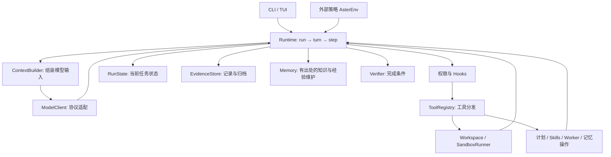

# 跟着一次任务，读懂 Aster

模型提出动作，工具接触工作区，Harness 把两者连接起来，并管理上下文、权限、记忆和执行状态。这套教程带你沿着一项任务读 Aster 的实际代码，逐步回答：**它为什么能继续做事、为什么知道何时停下、结果出了问题又如何查明原因？**

需要的基础只有 Python：能读函数、类和字典。遇到 `async`，先理解为“此处可能等待模型、进程或用户”，不用先学完异步编程。数据字段会在第一次用到时解释；训练算法知识不是前置条件。

## 从哪里开始

第一次接触项目，从 [00｜跑通任务](00-quickstart.md) 开始。先看完整闭环，再按顺序增加概念。章节顺序是学习路线，所有实验使用当前同一个 Runtime，不要求切换旧版本或复制另一套 Agent。

日常 CLI/TUI 使用默认开启项目记忆、记忆演化和自动整理，无需手动配置。部分离线实验会显式关闭它们，以便单独观察某条执行路径；这些实验设置不代表产品默认值。

| 阶段 | 章节 | 这一章要能回答的问题 |
|---|---|---|
| 看见闭环 | [00 跑通任务](00-quickstart.md) | 没有 API Key 能先学什么？ |
| 看见闭环 | [01 Agent 循环](01-agent-loop.md) | run、turn、step 有什么区别？ |
| 看见闭环 | [02 模型协议](02-model-protocols.md) | 三种接口如何进入同一个循环？ |
| 让动作可控 | [03 工具系统](03-tool-system.md) | 工具如何定义、加载和分发？ |
| 让动作可控 | [04 权限与沙箱](04-permissions-sandbox.md) | 想调用工具，为什么不一定能执行？ |
| 留下可检查的状态 | [05 状态与证据](05-state-and-evidence.md) | 聊天记录、检查点和日志为何都需要？ |
| 处理长任务 | [06 上下文预算](06-context-budget.md) | 模型输入何时压缩、按什么顺序压缩？ |
| 处理长任务 | [07 归档与回读](07-context-archives.md) | 移出输入的工具结果如何找回来？ |
| 处理长任务 | [08 Hooks 与完成检查](08-hooks-and-completion.md) | 重复、震荡和过早结束怎样处理？ |
| 处理长任务 | [09 检查点与恢复](09-checkpoint-resume.md) | 中断后哪些状态可信，哪些必须拒绝？ |
| 复用可靠信息 | [10 分层记忆](10-layered-memory.md) | 原始历史、文件摘录与提炼出的知识如何分工？ |
| 复用可靠信息 | [11 记忆演化](11-memory-evolution.md) | 后台何时整理知识，怎样避免覆盖纠正，维护成本如何统计？ |
| 组织复杂工作 | [12 计划、待办与技能](12-plans-and-skills.md) | 计划、执行权限、技能文本是一回事吗？ |
| 组织复杂工作 | [13 交互与 Worker](13-interaction-and-workers.md) | 用户、界面与子任务如何接入？ |
| 证明机制有效 | [14 评测与审计](14-evaluation.md) | 规则通过与真实任务成功如何区分？ |
| 选读 | [15 外部策略环境接口](15-rl-interface.md) | 换外部策略时如何继续复用 Harness？ |

如果已有基础，想先理解最关心的部分：

- 上下文路线：01 → 02 → 05 → 06 → 07 → 14。
- 记忆路线：01 → 05 → 10 → 11 → 14。
- 安全与可靠性路线：01 → 03 → 04 → 08 → 09 → 13。

## 每章怎么学

每章从一个具体场景开始，再给出数据流、少量源码节选和字段解释，最后安排可运行实验及练习。建议先预测实验结果，再运行，对照结果回到源码找原因。你应该能解释“为什么出现这个结果”，而不只是记住返回字符串。

正文中的短代码块是源码节选或数据示意；标有 **`# 可运行实验`** 的完整 Python 块可独立执行。实验大多使用临时工作区，结束后清理，不依赖上一章遗留文件，不需要 API Key。模型替身的动作固定，目的是让机制可观察；真实模型的自主能力要另外评测。

在仓库根目录、已安装项目的 项目虚拟环境 环境中：

```bash
source .venv/bin/activate
# 看本课程包含哪些完整实验：
python docs/learning/run_examples.py --list
# 运行一章，可写 06 或 6：
python docs/learning/run_examples.py 06
# 运行所有标记实验；不调用远程模型：
python docs/learning/run_examples.py all
```

[run_examples.py](run_examples.py) 只用标准库提取上述标记代码块，交给当前 Python 执行。它不实现 Agent，不执行正文里的真实模型命令，也不会安装依赖。你也可以直接复制一个完整代码块到 `/tmp/aster-lesson.py` 后运行。

多数实验只需要 Python 环境；涉及测试进程、Worker 的部分需要当前支持 Landlock / seccomp 的 Linux 环境。实验失败会停止并保留错误，不会自动把沙箱降级为关闭。TUI 另外给出人工体验步骤；其离线章节实验验证的是问答回调和 Worker 数据流。

## 整张代码地图



读 [runtime.py](../../src/aster/core/runtime.py) 时，不必一次消化所有分支。每章会指定入口，例如研究上下文先跟 `prepare_request`，研究动作先跟 `_execute`，研究结束先跟 `finalize`。这比把文件从第一行逐字读到最后一行更容易形成结构。

| 目录 | 职责 |
|---|---|
| [src/aster](../../src/aster/) | 产品运行时，各入口共用的实现 |
| [tests](../../tests/) | 工程契约与边界回归 |
| [datasets](../../datasets/README.md) | 任务、初始文件、参考动作与评分标准 |
| [scripts](../../scripts/) | 评测执行与结果比较 |
| [docs](../) | 学习、配置、设计记录与实测结论 |

## 几个先认得名字就够的术语

| 名词 | 本教程中的意思 |
|---|---|
| Harness | 连接模型与环境、控制执行边界的运行系统 |
| tool calling | 模型输出工具名称与参数，由程序决定是否执行 |
| schema | 数据的字段、类型和约束；工具用它说明参数格式 |
| context / prompt | 本轮送给模型的输入；不等于磁盘上的全部历史 |
| working memory | 本次任务整理出的短期信息 |
| checkpoint | 可以用来恢复运行的状态快照 |
| trace | 按时间记录的执行事件 |
| verifier | 按明确条件验收结果的程序 |
| ablation / 消融 | 只改变某个机制，比较开关前后的结果 |
| rollout | 策略在环境中逐步行动产生的一条完整轨迹 |

## 学完怎样判断自己会了

找一条真实运行，从请求、调用、工具结果走到最后报告；不用照着目录，画出它经过的组件。然后回答：

1. 为什么工具结果不能脱离调用单独留在压缩后的历史里？
2. 为什么跨运行记忆关闭后，短期工作记忆仍然存在？
3. 为什么“代码测试通过”和“Agent 正常完成任务”需要分开记？
4. 为什么归档能读回，不等于模型必然会主动读回？
5. 如果要证明一个 Hook 有收益，你会设置什么对照和共同目标？

答案分别在 02/06、10、08/14、07/14、08/14。能结合具体源码与实验说明，才算读懂了设计。

本次重写借鉴三个教学项目的章节组织、代码走读和实验方式；实际阅读的章节、版本与差异记录在 [教学参考](references.md)。

当前包结构及 Python 导入路径见 [模块整理说明](../module-layout.md)；课程示例直接导入实现所在模块。


历史实验的设计取舍与证据边界见[优化历程](../optimization-history.md)；已公开的报告与原始数据见[指标证据](../evaluation-results.md)。
