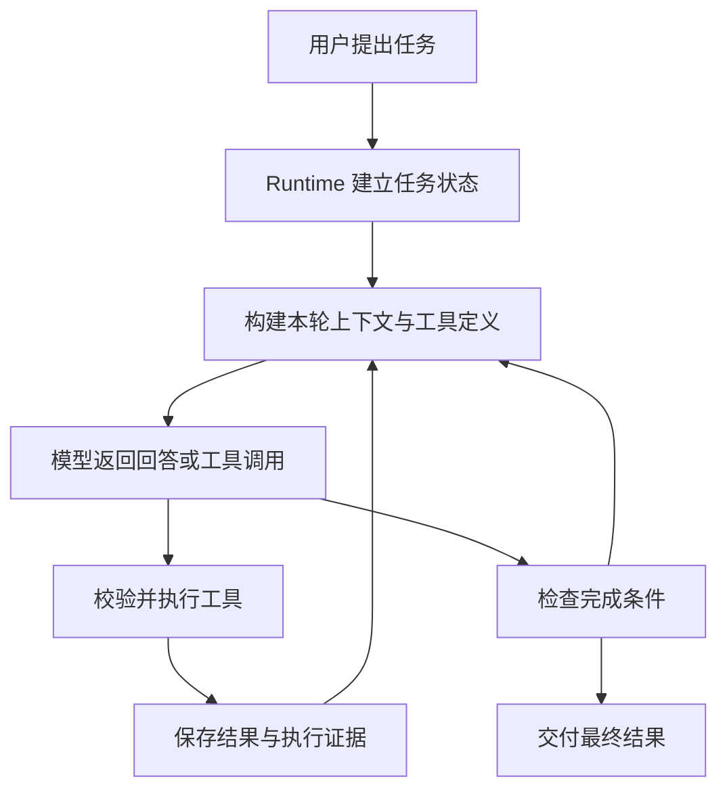
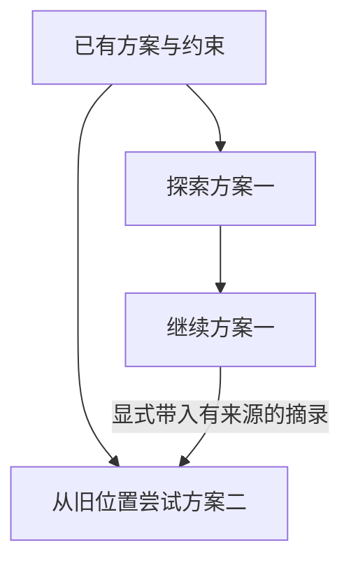
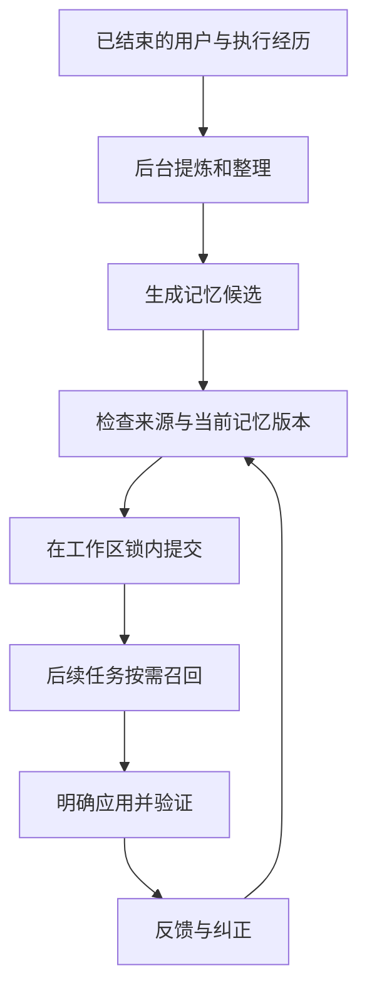

# Aster 的设计与演进

Aster 是一个用 Python 编写的本地 Coding Agent。给它一项代码任务，它需要自己查资料、读文件、修改实现、运行测试，再把结果交给用户。这个项目关心的是：怎样把模型的工具调用能力，组织成一套可以持续工作、可以恢复、可以检查的运行系统。

这篇文章把项目的设计和实验按问题串起来。先理解最小循环为什么不够，再看上下文、会话、子 Agent 和记忆怎样逐步加入，以及真实评测怎样反过来改变设计。读完后，再进入 [00–15 章源码教程](README.md)，会更容易理解每个模块为什么存在。

记录范围为 **2026 年 9 月 11 日至 10 月 11 日**。日期表示相关阶段和实验发生的时间；不同实验的模型预算、题目和评分方式并不相同。文中的数字各自链接到原始报告，不能沿着时间线直接拼成一条能力增长曲线。

## 一、为什么要做一个 Coding Agent Harness

假设用户提出这样的需求：

> 修复 CSV 导出中的金额舍入问题，保留原来的列顺序，并补充回归测试。

这是一个用于解释流程的例子。模型即使知道十进制计算，也不能只回复一段建议代码。它必须找到真正的导出入口，确认金额在哪一层转换，了解项目的舍入约定，修改合适的函数，再检查列顺序和已有行为有没有被破坏。

更麻烦的是，任务可能中途断网，测试依赖可能缺失，用户可能临时纠正需求，模型也可能读错文件或误以为任务已经完成。随着工具输出不断加入，对话还会越来越长。

这些问题组成了 Aster 的工作范围。

**Harness 可以理解为模型与执行环境之间的运行系统。** 模型决定下一步想做什么；Harness 准备它能看到的信息，判断动作能否执行，记录执行结果，并决定任务还可以继续多久、是否满足交付条件。

| 参与者 | 在金额修复例子中负责什么 |
|---|---|
| 模型 | 判断根因、选择文件、提出补丁和测试 |
| 工具 | 真正读取文件、应用修改、启动测试进程 |
| Harness | 管理调用顺序、权限、上下文、预算、状态和完成检查 |
| 独立评测 | 在 Agent 结束后，检查交付是否满足预先规定的要求 |

最后两项尤其容易混在一起。Harness 能要求“修改后必须运行测试”，却未必知道模型选择的测试是否足够。独立评测可以发现遗漏，但正式做任务时，模型不能提前看到隐藏答案。

因此，Aster 从一开始就同时需要运行系统和评测材料。前者让任务有机会完成，后者帮助判断到底改善了什么。

项目采用本地文件、JSON、SQLite 和 Python 异步机制组织这些能力。涉及外部模型、数据校验和终端界面时，分别使用已有的 HTTP 客户端、Pydantic 和 Textual。设计参考与取舍保存在[设计来源](../design-references.md)，当前结构见[模块说明](../module-layout.md)。

## 二、先把一次任务跑成闭环

### 2.1 一轮模型请求之后，事情才刚刚开始

Aster 最基本的路径可以这样读：

最后一条返回边很重要。模型给出最终回答后，如果任务要求的修改或验证没有完成，Runtime 可以把缺口反馈给它，允许在已有额度内继续修正。反馈也有次数和预算限制，不能无限循环。

源码中有三个容易混淆的单位：

| 单位 | 含义 | 为什么要分开 |
|---|---|---|
| run | 一次任务运行 | 保存任务、预算、产物和最终状态 |
| turn | 一次模型决策轮次 | 一轮可能没有工具，也可能提出多个工具调用 |
| step | 一次工具动作 | 可以单独判断执行是否成功、是否修改了文件 |

例如一次模型回复同时要求读取两个文件，模型决策只有一轮，工具动作却有两个。只限制其中一个计数，很容易误判任务已经使用了多少资源。

当前主入口在 [Runtime](../../src/aster/core/runtime.py)：`run()` 维持循环，`prepare_request()` 准备本轮输入，工具执行路径更新状态，`finalize()` 处理完成请求。CLI、TUI 和外部策略环境都使用这一套内核。

### 2.2 为什么聊天记录之外还要保存状态和证据

聊天记录适合回答“模型刚才看到了什么”，却不适合单独回答“这份测试结果对应哪个版本的文件”。

因此，Aster 把信息分开保存：

| 信息 | 主要用途 |
|---|---|
| 模型历史 | 维持对话和工具调用协议 |
| `RunState` | 记录当前预算、待办、修改路径、验证状态等事实 |
| 执行事件与工具归档 | 复盘具体动作，查阅较长的原始结果 |
| checkpoint | 保存恢复运行所需的状态和身份 |
| 跨会话记忆 | 保存后续任务可能复用的知识和方法 |

这些材料会引用同一次工作，但保留条件不同。某段测试输出可以移出本轮模型输入，同时继续留在归档中；一次已经失败的测试也不能因为聊天窗口变短就失去记录。

这种区分后来成为上下文压缩、历史分支、子任务交付和记忆学习的共同基础。如果一开始只维护一份不断追加的字符串，后面每增加一个功能，都需要重新猜测字符串里哪些内容仍然可信。

继续读：[01 Agent 循环](01-agent-loop.md)、[05 状态与证据](05-state-and-evidence.md)、[早期修复记录](../repair-results.md)。

## 三、先弄清楚“做对了”是什么意思

项目很早就遇到一个评测问题：程序正常结束、内部检查通过、用户任务完成，可能是三件不同的事。

例如，模型为金额修复写了一条只检查普通整数的测试。测试确实执行并通过了，进程也正常退出，但小数边界仍然错误。另一个任务可能已经留下正确补丁，却在最后整理答案时超时。

这两种情况都值得保留。前者暴露验收覆盖不足，后者暴露交付与预算问题。

| Runtime 是否正常交付 | 独立验收是否通过 | 应当怎样理解 |
|---|---|---|
| 是 | 是 | 完整交付成功 |
| 是 | 否 | 内部完成判断没有覆盖真实需求 |
| 否 | 是 | 产物正确，但运行或交付流程仍有问题 |
| 否 | 否 | 同时检查任务实现与执行失败原因 |

不同实验可以选择不同主指标。例如 SWE-bench 官方评分主要判断补丁是否修复问题；跨会话任务可以要求“正常交付且独立通过”。比较前必须先确认分子和分母是什么。

Aster 的验证材料也因此分成几类：

- **工程回归**检查明确的程序契约，例如错误的工具配对是否被拒绝。
- **固定动作回放**让工具按预定顺序执行，用来确认环境、工具和评分器能够工作。
- **真实模型评测**观察模型能否自主选择有效动作，并记录所有失败和消耗。
- **机制分析**回看轨迹，确认新增的机制是否触发、交付是否被使用。

固定动作回放可以全部通过，真实模型仍可能选错工具；真实模型成绩上升，新增机制也可能一次都没用到。后面的子 Agent 实验就出现过第二种情况。

实验协议、候选源码身份、任务和判分规则尽量在运行前固定。题目用过之后仍可用于开发回归，但它们已经参与设计，不能再叫未见测试集。旧失败、服务故障和额外补测也需要保留身份，不能挑各轮最好的答案拼分。

早期 `artifacts` 中还有旧指标口径的记录。[工件说明](../../artifacts/README.md)明确保留了早期 token 重复相加、任务重复等问题。因此学习项目时应沿着修订后的报告读，不能只找历史上最漂亮的百分比。

继续读：[14 评测与审计](14-evaluation.md)、[评分器边界](../grader-boundary.md)、[评测总索引](../../evaluations/README.md)。

## 四、上下文越来越长，应该删掉什么

### 4.1 只保留最近几轮为什么不够

修复一个跨文件问题时，用户可能在第一轮强调“不能改变公共 API”，几轮后补充“旧格式还要兼容”。随后几十次读取和测试会把这些要求推到历史前面。

简单丢掉最旧内容，会连要求一起丢掉。给每个工具输出固定截断长度，也会在窗口还有空间时过早损失信息。反过来，全部保留又可能挤掉后续推理所需的空间。

还有一个更基础的约束：工具历史本身是一种协议。某条结果对应特定调用编号；结果与调用不能随意拆散，一些服务要求的推理元数据也不能被当作普通文本删除。

因此，Aster 在 9 月 16 日的改造中采用确定性预算管理：先保存可回读的原文，再计算整个请求是否装得下；只有存在压力时，才按规则减少发送给模型的内容。

### 4.2 全局预算、成组压缩、按需回读

这里有三个相互配合的选择。

**第一，预算针对完整请求。** 系统指令、工具定义、历史消息、动态状态和协议包装都会占空间，同时还要给输出留额度。只数用户正文和文件内容，会低估真实请求。

**第二，压缩保持交互完整。** 优先移出允许删除的旧普通消息，再缩短旧工具结果或移出旧的完整交互组；最近交互和必要协议信息尽量保留。如果仍然放不下，明确停止并说明预算不足。

**第三，详细结果有归档入口。** 被移出的工具正文可以通过 `observation_read` 查找和分页读回。较小的完整结果不必额外挂长引用，回读工具也按需加载，避免为“可能需要”增加每轮固定开销。

可以把它理解成：桌面放当前工作需要的材料，文件柜保存已经收集到的原文。桌面清理之后，文件柜里的东西仍可找回。但文件柜不能补出最初就没采集到的内容，也不能保证模型主动想到去查。

具体规则及其研究取舍见[上下文设计](../context-redesign.md)，当前代码从 [ContextBuilder](../../src/aster/context/builder.py) 进入 [BudgetCalculator](../../src/aster/context/budget.py)。预算计算先生成候选，成功后再安装压缩结果，避免失败预检破坏原历史。

### 4.3 最有价值的结果，包含没有改善的那一组

上下文实验使用 12 道预置长历史的代码题，每题运行三次。v8 在原来的 **6,144 输入预算**下，完整完成数从 v7 的 **28/36 降到 22/36**。虽然隐藏功能检查有改善，但更多运行在正常收尾前用尽动作额度。

因此，这一轮不能解释为“换了压缩算法，同样预算下效果更好”。

随后按预先确定的规则比较 8,192、10,240、12,288 三档输入预算，选择满足门槛的最小档位，再用全新尝试确认。选定 **8,192 输入预算**后，主任务 **36/36 完成**；首次请求长度从平均 **18,434.83** 压到 **7,779.25** 个本地估算 token，平均压缩 **57.8%**。

这里要同时读出两层信息：全局预算机制可以在这组任务上保留足够材料；给任务足够空间也很重要。后面的 36/36 包含预算选择的影响，不能全归给代码改动。

另外，一次性历史证据控制题在新确认批次中 **0/3 完成**，模型没有主动使用归档读取。这说明“原文没有丢”和“模型能利用原文”之间还有距离。

57.8% 也只描述首次请求的本地长度估计，不是整项任务的总 token 降幅，更不是账单下降。完整的选参、失败与确认过程见[上下文结果](../context-results.md)。其中 8,192 是压力实验档位，日常配置仍按模型窗口与用户设置管理。

继续读：[06 上下文预算](06-context-budget.md)、[07 归档与回读](07-context-archives.md)。

## 五、工具能执行，还要让它适合真实仓库

### 5.1 从“允许操作”到“能正确完成操作”

一个只有读文件、写文件、运行命令的 Agent，已经可以完成简单任务。进入真实仓库后，问题会集中到操作细节：补丁匹配到多个位置、测试日志超过返回上限、依赖安装后下一条命令找不到、模型使用了过时的文件内容。

9 月 18 日的长任务改造逐批处理了这些问题。

批量补丁会先在同一份原文里定位所有修改，要求位置唯一且互不重叠，再统一应用。这样可以减少工具往返，也避免第一处修改已经发布、第二处才发现无效的半成品状态。

命令输出增加有界采集、脱敏归档和分页回读。模型先看到可读预览，必要时查询详细日志；超过采集上限的部分明确标记，不能声称所有输出都永久可恢复。

对于权限，工具名称本身没有特殊通行证。读取、写入、命令执行和结果发布仍要通过各自的检查。文件在等待用户批准期间可能已被另一进程修改，因此实际执行前还要复核版本。

这些机制共同服务于一件很具体的事：模型基于刚才读到的内容提出修改时，程序要确认它现在面对的仍是那份内容。

### 5.2 保护边界也会改变模型面对的环境

隔离执行会带来真实的使用约束。工作区路径可能变化，被忽略的临时文件可能不进入测试副本，进程生命周期也可能与普通终端不同。

10 月的成本诊断发现，模型会先把一次性测试写进临时目录，再启动隔离测试。由于测试文件没进入副本，它又要重新写、重新执行。模型在做合理的验证准备，却被工具之间的契约迫使多绕了几圈。

后来的修正允许一次 `run_tests` 调用直接携带临时测试源码，由工具在隔离副本中创建和执行。这既减少了准备动作，也让“临时测试文件应该在哪里”成为工具明确负责的事。

10 月 11 日又发现另一类问题：临时 pytest 项目位于仓库树内时，会向上继承仓库配置，受到原项目 `--strict-markers` 等选项影响。改动把每条命令的临时目录放到项目树之外，并授予相应的有限访问权限。

这些案例说明，分析 Agent 失败时除了看模型思路，也要问：模型预期的文件和进程语义，与工具真实提供的语义是否一致。

### 5.3 流式显示、并行读取和 Skills 分别解决什么

流式响应让用户更早看到输出，但半截工具参数不能提前执行。Aster 的工具动作仍等完整响应确认；服务断流后也要区分可以重试的请求失败与已经发生的工具副作用。

只读工具并行可以缩短独立读取的等待。它和多个 Agent 各自推理不同：前者并发执行模型已选好的工具，后者还会产生分工、子推理和汇总成本。

Skills 则把任务方法打包成可发现、按需加载的文本与资源。方法能指导模型，但不会自动授予写文件或联网权限。加载后的技能正文保留快照，后续请求不应因为磁盘内容变化而悄悄切换到另一份指令。

这三项能力分别改善交互、工具调度和知识组织。是否提高任务成功率，都需要各自的实验来回答。

继续读：[长任务分批实施记录](../long-task-implementation.md)、[03 工具系统](03-tool-system.md)、[04 权限与沙箱](04-permissions-sandbox.md)、[12 计划与技能](12-plans-and-skills.md)。

## 六、任务会中断，探索也会走弯路

### 6.1 恢复运行需要检查什么

长任务不可能只考虑一直顺利执行的情况。模型请求可能失败，终端可能退出，用户也可能主动取消。

checkpoint 保存了恢复线索，但保存过不代表现在可以直接继续。恢复前还要检查工作区是否改变，模型协议是否兼容，引用的归档是否存在，以及上次中断时有没有状态不明的动作。

如果写入动作可能已经执行，盲目重放会产生第二次修改；如果文件已经变化，旧测试通过也不能继续当作当前版本的验收证据。

因此，Aster 的恢复路径复用正常运行的权限、协议和来源检查。遇到无法确认的状态会明确拒绝，让用户或后续操作处理实际差异。

### 6.2 “回到之前”逐渐变成一个会话树问题

单个 checkpoint 能解决中断续跑，却不太适合这样的工作方式：先完成一版方案，尝试几轮新方向，再回到原来的位置重新探索。

9 月 20—21 日的会话改造引入类型化历史树，用 SQLite 保存位置与关系，允许选择祖先位置继续，或者明确带回另一条探索中的摘录。

关键区别在于“显式”。选择旧位置，不能自动看到离开它以后发生的全部对话；如果想复用新探索的结论，需要说明哪些材料被带回来、来自哪里。子会话的恢复后来也沿用这个原则，避免旧父分支看到孩子在未来才得到的信息。

会话分支并不回滚磁盘文件。对话回到了旧位置，工作区仍可能保留新修改，因此恢复要检查文件差异；如果需要文件也分支，应配合 Git 或独立工作区。

### 6.3 这轮改善的是使用流程

六类固定工作流、每类三个变体的离线对照中，两版都完成 **18/18**，规定路径的操作数从 **69 降到 36**，减少 **47.8%**。减少的是按协议计数的命令、确认、复制等操作，没有测量人的思考时间。

后续又单独进行了真实编码回归：核心工具集两版均 **5/5** 完整完成，完整工具集两版均 **4/5**。这支持“固定流程更方便，这组编码质量持平”，不需要把导航改造说成模型推理能力提升。

继续读：[会话操作评测](../../evaluations/session-ux-20260920/REPORT.md)、[编码质量回归](../../evaluations/session-quality-20260921/REPORT.md)、[回到历史位置的专项](../../evaluations/session-branch-scenario-20260921/REPORT.md)、[09 检查点与恢复](09-checkpoint-resume.md)。

## 七、为什么中途还要重构代码

功能增加后，运行时、工具、协议和界面的边界会变得模糊。例如，为估算新配置下的上下文，先临时修改全局状态再改回来；或者同一份工具参数在多个入口被重复解析。

9 月 19—20 日的源码整理，主要目的就是把这些状态归属说清楚。

| 边界 | 重构后的职责 |
|---|---|
| Runtime | 持有任务状态，控制执行、授权和结果归集 |
| ContextBuilder / BudgetCalculator | 计算请求和压缩候选，成功后安装 |
| Provider client / codec / usage | 分开网络请求、协议转换和每请求用量 |
| ToolRegistry 与具体工具 | 分发动作，执行各自业务 |
| Session lifecycle / navigation | 准备恢复候选，检查后切换 |
| TUI | 展示状态和接收操作，调用共同内核 |

一个贯穿这些边界的做法是：**先准备并验证候选，再提交状态变化。** 模型切换预检失败时保留原会话；上下文计算失败时保留原历史；后台记忆生成候选时，也不能直接覆盖前台的新纠正。

这次重构并没有让全部代码变短。阶段报告中，Python 模块从 **27 增至 51**，源码物理行从 **9,350 增至 9,707**。某些入口文件缩短，是因为职责被拆开，并不代表全部业务消失了。

重构的价值要落到具体的重复逻辑、修改范围和状态边界上。上述数字属于当时的重构批次，后面会话树和记忆维护继续增加了代码；当前目录结构应看[模块说明](../module-layout.md)。

过程、兼容性与验证见[源码重构结果](../src-refactor-results.md)。

## 八、多个 Agent 为什么没有自然地变得更好

### 8.1 第一层困难是孩子交不出东西

把一个问题交给两个 Agent，直觉上应该更快。真正执行时，却要先决定怎么分工，让孩子理解任务，再等待、核对和整合它的结果。

Aster 在 9 月下旬连续做了等待、交付和预算方面的修正。早期发现父任务的正式测试要求被沿用到子任务后，只负责调查或局部实现的孩子也可能被完整交付条件挡住。于是区分子任务交付与父任务最终验收，让孩子按自己的职责返回，最终由父方检查整体结果。

但机制修好，整体收益仍没有自动出现。

9 月 28 日的 20 道混合代码题对照中，Solo 通过 **14/20**，Worker 通过 **13/20**；全队 token 多 **5.9%**，耗时多 **3.4%**。18 个实际启动的子任务只有 **5 个正常交付**，不少孩子把额度花在调查上，最后没有交付报告。

报告也保留了有效协作：一次 COBOL 任务里，孩子指出父方验证数据矛盾，反馈被采纳。一个正例可以帮助定位适用方式，却不足以推翻整体结果。

因此，后续改造先处理“能交什么、什么时候交、预算由谁负责”。子任务收到必要的原始需求和局部分工；接近额度时尝试有界交付；父方收到的部分结果明确标记为 partial；全队统一统计消耗，避免每个孩子各自拥有一份看似独立的无限预算。

相关记录：[Worker 基线](../../evaluations/worker-code-20260928/REPORT.md)、[交付与预算改造](../worker-redesign.md)、[需求归属评测](../../evaluations/worker-owned-20260930/REPORT.md)。

### 8.2 孩子答对了，父方仍可能重复做一遍

进入十题源码调查与审查实验后，问题变得更细。

r2 采用父方加一个孩子的分工，两遍严格通过为 Solo **12/20**、team **16/20**。但父方在子交付前读取的 11,490 个不同源码行中，有 4,673 行与孩子重合；完整用量配对的成本仍然很高。

这并不是说同一文件绝不能重复读。父方有时需要核对关键结论。真正的问题是，如果父方在孩子尚未交付时，已经独立完成了孩子的整个工作包，团队只是做了两遍调查。

于是后续迭代加入更明确的父方分工、精选来源片段、交付通知、等待方式和工具目录精简。它们分别减少重读、轮询和消息开销。

r3 的交叠行数确实下降，但质量收益仍有限；r4 的固定分工总体通过数甚至略低于 Solo。到 r5，策略改成按需要自主决定是否委派，20 个 team 回合只有 **3 次实际派工**。严格通过为 **13/20 → 15/20**，19 对完整用量的总 token 增加 **17.3%**，耗时配对中位数减少 **19.0%**。

这是一种有限的取舍：减少不值得做的协作，让少数分工产生实际交付。但全体行为事实并没有全面改善，六个胜对里还有四个没有派工，因此不能把所有分差都记在多 Agent 头上。

完整 r0–r6 的失败、修改和采用理由保存在[十题迭代记录](../../evaluations/subagent-ten-20261003/ITERATIONS.md)。它比单看最终通过率更能解释设计怎样收敛。

### 8.3 新机制一次没触发，应该怎样验证

r5 留下了一个很明确的失败：孩子耗尽 token，父方只收到程序生成的部分读取摘要，接管后又花光全队额度，最终没有答案。

r6 据此增加按剩余 token 提前收尾，让孩子趁还能负担一次请求时生成部分结论。

第一次完整复测中，team 分数有所变化，但 **20 个 team 回合没有一次实际委派**。新分支根本没执行。因此当时保留 r5，把 r6 候选和负结论一起存档。

后续才专门设计受控实验：确保发生真实派工，并用已读取证据和预先冻结的压力预算检验交付。44 个回合全部启动孩子，r6 的六个压力回合全部触发提前总结。压力组严格通过从 **0/6 到 4/6**，空答案从 **6 到 1**，token 增加 **10.2%**。

这次证据支持的是“预算紧张时更容易交出可用结果”。它没有证明速度更快，也没有解决所有子答案错误或父方耗尽问题。采用决定见[受控续测报告](../../evaluations/subagent-budget-controlled-20261004/REPORT.md)。

这段经历给项目留下一个很实用的评测习惯：新增机制后，先确认真实运行经过了那条路径，再讨论它贡献了多少。

当前默认 `max_workers=0`，模型自主委派仍默认关闭；用户可以按需使用显式子 Agent 入口。产品能力与默认策略需要分开理解。继续读：[13 交互与 Worker](13-interaction-and-workers.md)、[Worker 使用边界](../worker-readiness.md)。

## 九、记忆是怎样从文件摘录变成知识的

### 9.1 保存原文解决不了所有跨会话问题

早期 Memory 主要保存有出处的文件摘录。它适合记住某段项目说明：原文来自哪里、文件是否变化，都容易检查。

但用户可能直接在对话里纠正约定，或者一次修复只在执行记录中留下经验。仅允许逐字文件摘录，就很难保存这些信息。

更重要的是，代码本身与可迁移的方法不同。一段支付实现可以被再次读取；“金额转换要使用明确的十进制舍入方式，以及这条规则适用于哪些路径”才是后续退款任务可能复用的知识。

10 月 5 日的改造把条目扩展为三类：原文摘录、事实和方法。派生知识可以引用真实用户请求、文件观察及实际执行结果，同时带上适用条件。存储继续使用本地 JSON 和已有检索，没有因为增加“知识”一词就引入图数据库或向量服务。

| 一条可复用记忆需要回答的问题 | 对应设计 |
|---|---|
| 它说了什么 | 摘录、事实或方法正文 |
| 在什么情况下适用 | `when` 等适用条件 |
| 为什么允许保存 | 文件、用户消息或执行事件的出处 |
| 后来是否被纠正 | 替换关系和有效状态 |
| 有哪些使用反馈 | 明确应用并验证后的记录 |

出处检查能证明材料确实存在，不能自动证明模型归纳正确。所以“有引用”只是准入条件之一，知识质量还需要实际使用与纠正。

### 9.2 召回、使用和正确使用要分开

假设某次请求同时召回“金额用 Decimal”和“项目说明用法语”。代码测试通过，并不能说明法语约定被正确应用。

旧逻辑中曾出现无关召回条目连带获得成功反馈。改造后由测试调用明确说明正在检验哪些已召回记忆，没有声明的条目不跟着计分，环境错误也不作为知识对错的证据。

这改善了反馈归属，但仍然依赖模型正确判断使用关系。它没有自动完成严格的因果归因。

十题定向学习对照中，新版复用严格成功从 **4/10 到 7/10**，约束通过从 **17/30 到 25/30**，学习加复用总 token 增加 **1.7%**。学习阶段明确要求记住，所以测到的是定向学习后的复用，不是无人提示时的自动积累能力。

这一轮还暴露了更直接的问题：模型会说“已经记住”，实际没有写入；金额与用户纠正题仍然失败。学习和复用全流程成功只有 **6/10**，不能只盯着复用阶段的 7/10。

设计与结果：[知识记忆改造](../memory-knowledge-design.md)、[十题报告](../../evaluations/memory-knowledge-20261005/REPORT.md)。

### 9.3 自动学习为什么需要独立的后台路径

要求主 Agent 既完成当前任务，又恰好在正确时机主动保存经验，并不稳定。于是 10 月 6—7 日加入从已结束经历中自动提炼和批量整理的路径。

前台仍可及时保存用户纠正。后台读取有来源的经历，提出少量新增、替换、停用或不操作的候选；Runtime 在合适的工作区边界检查后再提交。

生成与提交分开的原因很具体：后台开始处理之后，用户可能已经更正了旧规则。如果它完成时直接写回旧理解，就会覆盖刚发生的纠正。候选必须接受当前版本和来源检查。

保存回执也来自实际提交结果。后台正在处理、决定跳过、候选被拒绝，都不能显示成已经学会。

十题、44 会话对照中，正常完成且通过从 **4/10 到 7/10**，独立功能通过从 **4/10 到 9/10**，14 次新增或替换回执都能对应实际条目。但已报告总 token **增加 12.6%**，预设的降耗目标没有达到；基线还存在服务失败，分差不能全部归因于自动学习。

因此，异步整理解决的是时机、并发和漏存问题。它是否减少总成本，要由下一轮单独回答。

当前配置默认开启 `memory_enabled`、`memory_evolution`、`auto_dream`，显式关闭仍生效。这里改变的是外部知识与召回材料，模型权重没有训练或更新。

继续读：[自动学习设计与交付](../agent-next-optimization.md)、[自动学习实验](../../evaluations/memory-sleep-20261005/REPORT.md)、[10 分层记忆](10-layered-memory.md)、[11 记忆演化](11-memory-evolution.md)。

## 十、降成本之前，先看看钱花在哪里

自动整理增加了模型调用，很容易让人先想到把它关掉。但上一轮账本显示，维护只占已报告总 token 的约 **7.8%**，主要开销仍在前台任务。

因此，10 月 7 日的优化先回看真实轨迹，找具体的多余工作。

一类是前面提到的临时测试文件反复准备。另一类是新会话对同一份没有变化的材料再次请求后台整理。还有一类发生在最后收尾：虽然要禁止继续执行工具，但没有必要同时改动已经提供给模型的工具定义。

对应的改动很集中：

1. 临时测试源码随 `run_tests` 一起提交，在现有隔离副本中执行。
2. 已成功整理、来源及记忆版本等条件没有变化的相同材料，跳过重复提炼；失败、取消、纠正和来源变化继续重新处理。
3. 父任务预算收尾保留工具定义，由执行入口阻止继续调用，减少请求前缀的不必要变化。

“保留工具定义”和“允许执行工具”是两个不同控制点。把它们分开后，可以限制后续动作，同时保持请求结构相对稳定。

两组各 24 会话的对照得到：

| 指标 | 基线 | 降耗版 |
|---|---:|---:|
| 正常交付且独立通过 | 9/10 | 9/10 |
| 独立功能断言 | 30/30 | 27/30 |
| 已报告总 token | 1,629,128 | 978,713 |
| 后续任务已报告 token | 1,274,240 | 689,437 |
| 工具调用 | 226 | 146 |

总 token 减少 **39.9%**，后续任务减少 **45.9%**。真实新版运行中用了 12 次临时测试源码入口，跳过了 2 次相同材料整理，因此可以确认这些机制确实执行过。

不过，一条 CSV 约定没有保存，功能断言退步了三项。修正提炼说明后，单题补查通过，但原始失败仍保留在主表。工具与提示同时变化，也没有做逐项消融，所以不能把总降幅拆给某个单独机制。

缓存数字同样需要仔细读。缓存输入占比从 **61.26% 降到 59.17%**，未缓存输入却减少 **36.8%**。比例下降和绝对工作量下降可以同时发生；这组结果支持减少总输入，不支持缓存命中比例提高。

两组还存在缺失用量，供应商实际单价也没有核实，不能把 token 降幅写成账单降幅。全项目总成本更不能直接累加几个摘要：有些后续报告已经包含前期重试消耗，还有后台用量和未知部分。

完整账本、失败与请求归档缺口见[降耗报告](../../evaluations/memory-cost-20261007/REPORT.md)，方案见[成本优化设计](../cost-optimization-20261007.md)。

## 十一、真实仓库评测把哪些问题重新暴露出来

### 11.1 从内部任务走向 SWE-bench

前面的专项实验分别检查上下文、协作和记忆。它们能帮助定位机制，但真实仓库修复还需要模型理解复杂 API、找到正确测试入口，并处理跨文件的语义影响。

10 月 8 日先做了十题 SWE-bench Verified 本地隔离评分，Aster 为 **4/10**。随后 Aster、pi、Codex 使用固定模型和十题进行官方 Docker 评分，原始结果分别为 **2/10、3/10、2/10**。

这两组数字的评分环境不同，不能说同一条件下从 40% 退到 20%。官方对照中还有五次尝试因主机或模型连接故障留下空补丁；五次补测后，替换对应结果的合并成绩为 **2/10、3/10、3/10**，原始尝试和费用另行保留。

官方评分会同时检查原来失败、修复后应通过的测试，以及原来通过、仍应保持通过的测试，通常记为 F2P 和 P2P。这样才能区分“目标问题修好了”和“顺便破坏了其他行为”。

原始材料：[本地十题](../../evaluations/swebench-verified-20261008/REPORT.md)、[官方三方对照](../../evaluations/swebench-compare-20261008/REPORT.md)、[故障补测](../../evaluations/swebench-retry-20261009/REPORT.md)。

### 11.2 一个通过的测试，不能擦掉另一份失败

这轮诊断推动了验证状态修复。

假设第一次正式测试发现 A、B 两项失败，随后模型只重跑 A 并通过。如果程序把“最近一次测试通过”当成全部验证通过，B 就会被遗忘。测试受环境阻碍或没有真正采集到用例，也可能被误解为完成。

当前 [Verifier](../../src/aster/core/verifier.py) 持续保留结构化报告中的失败项，只在对应失败重新通过时移除；文件修改之后，旧版本的通过证据也要失效。

这修复的是“已知失败不应消失”。它仍然无法发现从未测试过的情况。

修复后的十题官方结果仍为 **2/10**。九份非空补丁的已有通过测试都保持通过，但七份仍没通过目标修复测试。框架更准确地追踪已有证据，不代表模型已经覆盖共享根因和边界。

结果与限制见[验证机制复测](../../evaluations/swebench-verification-20261009/REPORT.md)。

### 11.3 多加一次“再检查”为什么最后被删除

下一版尝试在完成前自动追加复核，同时改进过载处理。官方结果仍为 **2/10**。

六次复核触发后，记录到 34 次请求和 931,400 个已报告 token，其中四次没有文件修改。部分复核确实调整了实现或测试，但没有足够证据支持默认追加这一流程。最后删除自动复核，保留故障处理修复，并补齐断流重试。

这不是说代码审查没有价值，而是这个固定触发方式在该批任务上没有证明足够收益。复核之后的 token 是观察量，也不能直接当成删除流程后必然节省的净费用。

另外，报告成绩属于带复核的冻结候选；后来删除复核、补断流重试后的代码只做本地回归，没有凭空获得一份新的十题成绩。完整决策见[复核实验报告](../../evaluations/swebench-review-20261009/REPORT.md)。

### 11.4 最新二十题：改进真实存在，盲区也仍然存在

10 月 10—11 日扩大到三来源的 20 道通用编码题：12 道仓库修复、6 道终端编码、2 道小型实现。三者原始单次都使用同一模型，每次尝试 900 秒。

| Aster 运行批次 | 独立通过 | 怎样产生这份成绩 |
|---|---:|---|
| 原始单次 | 12/20 | 各题一次，与 pi、Codex 同批比较 |
| 纳入五题补测 | 15/20 | 对应五题全部替换，包含选择性补测与环境适配 |
| 第一版优化 | 14/20 | 二十题全部全新尝试 |
| 第二版优化 | 15/20 | 再做二十题全部全新尝试 |

pi、Codex 的原始成绩为 **15/20、14/20**，后两轮没有重新跑它们。第二版 Aster 与 pi 的历史成绩持平。

改动包括临时目录隔离、有界故障退避，以及提醒模型追踪共享根因、验证类型和顺序等通用验收指引。同时，评测容器的解释器、导入、信号权限和持久服务也做了适配，所以结果不能全部归因于生产 Harness。

最新一轮正常交付且独立通过也是 **15/20**。但是，内部正常完成的 18 题中仍有 3 题独立失败：Django 遗漏共享 API 的排序行为，SymPy 漏掉通用零矩阵加法，pytest 的实现不满足返回类型和继承顺序要求。

还有一次解释器任务反复使用隔离副本中不合适的绝对路径，停滞退出；其产物本身也没有通过独立验收。因此不能假定只要修通路径就一定解对。

这些失败把下一步问题指向更具体的地方：怎样让模型定位共享语义、选择有区分力的验证，并在环境反馈后有效调整行为。继续追加泛泛的自查提醒，还不足以解决它们。

这 20 题已经用于诊断和优化，属于开发集复测。两版优化共 40 次正式尝试，已报告 **16,746,634 tokens**，另有健康探测和缺失用量说明；全部失败仍然保留。详见[原始对照](../../evaluations/general-coding-20261010/REPORT.md)、[补测合并](../../evaluations/general-coding-retry-20261010/combined/REPORT.md)、[第二版完整结果](../../evaluations/general-coding-optimized-v2-20261011/REPORT.md)。

## 十二、这些演进留下了怎样的设计方法

### 12.1 用明确的程序事实约束执行

Aster 逐渐把适合程序判断的事实放进运行系统：工具参数是否合法，文件是否变化，历史配对是否完整，额度是否足够，哪些失败尚未解除。

模型继续负责理解需求、选择证据和提出实现。对这些开放判断，框架可以提供更好的信息和反馈，但不能把一条自然语言提示当作正确性保证。

这也是为什么某些改动适合写成硬检查，另一些需要通过实验选择。禁止执行半截工具调用是明确的协议约束；要求所有任务额外复核一次，则是有成本的策略选择。

### 12.2 轻量意味着每项复杂度都有用途

上下文先采用确定性预算和归档，知识记忆继续使用本地 JSON，后台整理复用 asyncio，子任务复用同一个 Runtime。源码重构增加了模块，却尽量让状态只在明确位置修改。

这些选择各有适用范围。本地少量记忆可以用简单检索，不能据此保证十万条知识仍有同样效果；单机工作区锁能保护当前提交边界，也不能被解释成分布式事务。

判断是否需要更复杂的组件，应回到具体失败。例如只有证据显示跨条目的关联检索是主要瓶颈，才有理由承担知识图或新检索服务的维护成本。

### 12.3 记忆演化和模型训练处于不同层

参考项目围绕 SFT 和 GRPO 组织故事，Aster 当前的重点是 Harness。两者可以连接，但现有成果要分清楚。

Aster 已经提供外部策略环境，以及带来源、数据划分、请求匹配和分组校验的后训练数据契约。外部策略提出动作后，仍可以经过共同的工具和执行边界。

实际 tokenizer 对齐、采样训练器、优化器、权重更新和训练效果尚未完成。后台从任务中提炼知识属于外部记忆变化，不能称为已经训练了模型。

如果以后推进后训练，这些历史开发题也不能直接改名为未见测试集。任务来源与许可、训练验证隔离、可验证奖励以及完整成本，仍然需要各自落实。

继续读：[15 外部策略环境接口](15-rl-interface.md)、[后训练设计](../post-training-design.md)、[训练准备度](../post-training-readiness.md)。

## 十三、沿着时间线回看，再进入源码

前面按问题组织故事，下表把主要阶段放回时间顺序。某个阶段解决的问题会在后面重新出现，例如预算最初约束上下文，后来又影响子任务和最终交付。

| 时间 | 主要变化 | 最值得记住的问题 | 原始记录 |
|---|---|---|---|
| 9 月 11—14 日 | 初始 Runtime、工具、状态、修复与验收 | 调用成功和任务成功怎样分开 | [实施记录](../implementation.md)、[修复验收](../repair-results.md) |
| 9 月 15—16 日 | 上下文压力实验、归档与预算选择 | 保存证据、装入请求、主动利用是三件事 | [上下文结果](../context-results.md) |
| 9 月 18—19 日 | 长任务工具、流式、并行、Skills、实战产品 | 工具契约能否承接真实任务 | [分批实施](../long-task-implementation.md)、[工程验收](../../evaluations/v0.2-release/REPORT.md) |
| 9 月 19—21 日 | 模块重构、会话树、分支与恢复 | 状态归谁持有，选择历史会带回什么 | [重构结果](../src-refactor-results.md)、[会话评测](../../evaluations/session-ux-20260920/REPORT.md) |
| 9 月 22—30 日 | Worker 等待、交付、共同预算和需求归属 | 孩子是否交付，父方是否验收 | [Worker 历程入口](../worker-readiness.md) |
| 10 月 1—5 日 | 子任务证据、等待方式、十题迭代与受控续测 | 减少重复调查，证明新机制真的执行 | [交付设计](../subagent-evidence-design.md)、[迭代记录](../../evaluations/subagent-ten-20261003/ITERATIONS.md) |
| 10 月 5—7 日 | 知识记忆、自动学习、异步整理和降耗 | 保存可靠性、质量收益和维护成本怎样兼顾 | [知识设计](../memory-knowledge-design.md)、[学习设计](../agent-next-optimization.md)、[降耗结果](../../evaluations/memory-cost-20261007/REPORT.md) |
| 10 月 8—9 日 | SWE-bench 对照、验证失败留存、复核取舍 | 内部完成为什么仍过不了独立测试 | [官方对照](../../evaluations/swebench-compare-20261008/REPORT.md)、[复核结果](../../evaluations/swebench-review-20261009/REPORT.md) |
| 10 月 10—11 日 | 通用编码二十题与两版优化 | 环境适配与模型语义遗漏怎样区分 | [最新完整复测](../../evaluations/general-coding-optimized-v2-20261011/REPORT.md) |

第一次读源码，可以先从 [00 跑通任务](00-quickstart.md) 到 [01 Agent 循环](01-agent-loop.md)，把一次请求走通，再选择一条自己关心的路径：

| 想深入的问题 | 建议阅读顺序 | 回来复盘哪个案例 |
|---|---|---|
| 长任务如何保留信息 | 02 → 05 → 06 → 07 → 09 | 8,192 预算确认与归档控制题 |
| 工具结果何时可信 | 03 → 04 → 08 → 14 | 已知失败留存与隐藏测试遗漏 |
| 跨会话怎样积累经验 | 05 → 10 → 11 → 14 | 口头承诺未保存、后台候选遇到用户纠正 |
| 多 Agent 什么时候值得用 | 01 → 12 → 13 → 14 | 父方重复调查和 r6 未触发的复测 |

源码教程中的离线实验可以让你在不调用远程模型的情况下观察机制。真实能力、服务故障和费用仍应回到对应实验报告，不用再运行一轮付费评测才能理解这篇文章。

学完后，试着从一个失败出发解释整条链路：模型当时看到了什么，选择了什么动作，环境实际执行了什么，哪份证据影响了下一轮，最后的判分又在检查什么。能沿着这些问题找到源码与原始记录，就能继续独立研究项目的新变化。

### 阅读依据与写作参考

本文以 Aster 的源码、专题设计、阶段报告和 Git 历史为依据。最新二十题结果以 10 月 11 日冻结报告为准；当前工作区中的后续修改不自动继承该批成绩。历史设计页中“尚未实现”的内容应结合日期阅读，后续落地情况沿本篇给出的下一阶段链接查询。

仓库公开材料与本机完整运行证据不是同一份集合。部分原始请求、冻结工作区和轨迹受 Git 忽略规则管理，本篇与教学网站提供可阅读的正文及直接引用文件，不表示所有原始实验都随网站完整发布。

写作组织参考用户指定的[长程购物 Agent 后训练文章](https://yyhdbl.github.io/)及其[项目 main 分支](https://github.com/YYHDBL/shopping-grpo-longhorizon/tree/main)。2026-10-11 阅读时，main 指向 `449bba2686a6ff07327cb3ea77e5f0f91ebb4239`，对应[仓库说明快照](https://github.com/YYHDBL/shopping-grpo-longhorizon/blob/449bba2686a6ff07327cb3ea77e5f0f91ebb4239/README.md)。借鉴的是从动机、具体困难、方案取舍、实验结果走向未解决问题的叙述方式；本文的实现、案例和数字均来自 Aster。

[进入 00 章：跑通任务](00-quickstart.md) · [查看完整课程](README.md)
