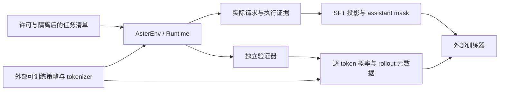

# 后训练方案与数据契约

日期：2026-09-18。范围：数据隔离、SFT 导出准备、GRPO 采样记录及校验。**本批没有训练、没有新增模型调用、没有导出当前评测题用于训练，也没有训练效果结论。** 准备度依据见 [后训练审计](post-training-readiness.md)；新增可执行契约在 [training/contracts.py](../src/aster/training/contracts.py)。

## 1. 采用的最小路线

保留 `AsterEnv`、Runtime、沙箱与独立验证器。训练侧负责模型权重、tokenizer、chat template、采样及优化，Aster 负责执行经过解析的动作并提供环境证据。先完成新任务上的 SFT 数据与小批次训练校验，再决定是否开展 GRPO。首版关闭 Worker、持久 Memory 与 Skills，避免把学习效果同这些机制混合归因；恢复、只读并行和流式也要固定版本与设置。



新增模块只使用已有 Pydantic 和标准库。它不连接网关、不下载权重、不执行 tokenization、不更新模型，也不替代真实 tokenizer 对齐和奖励验收。仅靠推理网关不能更新该网关模型的权重；网关最多在另行获准的数据方案中充当教师。

## 2. 新任务与许可隔离

每个 `TaskRecord` 必须声明：任务 ID、规范化仓库身份、不可变仓库 revision、问题家族、来源、许可、训练准入结论、split，以及初始 fixture、执行环境、独立验证器的 SHA256。许可字段是审查记录，不表示代码能自动判断许可证或证明某份数据适合训练。

划分由数据维护者在采集前完成，按规范化仓库和问题家族的连通分量整体分配到 train/dev/test。仓库别名、镜像、fork 中的同题及改名、改值、改措辞版本须先合并身份。`validate_splits()` 拒绝同仓库或同问题家族跨 split、重复任务 ID；字符串比较不能识别刻意改写的仓库名或题目近重复，仍需来源审计与近重复检查。

现有 `datasets/` 评测、其参考动作和轨迹，以及 `learn_web/`、`evaluations/archive/` 中已用于调试或机制比较的实战及其 `exam_project/` 产品副本，只能登记为 `audit`。它们不进入 train，也不冒充新冻结的 dev/test。新增 schema 明确拒绝把 `existing_evaluation` 或 `existing_practice` 标成 train/dev/test。历史报告可帮助诊断 Harness，但不能用同题训练后成绩声称泛化。

采集前的具体门槛：

1. 核对源仓库、问题文本、参考实现、依赖与教师输出的使用条款，保存许可审查出处；`training_allowed=true` 只由数据维护者填入。
2. 保存原始 fixture、环境与 verifier 内容及摘要。验证初始候选在目标检查失败、参考解通过目标与回归检查，排除无测试、全跳过和 setup 错误。
3. 封存新测试清单与独立测试答案，开发者只使用 train/dev 选择模型、提示、预算及超参。训练器无权读取隐藏测试文件。
4. 留下所有采集尝试及失败原因；成功轨迹筛选只生成新索引，不删除失败证据。不把重复采样、预算档位和机制开关算成新任务。

本批没有建立或填充上述新任务清单。

## 3. SFT：从实际请求到 assistant-only 监督

`prepare_sft(artifact, context_event, reply_event, task=..., provider=..., protocol=...)` 接收 Runtime 保存的单次请求工件及对应证据事件。它检查事件摘要、同一 run、轮次、请求文件路径、payload 摘要与上下文策略版本；`model_reply.request_sha256` 必须同时匹配该请求，避免把同轮较早的预览快照误配给实际回答。缺少这一绑定字段的旧证据只能审计，不导出 SFT。仅接受成功进入 `model_reply` 的完整响应，参数解析失败、流式部分输出、取消片段不成为正向示范。

完整模型响应不等于工具业务参数已通过校验或任务已通过独立验收。当前接口不实现成功轨迹筛选；正例资格必须由采集清单引用工具执行结果和独立验收证据后确定。调用方还须把 run_started 的任务身份与获准清单核对，不能仅重新填写一个 `origin=new` 就把旧评测改称新训练题。

源头是 `runs/<run_id>/requests/<turn>-<sha256>.json`，不是最后的 checkpoint、`state.messages` 或事后重建的全部历史。当前工件是**脱敏后的请求快照**；流式等传输参数可能由 transport 随后添加。它证明已归档的模型观察来源，不等于保留了所有原始 HTTP 字节或教师实际 token IDs。

`SFTRecord` 保留源请求摘要、完成事件摘要、教师 provider/model/protocol、上下文策略版本、原协议工具定义、可移植输入消息和目标 assistant 文本/工具调用。统一消息转换会去掉历史中的不透明 reasoning、签名与加密块，并记录移除数量；assistant target 只取 `model_reply` 的可见文本及结构化 `ToolCall`，不复制 checkpoint 的原生推理记录。不支持的内容由历史转换器明确拒绝。

因此它是**有来源的可移植训练投影**，不是教师请求 token 的无损重放。原始工件继续保存在审计区。若脱敏、裁剪、图像限制或移除不透明块使目标输出不再能从训练输入理解，应拒绝样本或改写数据方案，不能填补或伪造隐藏推理。当前 `prepare_sft` 只接纳明确获准的 train 任务；dev/test 使用独立评估入口。

外部 tokenizer 适配器的交接契约：

- 固定 tokenizer 文件摘要和 chat template 摘要，将 `prompt_messages`、`source_tools` 和目标 assistant turn 映射到目标模型的工具格式；核对工具 ID 与结果顺序。源工具定义仍是原协议格式，模块没有代写目标模板转换。
- 在完整样本上应用真实模板并获得 token IDs 与 assistant 边界，不分别 tokenize 两段后假定拼接等价。历史 assistant、system、user、工具观察、模板中的非目标部分全部位于 prompt 前缀，loss mask 为 false。
- `TokenizedDecision` 保存真实 `input_ids`、`prompt_length`、逐 token `assistant_mask`、请求摘要和渲染样本摘要。它验证长度、非负整数 token、非空监督及前缀全零；`labels` 将所有非监督位置写成 `-100`。目标 assistant 内部允许按模板约定屏蔽部分控制 token。
- 校验模块无法证明输入 token 来自所声明的 tokenizer、边界由真实模板生成，或文本不含隐藏答案。适配器必须用解码回读、边界反例和小批次梯度检查证明这些事实；并对原始资料、输出与导出文件做敏感信息审查。

未实现：完整轨迹筛选流水线、真实 tokenizer、训练 dataloader、packing、loss、优化器和 checkpoint 保存。新测试中的 token ID 是显式标注的合成数据，只检验边界规则。

## 4. GRPO：采样记录与外部策略接口

训练端在解析动作前保存每次真实生成的 token 序列，包括无法解析或被拒绝的动作；随后将合法单个 `ToolCall` 或 `Final` 交给现有 `AsterEnv.step()`。首版使用单动作决策口径：外部 step 消耗一轮，Final 也消耗一轮，工具步数不能多于所记录的决策数；不能直接拿自主 Runtime 的多调用模型轮数与之比较。若要训练同轮批次，需要先增加并验证单独的批次适配。

`PolicyDecision` 在 `TokenizedDecision` 上增加逐生成 token 的行为策略与 reference logprobs。包括 mask=false 的生成 token 在内，两组概率都必须完整、有限、非正且与输出长度相同。prompt token 不在这两组数组中。推理网关的 usage、输出 token 数或模型名称都不能代替这些概率。

`GRPORollout` 包含以下最小契约：

| 范围 | 必需信息与校验 |
| --- | --- |
| 同题分组 | group ID、run ID、sample index、任务身份、采样 seed；组内 run/sample 不重复 |
| 模型与模板 | actor/reference 权重 SHA256、tokenizer 与 chat template SHA256；可变的 `latest`、模型别名不合格 |
| 执行与上下文 | Harness Git revision、context policy version、工具 schema、环境、fixture 摘要；上下文版本不冒充权重版本 |
| 生成配置 | reasoning mode 与完整采样参数单独记录；不把 reasoning 正文当作配置，采样参数必须可序列化且无 NaN/Infinity |
| 逐决策数据 | 实际请求摘要、渲染样本摘要、token IDs、assistant mask、行为/reference logprobs |
| 终止与奖励 | 成功、候选失败、预算耗尽、解析失败、取消、基础设施错误、verifier 错误分开；独立评分器摘要、reward version 和奖励值 |
| 任务预算 | 工具步数、决策轮数、总生成 token、墙钟上限及实际消耗；Worker 关闭，不能靠生成新子任务绕过预算 |

`validate_group()` 仅接收至少两条有独立奖励的 rollout，检查任务、模型/上下文/奖励版本、采样参数和预算一致。不同样本可使用不同 seed。所有这些摘要由适配器从真实工件计算并核对；字符串格式校验不能证明对应文件存在或权重未变。

固定 reference，不把训练中更新后的 actor 冒充采样时行为策略。训练器必须校验采样观察与重算概率时的模板及 token 完全一致，再计算 `exp(logπ_current - logπ_behavior)`。组内奖励标准化可以形成相对优势；整组奖励一致时记录零学习信号并跳过无效更新，不人为制造奖励差异。具体 group size、clip/KL 系数、优化器与批量大小由训练负责人在选定权重和硬件后冻结并写入训练配置摘要，本模块不实现或暗中选择这些超参。

一条 rollout 内 actor/reference 与生成配置保持固定，不在 episode 内更新权重或切换 profile；训练器按已记录的行为版本结束整组采样后再执行优化。版本字段声明不能替代训练端对实际权重与调用路径的核验。

现 `AsterEnv.reset(seed=...)` 只报告 seed，未控制模型采样或依赖库随机状态。训练适配器必须设置实际采样 RNG、记录 seed/硬件与确定性设置；记录一个数字本身不证明可复现。

## 5. 奖励、失败与预算边界

当前 `AsterEnv` 的完成要求与独立 reward verifier 分开：没有独立验证器不会给成功奖励；工具测试、自报完成或 stdout 中的 passed 都不是可信成功。训练记录要求有分数时声明独立 verifier，并绑定其内容摘要与奖励版本。

取消、基础设施错误及 verifier 自身错误在训练记录中必须 `reward=None`，不能进入 `validate_group()`。这是训练侧的分类规则，**不是本批已经改写了 AsterEnv 的奖励行为**；现环境可能将部分故障表现为失败分数，适配器须依据结构化原因重分类并保留原 reward。候选代码错误、合法的预算耗尽和解析失败仍作为候选结果保留，是否赋负分由冻结的独立奖励版本决定。

每个 episode 的动作/生成 token 上限要在下次采样前预留；本接口拒绝悄悄超出这些上限。墙钟超限必须标为 budget_exhausted。停止采样后仍需完成进程清理、冻结候选与独立评分，清理/评分开销另行记录，不能让超时逃避判负或使无限重试不计成本。

当前隐藏测试的结构化报告和沙箱能约束具体作弊方式，但候选 Python 与 pytest 仍可能同进程运行。真正进行会主动探索奖励漏洞的 RL 前，需要隔离候选执行进程与可信断言进程，覆盖伪造报告、改测试、跳过用例、读取隐藏答案和异常高分审计。数据准入布尔值及独立 verifier 声明不构成抗作弊证明。

## 6. 当前就绪程度与开训条件

**方案与接口准备已完成的范围：** 明确任务隔离与许可准入、实际请求到 SFT 投影、assistant-only mask 校验、GRPO 的版本/概率/分组/预算记录、故障不计成任务质量分数的边界；提供无模型调用的可执行反例测试。

方案进入数据采集前仍需数据维护者完成新任务来源与许可审查、规范化仓库/家族身份、参考解与失败基线验收、冻结 train/dev/test 清单和任务难度分布；训练负责人选定可更新权重的目标模型及工具模板。现有评测或实战不用于补这些缺口。

**实际开训还缺：** 可用权重与训练许可、固定 tokenizer/template 与真实 token 对齐、推理/训练平台及显存容量、完整轨迹采集和安全导出、独立奖励器及抗作弊验收、行为/reference 概率重算、优化器/检查点/恢复与 seed 实现、冻结超参和明确算力/token/费用预算。先验证一个小批次只更新预期 assistant 标签，并得到训练前基线；GRPO 另需同题多样采样、非零组内学习信号及一次可复现的组更新。满足这些条件之前，不能报告“可以直接开训”或“已有训练收益”。

本批验证命令：

```bash
python -m pytest -q tests/test_training_contract.py
python -m ruff check src/aster/training/contracts.py tests/test_training_contract.py
```

训练模块独立于权重更新路径；本批同时在 Runtime 的 `model_reply` 事件新增实际请求摘要绑定，以避免导出同轮预览错配。回滚时须一并处理该证据字段及其回归，不能只删除新增模块后声称数据接口完全回到原状。没有修改训练数据、模型权重或环境依赖。
