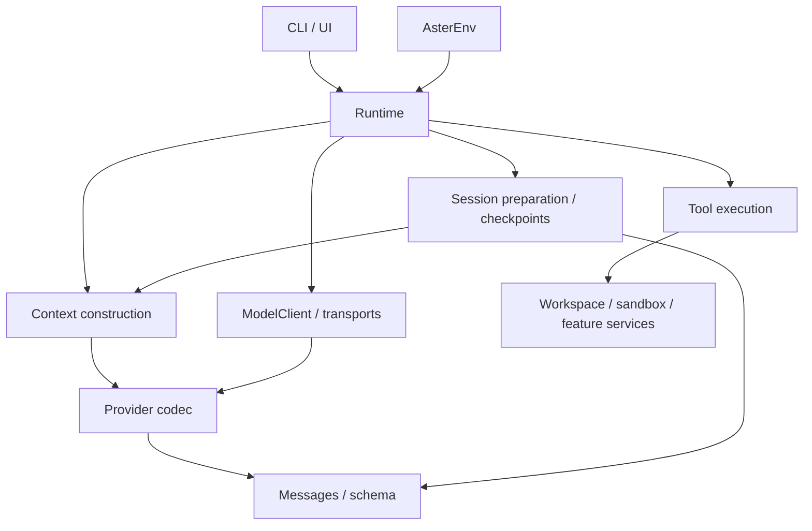

# Aster 源码瘦身与解耦实施方案

制定日期：2026-09-19。用途：交给新会话执行的结构重构方案。

## 1. 目标与完成标准

在保持现有功能、协议和持久化语义的前提下，整理 `src/aster` 的职责与依赖，减少重复处理，为后续会话树提供清晰的接入位置。

本轮交付是可安装、可正常使用的重构版本。会话树、全局配置自动发现、新 provider、新插件平台、Memory 算法调整和训练器均属于后续独立任务，不混入本轮。不得为了减少代码量删除现有工具、权限、恢复或验收能力。

完成标准：

- Runtime 不再承担 todo、plan、Memory、Skills 等工具的全部具体业务；工具不再接收整个 Runtime 并任意读取其内部状态。
- 协议转换和历史校验可独立使用，不依赖网络客户端或 TUI；流式传输不再调用整个 ModelClient 的多个私有方法。
- 会话准备、上下文计算和状态提交有明确边界；同一份状态只有一个所有者。
- 已确认的重复逻辑得到收敛；不是仅搬目录、拆成 mixin，或增加另一套同步状态。
- 保留公开使用方式、已支持的旧 checkpoint、训练数据契约和实际安装行为，相关回归通过。
- README、当前教程、网站源码镜像与新结构同步；每批有 Git 提交，最终有前后指标和验证记录。

不规定“必须砍掉多少行”或“每个文件不得超过多少行”。文件数可能增加；重点是依赖、状态归属和维护成本。最终解释新增文件各自承担什么职责，若总行数增长则说明增长来自兼容出口、测试还是新抽象。

## 2. 已核对的基线与工作区保护

制定时 Git HEAD 为 `068f1a6`，分支为 `master`。这不是完整功能基线：工作区还有以下未提交修改：

```text
README.md
src/aster/cli.py
src/aster/config.py
src/aster/streaming.py
src/aster/tui.py
tests/test_interaction_workers.py
tests/test_model_context_config.py
tests/test_model_profiles.py
tests/test_tui_streaming.py
tests/test_tui_commands.py                 # 当时尚未跟踪
```

上述改动包含新的 TUI 命令、交互配置和展示行为。执行时重新读取 Git 状态和完整 diff，以最新实际内容为准，不能把它们恢复成 `068f1a6` 的实现。制定时 `src/aster` 共 27 个 Python 文件、9,350 个物理行，含空行、注释和上述工作区修改；Runtime 1,613 行，Provider 939 行，TUI 854 行，Context 458 行。

开始实施前完成以下版本准备；这是执行前置检查，不是一个“调研后再决定方向”的开发阶段：

1. 读取本文件、当前项目指令、`pyproject.toml`、Git 状态和相关 diff。重新记录源码文件数、行数、长函数与导入依赖，以及基线检查结果。
2. 若工作区已干净，在新分支实施。若仍有上面的工作区修改，优先创建独立 worktree，将明确列出的受影响源码、文档和测试快照带入；不能只从 HEAD 开工而遗漏新功能。不得复制 `.env`、私有 `.aster`、凭证或原始运行记录。
3. 在隔离分支用单独的基线提交保留带入的修改，提交说明标明“现有工作区快照”，不得将它们记为本次重构成果。记录原 HEAD、带入文件及验证结果；基线失败单列，不通过删断言或关功能制造全绿。
4. 原工作区的未提交内容保持原状。若其他会话还在修改同一目录，使用冻结快照独立推进，避免两个会话同时移动同一批文件。
5. 每批使用显式路径暂存并提交，提交前复核 HEAD、暂存 diff 和未跟踪文件；不使用 `git add .`、`git reset --hard` 或批量删除恢复干净。用户已要求及时使用 Git 保存版本，不需要每批再次征求提交许可。
6. 最终交接写明分支、worktree、各批提交和验证状态。原工作区干净且可安全合入时完成本地整合；存在更新的并行修改时保留结果分支，列明合入差异，不覆盖他人修改。没有推送或发布授权，不添加远程、不推送。

旧的 [v0.2 收尾计划](lightweight-agent-v0.2-plan.md) 曾冻结当轮拆分范围。本文件对应用户后来明确提出的新结构整理任务；旧验收报告和证据继续保留，不改写成此次重构的成绩。

## 3. 采用的组织方式

保留 Python 的 `src/aster` 包布局和单一发行包 `aster-harness`。不把文件提升成 `src/core`、`src/tools` 等多个通用顶层包。

目标目录及职责如下。目录在所属批次有实际实现时创建，不预建空壳：

```text
src/aster/
├── __init__.py
├── cli.py                     # 稳定命令入口与参数处理
├── config.py                  # 配置，保持现有字段及默认行为
├── schema.py                  # 公共数据契约
├── messages.py                # 历史配对、可移植转换及其错误类型
├── core/
│   ├── __init__.py
│   ├── runtime.py             # 运行协调、会话状态安装与跨工具归集
│   └── execution.py           # 已准备动作的调度、只读并行及取消收束
├── providers/
│   ├── __init__.py
│   ├── errors.py              # ProviderError
│   ├── codec.py               # 三种协议的请求/终态响应转换
│   ├── client.py              # ModelClient、非流式请求与调用编排
│   ├── streaming.py           # Responses SSE、增量与终态处理
│   └── usage.py               # 用量归一、累积及脱敏诊断
├── sessions/
│   ├── __init__.py
│   ├── checkpoint.py          # 检查点读写结构与恢复校验
│   └── lifecycle.py           # 续聊/模型切换准备、归档来源和恢复候选
├── context/
│   ├── __init__.py            # 导出 ContextBuilder/ContextReport 等旧接口
│   ├── builder.py             # 组装、计算结果及统一提交入口
│   ├── prompt.py              # 策略正文与请求区段构造
│   └── budget.py              # 预算裁剪、工具结果摘要及计算报告
├── tools/
│   ├── __init__.py            # 导出实际使用的旧工具接口
│   ├── schemas.py            # 参数 schema、描述、工具集与定义
│   ├── registry.py           # 校验/分发及明确的工具上下文
│   ├── workspace.py          # 文件、搜索、补丁、图片与 Shell
│   ├── workflow.py           # todo、plan、Memory、Skills 等业务
│   └── testing.py            # 正式测试运行与报告解析
├── ui/
│   ├── __init__.py
│   ├── app.py                # Textual App、布局与事件
│   ├── commands.py           # 命令解析与执行
│   └── widgets.py            # 输入、批准框等现有组件
├── safety/                   # 保持现有模块与执行边界
├── memory.py
├── skills.py
├── workers.py
├── hooks.py
├── recovery.py
├── evidence.py
├── workspace.py
├── verifier.py
├── rl.py
├── training.py
├── runtime.py                # Runtime 的薄兼容出口
├── provider.py               # ModelClient 等既有公开接口的薄出口
├── history.py                # 历史转换公开入口兼容
├── session.py                # 已被当前脚本/教程使用的会话函数兼容
├── testing.py                # 既有测试工具函数兼容
└── tui.py                    # AsterTui 等实际使用的公开入口兼容
```

兼容文件只做显式导出，不保留第二份业务实现。`context.py`、`tools.py` 改为同名包，因此不得同时保留同路径的 `.py` 与包目录。包内 `__init__.py` 保持简单；特别是 `sessions` 的初始化不得反向加载 Runtime 或 TUI。

不强行保留所有私有 helper 的旧导入路径。迁移前按仓库使用处建立公开符号清单，至少包含 Runtime、ModelClient、ProviderError、历史校验/转换函数、ContextBuilder、AsterTui、工具定义/注册和教程使用的会话辅助函数。兼容出口保留同一个类/函数对象，不能增加包装子类而改变类型判断。当前顶层 `streaming.py` 是内部传输实现，本轮迁移后由 Provider 使用新入口，相关测试与教程同步修改，不为旧的内部签名新增兼容包装。禁止用 `sys.modules` 替换、动态 `__getattr__` 或大量转发属性模拟整个旧模块。

### 依赖与状态归属



- `messages.py` 只依赖公共数据契约和标准库，不依赖 Provider 客户端。把当前 `provider.py` 中的 `history_groups` 和 `ContextHistoryError` 与历史转换放在这一依赖底层，避免 `history → provider → history`。
- Context 可以调用纯协议编码函数计算真实 payload 预算，但不能创建 HTTP 客户端；预算计算和发送继续共用同一编码实现。
- Runtime 拥有当前 RunState，统一安排审批、执行、跨工具归集、运行/会话状态对象的安装和检查点时序。Session 模块产生校验通过的候选状态；Context 产生计算结果，沿现有成功边界提交；二者不能在失败时留下半更新状态。这里不要求所有字段只能在 Runtime 赋值：workflow 工具可以在授权的串行边界内修改现有 todo/plan 等业务字段，不为重构引入通用 StateDelta 或事件溯源框架。
- 工具只持有确实需要的工作区、沙箱、RunState、Memory/Skills 服务及用户/Worker 操作回调。不得将 `runtime` 政名为 `host` 后原样传入。
- UI 命令可调用 Runtime 的公开方法。原本只属于界面的状态仍由 App 持有；普通服务模块不得导入 `ui` 或 `textual`。
- Worker 创建 Runtime 的现有入口保留。先保持这一真实调用关系，不为追求“无环图”新增工厂框架、依赖注入容器或另一个运行器。

## 4. 分批实施

预计影响超过 8 个源码文件及其引用，需要以下独立可运行的批次。每批包含自己所需的导入、测试和当前文档修正，不依赖下一批补救才能运行。

### 第一批：工具业务与运行协调解耦

涉及当前 `runtime.py`、`tools.py`、`testing.py`，落到 `core/` 与 `tools/`。

- 将参数模型与工具元数据集中放进 `tools/schemas.py`，不按每个小 schema 拆文件。
- 把 `Runtime.workflow_tool()` 中的具体业务移入 `tools/workflow.py`。工具返回 Outcome，执行证据与跨工具的验证失效仍由 Runtime 归集。`run_shell` 接收明确的只读状态，不再访问 `context.runtime.state.mode`。
- 将只读并行的实际调度和取消收束放进 `core/execution.py`，接收已经准备的动作；批量预检、步数预留、授权和稳定顺序发布继续由 Runtime 控制。不要把整段 Runtime 作为参数传给调度器。
- 统一工具参数的校验与规范化结果，避免同一执行路径重复解析三次。必须保留整批副作用前预检，也必须保留工具直接调用入口的参数检查；hook 后实际执行的参数与获批参数必须一致。
- 收敛 `memory_retrieve` 对 `recalled_ids` 的重复合并，由统一结果归集处更新一次。逐项列出实际删除的重复逻辑及其调用方，不能将安全检查的多层防线当作普通重复删掉。
- Runtime 迁入 `core/runtime.py`，旧入口保持可导入。未触及的小模块不为了目录整齐顺手重写。

验收：工具 schema 和描述、分页、补丁原子性、完整批次拒绝、只读并行顺序、取消等待、审批期间文件变化和正式测试证据保持一致。

### 第二批：协议、传输、历史校验分层

涉及当前 `provider.py`、`streaming.py`、`history.py` 和 Context/Session 的导入。

- 按目标目录移动纯编码/终态解析、历史校验/转换、用量/诊断。ModelClient 保留对外 `complete()` 行为和同一个终态解析路径。
- 每次 `ModelClient.complete()` 创建一个轻量的请求记账对象，由 `usage.py` 管理该请求各次尝试的累计用量和最新诊断。流式入口只接收 Settings、payload、必要请求头、事件/终态解析回调和这个对象，不接收整个 ModelClient。流式与非流式共用这一个记账位置；ModelClient 在成功、失败和取消时同步发布现有 `last_usage`/`last_diagnostics`，不能遗失失败尝试的已知用量。这个对象只收拢现有状态，不扩展为通用监控框架。
- 重试状态分类、次数、间隔、HTTP 状态集合和脱敏处理可提取共同函数。暂不统一流式与非流式的截止时间语义，因为二者当前行为不同；不得借重构改变超时、自动重试或协议回退。
- 保持三种协议发送的实际字段、工具 schema 顺序、原生历史与可移植转换规则、用量缺失的“未知”含义，以及失败尝试的记账规则。
- 更新测试中实际依赖位置：例如 `aster.provider.asyncio.sleep`、`aster.streaming.MAX_PROGRESS_CHARS` 的 monkeypatch 路径。公开导入兼容不意味着补丁会自动作用于迁移后的实现。

验收：固定输入的 payload、模型/工具回复解析、历史配对、流式终态与失败、取消、usage 和 credential redaction 对照保持一致。不使用真实服务随机回复来证明结构重构等价。

### 第三批：会话与上下文计算边界

涉及当前 `session.py`、Runtime 生命周期及 `context.py`，落到 `sessions/`、`context/`。

- 基于已有 `prepare_continuation()`、`load_checkpoint()`、`preview_context()` 提取检查点编码、恢复候选与模型切换准备。Runtime 保留空闲门禁和通过预检后的唯一安装位置。
- Context 拆出策略/区段构造、预算计算和结果提交。保持当前 `ContextBuilder.build()` 的外部行为：内部计算成功后，仍在原来的逻辑时点更新传入历史与消息；计算函数本身不随意修改共享状态。
- 不修改 prompt 正文、消息角色/排序、裁剪算法、上下文策略版本或预算默认值。该批先澄清完整输入、副本和提交结果的归属，不引入会话树的新存储格式。
- 保留 checkpoint 写入版本 2，以及 loader 现有版本 1/2 兼容与拒绝边界。保持 run/session/worker ID 含义、`continued_from`、原生历史、归档来源、工作区和权限身份检查。
- 保留 plan/todo、Skills 固定快照、读取凭据、验证与工作记忆的生命周期。退出、模型变化、外部文件漂移、恢复失败时均不能发布半更新状态。

验收：旧格式恢复、普通续聊和新会话、模型切换失败原状态保留、小窗口压缩、祖先归档授权、inflight/Worker 未结算拒绝及既有 RL/训练契约。

### 第四批：交互代码整理与交付检查

涉及当前 `tui.py`、`cli.py`，落到 `ui/`；CLI 命令入口继续是 `aster.cli:main` / `aster.cli:tui_main`。

- 提取输入和批准框组件、命令解析/执行；App 保留界面状态、渲染与 Textual 事件。使用普通函数或明确服务依赖，不使用共享整个 App 私有字段的 mixin 拆法。
- 保留带入基线中的中文界面、快捷键、补全、输入历史、忙时命令、退出/取消和流式/思考摘要行为。以当前工作区代码和测试为准，不退回旧提交的 TUI。
- 保持 `aster` 裸启动、带任务的单次执行、`aster-tui`、显式配置、`--cwd`、恢复和 smoke 行为。配置默认值与优先级保持一致，不顺手实现用户级全局配置。
- 逐条修正当前 README、`docs/learning`、配置/接口文档中的真实源码位置和方法归属；教程链接指向实现，不仅指向薄兼容出口。重建网站，核对新路径与删除的旧源码镜像。现有构建器已清理 `learn_web/source`，无需另造清理器。
- 运行最终整体回归、课程实验、实际 wheel 安装和终端验收，提交最终结构与验证说明。

## 5. 全程必须保留的行为

| 边界 | 必须保留 |
| --- | --- |
| 执行权限 | 权限、审批和 hook 在副作用之前；只读/计划/作用域不能通过工具加载或直接调用绕过 |
| 写入与沙箱 | 新鲜读取和原始字节校验；审批竞态检查；超时/取消清理；Landlock/seccomp 边界 |
| 批次与并行 | 业务参数整批预检；工具调用/结果配对；只并行已有允许的读动作；稳定顺序归集；不发布迟到结果 |
| 恢复 | 完整工具组检查点；保留 inflight 与 Worker 检查；不重放副作用不确定的操作；工作区/模型/权限身份校验 |
| Provider | 终态确认后才执行工具；重试与用量一次归集；错误分类、原生历史与跨协议拒绝规则 |
| 上下文 | 同一 payload 编码用于预算与发送；先归档后裁剪；来源有效；压缩成功后统一提交；稳定前缀不被重排 |
| 可选能力 | Memory 来源约束、Skills 版本快照、Worker 权限收窄、现有默认开关与界面行为 |
| 数据与训练 | request/trace/report 字段语义、RunState、SFT 的实际输入/输出配对、GRPO 分组/版本校验、AsterEnv 的动作与奖励契约 |

不新增生产依赖、协议抽象基类、插件总线、持久数据库或通用架构验证框架。发现独立功能缺陷时单独记录；若必须修复才能保持本次原有契约，用独立提交并保留能复现问题的验证，不能夹在纯移动提交里。

## 6. 验证方式与命令

所有 Python、pytest、pip、构建使用 Conda `aster` 解释器或由它派生的临时验证环境，不使用 base。项目解释器为 `/home/dzh/.conda/envs/aster/bin/python`。独立 worktree 不能直接使用共享环境原有的 editable 安装，否则测试可能仍加载 `/home/dzh/Aster/src` 中的旧实现。

复用已有测试，不以扩充条数为目标。只为已确认但缺少覆盖的跨模块契约补最小用例。结构性检查放 `tests/`；长运行证据才放 `evaluations/`；临时 wheel/工作区放 `/tmp`。`exam_project/` 只允许实际可运行、可交互的小产品，本轮不在那里创建评测壳。网站相关文件继续归 `learn_web/`。

### 基线与每批回归

先在执行 worktree 根目录建立专属验证环境，安装该 worktree 的代码，不重指共享 `aster` 环境的 editable 安装，以免影响其他会话。以下步骤只复用已有依赖；断言实际导入位置后才能运行基线和后续检查：

```bash
conda activate aster
aster_refactor_root=$(pwd -P)
aster_refactor_check=$(mktemp -d /tmp/aster-refactor-check.XXXXXX)
/home/dzh/.conda/envs/aster/bin/python -m venv --system-site-packages "$aster_refactor_check/venv"
"$aster_refactor_check/venv/bin/python" -m pip install --no-deps --no-build-isolation --ignore-installed -e "$aster_refactor_root"
source "$aster_refactor_check/venv/bin/activate"
python -c 'import sys; print(sys.executable)'
python - <<'PY'
import inspect
from pathlib import Path
import aster
from aster.runtime import Runtime
from aster.provider import ModelClient
from aster.context import ContextBuilder
root = (Path.cwd() / "src" / "aster").resolve()
for obj in (aster, Runtime, ModelClient, ContextBuilder):
    actual = Path(inspect.getfile(obj)).resolve()
    print(actual)
    assert actual.is_relative_to(root), (actual, root)
PY
```

若断言失败，先修复临时验证环境的导入位置，不能在错位环境继续检查。每次重新进入 worktree 或更换验证环境时重验；后续命令中的 `python` 均指这个专属环境。开始时运行一次基线完整检查；每批运行对应契约组及静态检查；最终运行一次完整检查。通过后不无理由反复跑全量。首次完整检查前查看当前测试配置，确认模型调用均由替身/MockTransport 隔离，不启动真实任务运行器。

```bash
python -m ruff check src tests scripts learn_web/scripts learn_web/tests
python -m pytest -q
```

分组优先复用以下文件；执行时补入本批实际改动的相关测试，而不是只跑表中路径后忽略新调用方：

| 批次 | 关键测试文件（均在 `tests/`） |
| --- | --- |
| 工具/调度 | `test_tool_contracts.py`、`test_tool_parallelism.py`、`test_protocol_pairing.py`、`test_batch_patch_output.py`、`test_fresh_read.py`、`test_write_approval_race.py`、`test_node_verification.py`、`test_runtime_lifecycle.py` |
| Provider/历史 | `test_context_provider.py`、`test_provider_events.py`、`test_streaming.py`、`test_usage_budget.py`、`test_history_conversion.py`、`test_history_phase.py`、`test_history_gateway_metadata.py`、`test_model_profiles.py`、`test_profile_redaction.py` |
| 会话/Context | `test_session_continuation.py`、`test_session_ui.py`、`test_context_state.py`、`test_context_archives.py`、`test_context_policy_input.py`、`test_stable_prefix.py`、`test_skill_snapshots.py`、`test_observation_archive.py`、`test_rl_contract.py`、`test_training_contract.py` |
| UI/安装 | `test_cli_contract.py`、`test_tui_streaming.py`、`test_tui_commands.py`（若仍在最新基线）、`test_interaction_workers.py`、`test_model_context_config.py`、`test_sandbox_packaging.py` |

必须区分公开导入和内部 monkeypatch。测试应补丁到实际使用依赖的模块，保留原有行为断言；不能因为旧补丁失效就删断言、宽化预期或放任真实网络请求。

对固定模型替身的代表性路径做前后对照：正常任务、批次末尾坏参数、写入后服务失败再恢复、流式失败与取消、预算压缩和模型切换。比较 payload、调用/结果顺序、工作区 diff、终态和已知用量；仅排除 UUID、时间戳、耗时和临时根路径等真实非确定字段，不能把模型名、工具参数、权限结果、缓存字段或错误原因一并抹掉。小型确定性用例足够，不新造大型回放平台。

### 教程和网站

```bash
python docs/learning/run_examples.py all
python learn_web/build.py
python -m pytest -q learn_web/tests
```

构建依赖和准确安装方式见 [网站说明](../learn_web/README.md)。源码迁移后同步修正当前课程的导入、方法节选、链接与依赖图；核对生成镜像没有遗漏新包。冻结在旧 commit 的历史报告、原始日志、数据集和既有产品不批量替换路径。

### 实际 wheel 与终端验收

不能只依赖仓库内导入、editable 安装或源码 pytest。使用现有 `aster` 环境的构建依赖制作 wheel，并在由该解释器派生的临时环境安装。示例：

```bash
aster_refactor_tmp=$(mktemp -d /tmp/aster-refactor-install.XXXXXX)
python -m pip wheel --no-deps --no-build-isolation --wheel-dir "$aster_refactor_tmp/wheels" .
/home/dzh/.conda/envs/aster/bin/python -m venv --system-site-packages "$aster_refactor_tmp/venv"
"$aster_refactor_tmp/venv/bin/python" -m pip install --no-index --no-deps --ignore-installed "$aster_refactor_tmp"/wheels/aster_harness-*.whl
cd "$aster_refactor_tmp"
"$aster_refactor_tmp/venv/bin/aster" --help
"$aster_refactor_tmp/venv/bin/aster-tui" --help
"$aster_refactor_tmp/venv/bin/python" -c 'import aster, sys; from pathlib import Path; print(aster.__file__); assert Path(aster.__file__).resolve().is_relative_to(Path(sys.prefix).resolve()); from aster.runtime import Runtime; from aster.provider import ModelClient; from aster.tui import AsterTui; from aster.context import ContextBuilder'
```

`--system-site-packages` 仅复用 `aster` 环境已有依赖；上面的路径断言必须确认 Aster 来自临时安装目录，避免原环境中的 editable hook 偷偷指向源码。另检查 wheel 内包含新包和 `safety/linux.py`，没有 `__pycache__`、私有数据或漏掉的 helper。

在安装后的临时工作区进行无 API 验收：真实终端/PTY 下裸启动、输入本地命令、取消与退出；脚本模式无任务及时报错；用内存模型替身验证单次任务、工具失败和恢复。`--help` 本身不能证明这些路径可用。以调用次数断言确保替身实际运行且未请求真实模型；仅打开界面不得生成任务。不要在真实项目目录借机执行模型写入。

## 7. 提交、回退与最终报告

- 每批功能可运行并通过对应回归后提交。提交主题可使用 `refactor(tools)`、`refactor(providers)`、`refactor(session)`、`refactor(ui)`；现有 WIP 快照使用独立提交，文档/生成物随对应批次同步。
- 不修改持久化格式、不批量迁移用户 `.aster`，因此回退本轮代码无需改写用户数据。共享分支回退使用针对本轮提交的 revert，避免把原有 WIP 一并回退。
- 最终记录实际改动映射、Runtime/Provider/TUI/Context 的前后长度、最长函数、模块数、确认减少的重复代码，以及仍保留的复杂边界。指标用当前源码计算，不沿用本计划的快照数字。
- 报告新增依赖数和新用户命令数，应均为 0；兼容出口只做导出的证据；工具不持有 Runtime、协议不导入 UI、Context 不创建 HTTP 客户端的核查结果。
- 报告每个验证命令的退出状态、通过/失败/跳过原因、wheel 实际导入位置、终端验收和文档/网站状态。重构通过不等于真实任务成功率、缓存、Memory 或 Skills 收益提升。
- 说明后续会话树接入点及剩余限制，但本轮不实现 `/tree`。后训练的数据/动作/奖励契约保持可用，不以结构重构结束为理由宣称可以直接开训。

## 8. 参考和判断依据

pi 参考仓库是 <https://github.com/earendil-works/pi>，本次核对版本为 `36b60d2e8985899743c4cf5bd5f8929832a3f05d`：

- [模型适配包](https://github.com/earendil-works/pi/blob/36b60d2e8985899743c4cf5bd5f8929832a3f05d/packages/ai/package.json)：协议层独立，借鉴职责划分，不照搬多个 npm 包的发布方式。
- [Agent 循环](https://github.com/earendil-works/pi/blob/36b60d2e8985899743c4cf5bd5f8929832a3f05d/packages/agent/src/agent-loop.ts)：统一消息/事件、执行循环与接口转换的边界。
- [SDK 组装](https://github.com/earendil-works/pi/blob/36b60d2e8985899743c4cf5bd5f8929832a3f05d/packages/coding-agent/src/core/sdk.ts)：组装入口与模型、工具、会话服务分工。
- [会话管理](https://github.com/earendil-works/pi/blob/36b60d2e8985899743c4cf5bd5f8929832a3f05d/packages/coding-agent/src/core/session-manager.ts)：下一轮会话树的参考，不作为本轮格式迁移要求。

pi 同样有较长的 `agent-session.ts`，并非完美解耦模板。本方案采用与 Aster 当前 Python、Textual、沙箱和证据体系相容的局部重构，不追求源码目录的一比一复刻。
